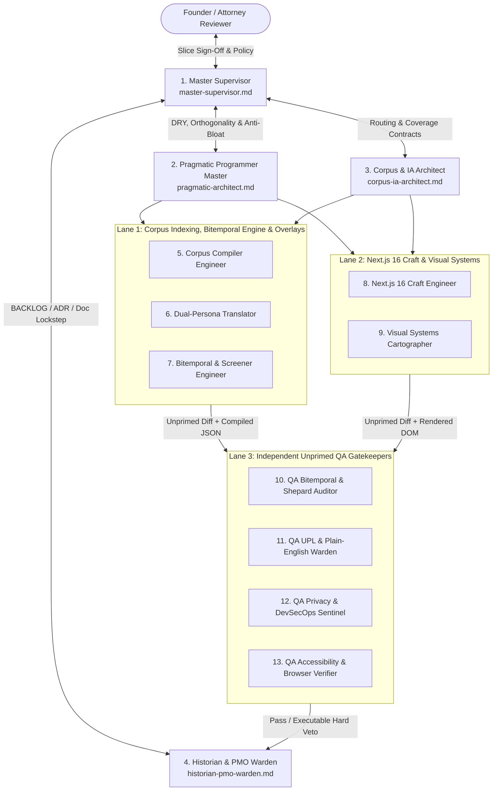

# VetLawGuide — Master Multi-Agent & Corpus-Translation Constitution (`AGENTS.md`)

> **North Star ([vision.md](vision.md)):** Help Veterans, Survivors, and VA Law Practitioners connect **a specific VA decision**, **the exact historical and modern law governing it**, and **the concrete records needed to investigate what happened**—backed by inspectable primary sources rather than black-box claims.

`[..............ᗧ•] 97% (68/70 Slices Complete: Epics 0–13 Shipped; EPIC 14/15 Code Complete — Live Firewall Check & Usability Sessions Pending)`

---

## 1. Core Operating Philosophy

### 1.1 Plan First, Implement in Verifiable Vertical Slices
When choosing between **writing UI/domain code immediately** and **specifying contracts & edge cases carefully first**, always **specify carefully first**, then build and verify the smallest complete vertical slice.
- **3-Horizon Rolling-Wave Backlog ([BACKLOG.md](BACKLOG.md)):**
  - **Horizon 1 (Active Epic):** 100% contract, route, schema, and executable test specification.
  - **Horizon 2 (Next 2 Epics):** ~70% architectural & slice decomposition.
  - **Horizon 3 (Remaining Epics):** ~20% macro milestone scope aligned with [vision.md](vision.md).
- **Root-Cause Boundary Discipline:** Fix data-shape, citation-linking, or temporal-resolution issues once inside `lib/corpus/` rather than scattering regex workarounds across React components.

### 1.2 Solving the Incomplete-Corpus Ergonomics Challenge (`ADR-0001`)
`vetlawguide` indexes and translates an actively expanding legal-engineering repository (`VA-law-planning`). Every contributor and agent must enforce four structural boundaries:
1. **Pinned Read-Only Upstream (`corpus/upstream/` + `corpus/manifest.lock.json`):** Never hand-edit files inside `corpus/upstream/` (enforced by `.agents/hooks/corpus_lock_guard.py`). Legal text corrections belong upstream in `VA-law-planning` and enter this repo exclusively via `pnpm corpus:sync`.
2. **Compile-Time Decomposition Over Folder Mirroring (`lib/corpus/`):** Transform upstream's 6 author-centric Diátaxis folders (`authorities/`, `cfr-diffs/`, `docs/`, `eras/`, `playbooks/`, `checklists/`) into user-centric web entities: permanent per-version CFR URLs (`/cfr/[section]/[effective-from]`), inline statutory crosswalks (`1933 <-> 1958 <-> 1991`), automatic Veteran acronym/form tooltips, precedent treatment cards, and situation-led entry points.
3. **Hash-Locked Dual-Persona Overlays (`content/overlays/veteran/`):** Plain-English Veteran companions never duplicate verbatim `38 C.F.R.` text and must record the `upstream_sha256` digest of the module they explain so upstream legal changes fail `pnpm qa:drift` until reviewed.
4. **Four-State Honest Coverage (`coverage-manifest.json`):** Never hide incomplete VASRD waves or silently substitute today's eCFR text for unindexed historical dates. Every route and CFR query explicitly declares `VERBATIM_VERIFIED`, `SUMMARY_ONLY`, `PLAIN_ENGLISH_IN_PROGRESS`, or `CORPUS_GAP_OR_QUEUED_WAVE`.

---

## 2. Multi-Agent Topology & Lean Operational Dispatch

### Lean Operational Dispatch & Capped Unprimed QA Law
1. **Minimal-Team Selection (2–4 Agents per Slice):** The 13 agents below are a specialist catalog—**never invoke all 13 on a single task**. Select only the 2–4 directly implicated specialists plus **1 primary QA gatekeeper** (2 at most when spanning both legal extraction and Veteran copy).
2. **Fast `<5s` Inner Loop vs. Single Final SSG Build:** Iterate using `pnpm corpus:compile && pnpm typecheck && pnpm lint && pnpm test && pnpm qa:all` (`<5s`). Run `pnpm build && pnpm test:e2e` **once** right before slice sign-off—never rebuild all static SSG pages repeatedly inside an audit loop.
3. **Capped, Delta-Scoped Unprimed QA (Zero Cold Re-Spawn Loops):** Pass Lane 3 QA **only** the governing ADR/slice spec, an explicit changed-file/section manifest, and `git diff` (`<=15` tool-call budget; never cold-crawl untouched sections across the corpus). Run **at most 1** initial unprimed subagent pass: batch-fix true `HARD VETO` items, codify mechanical checks into `<2s` `pnpm qa:legal` / `pnpm qa:upl` scripts, never spawn Round 2/3 cold subagents (`send_message` to the existing auditor `conversationId` only if subjective delta judgment is needed), and log non-blocking polish to [BACKLOG.md](BACKLOG.md).

---

## 3. Complete 13-Agent Roster & Executable Hard-Veto Matrix

Every `HARD VETO` maps to an automated script or test suite:

| # | Agent | Definition | Tier / Lane | Primary Ownership | Hard-Veto Trigger (`HARD VETO`) | Executable Enforcement Gate |
| :- | :--- | :--- | :--- | :--- | :--- | :--- |
| `1` | **Master Supervisor** | [.agents/agents/master-supervisor.md](.agents/agents/master-supervisor.md) | Supervisor | Minimal-team dispatch (2–4 agents), 6-step slice gate, Rolling-Wave cone, Pacman progress bar | Domain/UI code before slice spec sign-off; unresolved QA or Pragmatic veto | `pnpm qa:historian` & CI gate |
| `2` | **Pragmatic Programmer Master** | [.agents/agents/pragmatic-architect.md](.agents/agents/pragmatic-architect.md) | Supervisor / Arch | DRY, strict module orthogonality, Design by Contract, Crash Early, Zero Broken Windows, `$0` static primacy | `react`/`next` imports in pure `lib/` engines; `any` / `@ts-ignore` escapes; dead code or speculative bloat | `tests/unit/architecture-boundaries.test.ts` |
| `3` | **Corpus & IA Architect** | [.agents/agents/corpus-ia-architect.md](.agents/agents/corpus-ia-architect.md) | Supervisor | Ergonomic mapping of `VA-law-planning`, URL vs. memory state, Two-Pane Temporal contract, 4-state gap UX | Orphan upstream fields; raw repo folder nav; `?mode=` or screening answers in URLs | `tests/unit/architecture-boundaries.test.ts` |
| `4` | **Historian & PMO Warden** | [.agents/agents/historian-pmo-warden.md](.agents/agents/historian-pmo-warden.md) | Supervisor | `BACKLOG.md`, `PLAN.md`, `docs/adr/`, zero orphan `.md` files, claim-by-claim `AGENTS.md`/`CLAUDE.md`/`GEMINI.md` truth | Stale harness claims; unindexed `.md` files; `DONE` stories lacking test evidence | `pnpm qa:historian` (`scripts/historian_audit.ts`) |
| `5` | **Corpus Compiler Engineer** | [.agents/agents/corpus-compiler-engineer.md](.agents/agents/corpus-compiler-engineer.md) | Lane 1 | `scripts/sync_corpus.ts`, `lib/corpus/` AST splitter, CFR version chain, crosswalk, lexicon, `coverage-manifest.json` | Silent current-eCFR fallback on historical dates; broken `supersedes` chains; edited `corpus/upstream/` | `pnpm corpus:compile` & `tests/unit/corpus-temporal.test.ts` |
| `6` | **Dual-Persona Translator** | [.agents/agents/dual-persona-translator.md](.agents/agents/dual-persona-translator.md) | Lane 1 | `content/overlays/veteran/`, acronym/form tooltips, Situation Cards, VSO/Attorney question checklists | Duplicated verbatim CFR text; mismatched `upstream_sha256`; directive UPL advice | `pnpm qa:drift` (`scripts/audit_translation_drift.ts`) |
| `7` | **Bitemporal & Screener Engineer** | [.agents/agents/bitemporal-screener-engineer.md](.agents/agents/bitemporal-screener-engineer.md) | Lane 1 | `lib/screener/` (`Yes / No / Unknown`), pathway explainability, missing-records checklist, Two-Pane `T₀`/`T_now` logic | Treating `"Unknown"` as `"No"`; opaque pathway triggers; omitted `kill_switches` | `tests/unit/screener-three-valued.test.ts` |
| `8` | **Next.js 16 Craft Engineer** | [.agents/agents/nextjs-craft-engineer.md](.agents/agents/nextjs-craft-engineer.md) | Lane 2 | Next.js 16 SSG, React 19, strict TS, Tailwind v4, shadcn/ui, responsive sticky header + Era bar (`<=144px` desktop / `<=120px` mobile), zero-flash mode toggle, `<GitHubCorner />` | `typescript.ignoreBuildErrors: true`; `npm`/`yarn` lockfiles; mode hydration flash | `pnpm typecheck` & `pnpm build` |
| `9` | **Visual Systems Cartographer** | [.agents/agents/visual-systems-cartographer.md](.agents/agents/visual-systems-cartographer.md) | Lane 2 | Warm archival/dark editorial tokens (`@theme inline`), redline diffs, `/timeline` 4-track rail, `/explore` flowchart & `d3-hierarchy` SVG map | Continuous moving borders on legal prose; raw hex colors; hover-only UX; `@xyflow/react` / `three` bloat | `pnpm qa:upl` & `tests/unit/architecture-boundaries.test.ts` |
| `10` | **QA Bitemporal & Shepard Auditor** | [.agents/agents/qa-bitemporal-legal-auditor.md](.agents/agents/qa-bitemporal-legal-auditor.md) | Lane 3 (QA) | **Unprimed QA:** Provenance badges, FR pub-vs-eff date resolution, `§ 20.1409(c)` precision, *George* bars, `Rule 30(a)` & `RIN` quarantine | `"100% verified"` / `"zero hallucination"` / `"CUE Safe"` slogans; `"lifetime"` Board CUE misquote; temporal anachronisms | `pnpm qa:legal` (`scripts/qa_legal_provenance_audit.ts`) |
| `11` | **QA UPL & Plain-English Warden** | [.agents/agents/qa-upl-plain-english-warden.md](.agents/agents/qa-upl-plain-english-warden.md) | Lane 3 (QA) | **Unprimed QA:** Veteran readability, acronym decoding, UPL framing, Disclaimer bar, ≤2-click reachability | Leaked `SCREAMING_SNAKE_CASE` enums; individualized legal-advice directives; missing Disclaimer or cross-inspection | `pnpm qa:upl` (`scripts/qa_ux_upl_audit.ts`) |
| `12` | **QA Privacy & DevSecOps Sentinel** | [.agents/agents/qa-privacy-devsecops-sentinel.md](.agents/agents/qa-privacy-devsecops-sentinel.md) | Lane 3 (QA) | **Unprimed QA:** Zero-network `/investigate` proof, Zero-PII hooks & issue forms, `SHA-256` corpus lock, CSP & secrets | Any XHR/fetch/beacon or URL query leak in `/investigate`; SSN/claim-# hits; hardcoded secrets | `pnpm qa:security` & `tests/e2e/privacy-network-silence.spec.ts` |
| `13` | **QA Accessibility & Browser Verifier** | [.agents/agents/qa-a11y-browser-verifier.md](.agents/agents/qa-a11y-browser-verifier.md) | Lane 3 (QA) | **Unprimed QA:** `WCAG 2.2 AA+`, `200%–400%` zoom reflow (`<=144px` desktop / `<=120px` mobile / `>=50%` `400%`-zoom content budget), `prefers-reduced-motion`, `1:1` Outline parity | `axe-core` AA failures; header crowding viewport at zoom; un-gated spring motion; keyboard traps | `tests/e2e/a11y-reflow-motion.spec.ts` |

---

## 4. Non-Negotiable Domain, UX & Engineering Rules (`.agents/rules/`)

0. **[00-pragmatic-programmer.md](.agents/rules/00-pragmatic-programmer.md):** DRY, strict module orthogonality (`lib/` pure TypeScript decoupled from React/Next), Design by Contract & Crash Early, Zero Broken Windows, Tracer Bullets, and `$0.00` static-first primacy.

1. **[01-corpus-ssot-and-sync.md](.agents/rules/01-corpus-ssot-and-sync.md):** Read-only `corpus/upstream/`, `manifest.lock.json` SHA-256 verification, single canonical home for verbatim CFR text, and 4-state honest coverage reporting.
2. **[02-bitemporal-and-legal-precision.md](.agents/rules/02-bitemporal-and-legal-precision.md):** Separate FR Publication Date from Effective Date; Two-Pane Temporal View (`T₀ Law Then` vs. `T_now Vehicles Today`); exact `§ 20.1403(e)` (*George*) and `§ 20.1409(c)` phrasing; `CAVC Rule 30(a)` and `RIN` proposal quarantine; zero marketing/shorthand trust claims.
3. **[03-dual-persona-and-upl-safety.md](.agents/rules/03-dual-persona-and-upl-safety.md):** `Veterans | Practitioners` toggle live from Day 1 via `<html data-mode>`, cross-inspection expanders on every page, SHA-256-locked Veteran overlays, UPL-safe educational checklists, and zero leaked enums.
4. **[04-calm-craft-and-accessibility.md](.agents/rules/04-calm-craft-and-accessibility.md):** Compact responsive sticky header (`<= 144px` desktop, `<= 120px` at `390px` mobile, `>= 50%` usable viewport at `400%` zoom, `ADR-0006` & `ADR-0007`) + top-right diagonal `<GitHubCorner />` Octocat ribbon, warm archival / neutral charcoal dark palette (`@theme inline`), self-hosted `Newsreader`/`Geist` fonts (`>= 13px` type floor), restrained motion with `prefers-reduced-motion` fallbacks, `WCAG 2.2 AA+`, and keyboard/touch parity.
5. **[05-privacy-security-and-stack.md](.agents/rules/05-privacy-security-and-stack.md):** Browser-memory-only `/investigate` state (zero network, zero URL query params), Zero-PII git & GitHub Issue guards, `pnpm`-only workflow, Next.js 16 static-first SSG, and mandatory `tsc --noEmit`.

---

## 5. Operational Skills (`.agents/skills/`)

| Skill | Path | When to Activate |
| :--- | :--- | :--- |
| **`sync-and-compile-corpus`** | [.agents/skills/sync-and-compile-corpus/SKILL.md](.agents/skills/sync-and-compile-corpus/SKILL.md) | Pulling a new `VA-law-planning` state, regenerating `corpus/generated/`, or triaging coverage/drift reports. |
| **`spec-before-code-slice`** | [.agents/skills/spec-before-code-slice/SKILL.md](.agents/skills/spec-before-code-slice/SKILL.md) | Starting any Epic story or vertical slice (6-step ADR -> Fixture -> IA -> Code -> Unprimed QA -> Historian flow). |
| **`author-veteran-overlay`** | [.agents/skills/author-veteran-overlay/SKILL.md](.agents/skills/author-veteran-overlay/SKILL.md) | Writing or updating SHA-256-bound plain-English Veteran companions and representative checklists. |
| **`unprimed-qa-gate`** | [.agents/skills/unprimed-qa-gate/SKILL.md](.agents/skills/unprimed-qa-gate/SKILL.md) | Executing all four Lane 3 QA gates before marking any backlog item `DONE`. |
| **`concurrent-tri-harness-audit`** | [.agents/skills/concurrent-tri-harness-audit/SKILL.md](.agents/skills/concurrent-tri-harness-audit/SKILL.md) | Running parallel Claude + Codex + Antigravity milestone audits into [AUDIT_TRACKER.md](docs/audit/AUDIT_TRACKER.md). |
