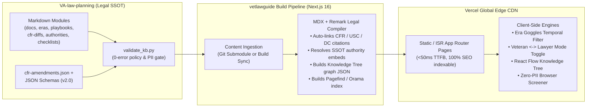

# VetLawGuide — Architectural & Product Vision (`vision.md`)

> **North Star:** Build the definitive, bitemporal interactive reference for U.S. Veterans Law—uniting **empathetic, plain-English clarity for Veterans** and **primary-source, zero-hallucination appellate precision for Practitioners** atop a single compiler-verified legal knowledge graph.

---

## 1. Why VetLawGuide Exists (The Gap We Solve)

Today, Veterans Law online is split into two broken halves:
1. **Veteran-facing blogs and forums** are approachable, but routinely conflate *proposed* Federal Register rules with enacted law, apply 2026 regulations to 1975 rating decisions, or accidentally steer claimants into irreversible procedural traps (such as burning their single lifetime Board CUE motion under `38 C.F.R. § 20.1409(c)` when an open-record `§ 3.156(c)` reconsideration was available).
2. **Practitioner authorities** (`eCFR`, GovInfo historical print editions, scattered Federal Register preambles, `VAOPGCPREC` PDFs, CAVC reporters) are accurate, but fragmented across five government websites with zero bitemporal cross-indexing.

Your `VA-law-planning` repository already solved the hardest part: **a primary-source-verified, schema-validated, bitemporal legal graph** separating *Procedural Finality Vehicles* from *Law-of-the-Era Substantive Merits*. **VetLawGuide** turns that compiler-verified corpus into an unforgettable interactive web experience.

---

## 2. Global Chrome: The Three-Tier Header Architecture

Every page shares a disciplined, high-craft persistent header engineered around trust, audience clarity, and temporal awareness:

```text
┌──────────────────────────────────────────────────────────────────────────────────────────┐
│ ⚠️ NOT LEGAL ADVICE: Educational reference only; no attorney-client relationship.        │
│    [Why this matters]                                    [Questions / Issues ↗ GitHub]   │
├──────────────────────────────────────────────────────────────────────────────────────────┤
│ 🏛️ VetLawGuide    [ 🛡️ VETERANS  |  ⚖️ LAWYERS ]     Docs  Tree  CFR  Cases  Screener ⌘K │
├──────────────────────────────────────────────────────────────────────────────────────────┤
│ 🥽 ERA GOGGLES: [Current Law ▾] ──●───────●──────●────────●──────●──────●──────●──────●─ │
│                 1946 VASRD     1958    1962   1988 VJRA  1997   2008   2015   2019  2026 │
└──────────────────────────────────────────────────────────────────────────────────────────┘
```

### A. Tier 1 — Unmistakable Legal Disclaimer & Community Issue Link
* **Always-Visible Top Notice Bar:** Clean, high-contrast top ribbon: *"Educational Reference Only — Nothing on VetLawGuide constitutes legal or medical advice or creates an attorney-client relationship."* Clicking **[Why this matters]** opens a concise drawer explaining why C-file specifics, combined-rating math, and one-shot rules (`§ 7111` Board CUE, 120-day CAVC deadlines) require accredited VSO, claims agent, or attorney review.
* **Direct Community Channel:** Right-aligned link in the top bar (and footer/doc sidebars) pointing directly to **[Questions or Spotted an Issue? GitHub Issues ↗](https://github.com/trustdan/vetlawguide/issues)**—with pre-filled issue templates (`Question`, `Citation / Effective-Date Correction`, `Feature Idea`) that include a bold reminder **never to post SSNs, claim numbers, or private medical records** in public GitHub issues.

### B. Tier 2 — Prominent Dual-Persona Switch (`🛡️ Veterans` Left <-> `⚖️ Lawyers` Right)
Centered in the primary navigation bar sits the signature **Dual-Persona Segmented Toggle** (styled with a crisp Magic UI animated pill / `BorderBeam` highlight, persisted in URL state `?mode=veteran|lawyer` and `localStorage`, and driven via root `<html data-mode="...">` CSS/React context for instant, zero-flash switching):

| Dimension | 🛡️ **Veteran Mode (Left)** | ⚖️ **Lawyer / Practitioner Mode (Right)** |
| :--- | :--- | :--- |
| **Voice & Reading Level** | Clear, respectful, plain English; decodes VA acronyms inline (`C&P`, `TDIU`, `SMC`, `NOD`, `SOC`). | Concise appellate density; exact `U.S.C.`, `38 C.F.R.`, `Fed. Reg.`, reporter pin-cites, and `VAOPGCPREC` digests. |
| **Primary Framing** | *"What happened in my claim, what records should I look for, and what should I ask my VSO/attorney?"* | *"Which procedural vehicle pierces finality, what verbatim CFR governed on `YYYY-MM-DD`, and what `kill_switches` bar recovery?"* |
| **Risk & Trap Callouts** | Protective guardrails (*"Stop before filing a Board CUE—you only get one chance ever; check if missing service records apply instead"*). | Bitemporal scope badges (`cue-and-open-claim` vs. `open-claim-only-george-restricted`), *Cook* / *Bell* / *Haines* bars, `CAVC Rule 30(a)` flags, and `§ 4.25` / *Barry* step math. |
| **Cross-Peek Superpower** | Every Veteran card includes a subtle **"Show exact legal citations"** accordion so veterans can bring exact citations to their VSO. | Every Playbook includes a one-click **"Copy plain-English client explanation"** snippet for client letters. |

> **How We Preserve Single Source of Truth (`SSOT`):** We **never** fork `VA-law-planning` into two separate Markdown repositories. `authorities/` and `cfr-amendments.json` remain the single canonical source of regulatory text and dates. Each doctrinal/playbook module simply exposes structured **Veteran Summary Blocks** (`veteran_summary`, `what_to_check_in_your_records`, `questions_for_representative`) alongside the practitioner body—compiled into one unified AST at build time!

### C. Tier 3 — The "Time-Period Goggles" Rail (Evolved from `WK-private-demo`)
Directly adapting `WK-private-demo`'s `components/landing/history-timeline.tsx` (`motion/react` spring fisheye magnification) into a **functional temporal lens**:
* Hovering across the rail smoothly magnifies milestone dots (`1946 VASRD`, `1958 Pub. L. 85-857`, `1962 SOC/Eff. Dates`, `1988 VJRA`, `1992 Bell`, `1996–97 VASRD`, `2000 VCAA`, `2006 § 3.156(c)`, `2008 TBI/Scars`, `2015 End of Informal Claims`, `2019 AMA`, `2022 PACT`, `2024 Barry/COD`, `2025–26 Soto/Hamill`) with glassmorphic preview cards.
* **Clicking an Era or Entering an Exact Date (`YYYY-MM-DD`) Activates "Era Goggles" (`?date=1974-08-12`):**
  1. A subtle archival amber/gold `BorderBeam` frames active legal viewers with a persistent pill: **`🥽 Viewing Law in Force on: Aug 12, 1974 (Pre-VJRA Closed Era) [Reset to Today]`**.
  2. **Automatic CFR Time-Snap:** Every `38 C.F.R.` provision page automatically snaps to the verbatim snapshot from `authorities/` & `cfr-amendments.json` that was legally effective on `1974-08-12` (respecting the exact `publication_date` vs. `effective_from` boundary!).
  3. **Live Statutory Crosswalk:** Statutory citations render era-accurate numbers (`former 38 U.S.C. § 3010 [now § 5110]`, or pre-1959 `Vet. Reg. No. 1(a)`).
  4. **Temporal Kill-Switch & Goldmine Highlighting:** Doctrines enacted *after* the selected date (e.g., pre-July 21, 1992 lack of *Bell* constructive possession, or *George v. McDonough* CUE restrictions) automatically display an amber/red **Temporal Gate Alert**, while rules uniquely alive in that era (like `former 38 C.F.R. § 3.157(b)` automatic hospital-report increase claims!) glow green.

---

## 3. Core Interactive Destinations (Information Architecture)

### 1. `/explore` — The VetLaw Knowledge Tree (*OSINT Framework, Reimagined*)
`osintframework.com` proved how intuitive a left-to-right collapsible radial/hierarchical tree is for navigating deep taxonomies—but its 2015 D3 v3 white SVG canvas feels dated and cramped on modern screens.

We reimagine it using **`@xyflow/react` (React Flow) + `d3-hierarchy` / `elkjs` deterministic tree layout + `motion/react` springs**, set over a subtle Magic UI `DotPattern` canvas:
* **4 Instant Tree Pivots (Root Switcher):**
  1. **By Situation / Claim Problem** *(Default in Veteran Mode)*: *"Denied Decades Ago"* · *"Rated 0% or Too Low"* · *" VA Reduced My Rating"* · *"Other-Than-Honorable / Guard Service"* · *"Toxic Exposure / Agent Orange / Burn Pits"* · *"Surviving Spouse / Estate"*
  2. **By Procedural Finality Pathway** *(Default in Lawyer Mode)*: Mirrors `VA-law-planning`'s Piercing-Finality flowchart (`Void Reduction` -> `§ 3.156(c) Service Records` -> `Pending / Notice / § 3.156(b) Lang / AMA § 5104(b) Hamill` -> `Nehmer § 3.816` -> `RO CUE § 3.105(a)` -> `One-Shot Board CUE § 7111`).
  3. **By Body System & VASRD Code (`DC 5000–9918`)**: All 15 VASRD Body Systems -> CFR Sections (`§ 4.40`–`§ 4.150`) -> Diagnostic Code clusters -> Linked Playbooks & Historical CFR Diffs.
  4. **By Legal Authority**: `Title 38 & Title 10 U.S.C.` -> `38 C.F.R. Parts 3, 4, 14, 20` -> `Controlling Courts & Binding VAOPGCPREC`.
* **Rich Node Aesthetics & Inspector Drawer:**
  * Color-coded pills by Diátaxis type (`Authority`, `Diff`, `Playbook`, `Era`, `Checklist`) with active `BorderBeam` tracing along the selected ancestor path.
  * Respects **Era Goggles**: dim or badge nodes outside the active historical window!
  * Clicking any node slides open a **Glassmorphic Quick-Read Drawer** (adapted to `Veteran` or `Lawyer` mode) with a button to open the full documentation page.
  * Graceful responsive fallback: transforms automatically into a sleek nested Command/Accordion Tree on mobile phones.

### 2. `/timeline` — Multi-Track Interactive Timeline of Veterans Law (`1933–2026`)
Directly builds on `WK-private-demo`'s `InteractiveTimeline` (`components/timeline/interactive-timeline.tsx`), upgraded for legal research:
* **Four Color-Coded Parallel Legal Tracks** (filterable via sticky pill bar):
  1. **🟦 Statutory Milestones** (`1933 Vet. Regs.`, `1958 Pub. L. 85-857`, `1962 Effective Dates/SOC`, `1988 VJRA`, `1991 Two-Step Renumbering`, `1997 CUE Act`, `2000 VCAA`, `2017/2019 AMA`, `2022 PACT Act`)
  2. **🟩 Part 3 Adjudication & Finality Rules** (`§ 3.157(b)` rise & 2015 repeal, `2006 § 3.156(c)` overhaul, `June 2024 § 3.12` Character of Discharge overhaul)
  3. **🟨 Part 4 VASRD Schedule Overhauls** (`1946 VASRD`, `1996 Mental Health`, `1997 Muscles`, `2002–03 Spine/Scars`, `2008 TBI & Count-Based Scars`, `2021 Musculoskeletal`, `2023 § 4.26(d) Bilateral Exclusion`, `May 2024 Digestive`)
  4. **🟪 Landmark Judicial Precedents** (*Gilbert*, *Bell*, *Russell*, *Brown*, *Roberson*, *Cook*, *Lang*, *George*, *Barry*, *Bufkin*, *Soto*, *Ingram*, *Hamill*, *Cash*, *Freund*)
* **Quarantined Watchlist Toggle (`⚠️ Proposed / Rescinded Rules`):** Explicitly separates unfinalized proposals (`RIN 2900-AQ72`, `AQ73`, `AQ82`, `90 FR 46542`) and rescinded IFRs (`91 FR 7118`) into a caution-striped track so users immediately see what is **NOT active law**.
* Every milestone card includes a **"🥽 Put On Goggles for This Date"** button that activates Era Goggles site-wide, plus **Retroactive Opportunity vs. Fatal Trap** split cards (evolving `WK-private-demo`'s Myth-vs-Fact box).

### 3. `/cfr` — The Bitemporal `38 C.F.R.` & Statutory Crosswalk Explorer
* **Point-in-Time Verbatim Reader + Visual Redline Diffs:** Powered directly by `authorities/` and `cfr-amendments.json`. Users can view any indexed `38 C.F.R.` section on a single date *or* compare two eras side-by-side (e.g., `Pre-2002` vs. `2002–2008` vs. `Post-2008` `DC 7804` Scars, or `Pre-1997` vs. `Post-1997` `§ 4.56` Muscle Injuries).
* **Publication vs. Effective Date Banner:** Every CFR card displays both dates distinctly so practitioners never fall into the classic 30–60 day Federal Register gap trap.
* **Bidirectional Title 38 Statutory Crosswalk Widget:** Instant lookup translating `1933–1958 Vet. Regs.` <-> `1959–1991 Pub. L. 85-857` <-> `May/Aug 1991 Modern Title 38 U.S.C.`.

### 4. `/cases` — Controlling Precedent & Binding `VAOPGCPREC` Citator
* Searchable, filterable directory of SCOTUS, Federal Circuit, CAVC precedential opinions, and binding `VAOPGCPREC` opinions (`docs/vaopgcprec-index.md`).
* **Instant Citator Badges:**
  * `Active Precedent` vs. `Superseded by Statute/Rule` vs. `Withdrawn / Invalidated VAOPGCPREC`
  * `CUE + Open Claim Safe` vs. `Open Claim Only (George v. McDonough Restricted)`
  * `Nonprecedential (CAVC Rule 30(a))` warning shield if an illustrative single-judge decision is referenced.

### 5. `/docs` & `/playbooks` — The Diátaxis Documentation & Playbook Library
* Clean, distraction-free three-column documentation reader (Left: collapsible domain/VASRD tree; Center: crisp typographic reader with Veteran/Lawyer view switch; Right: sticky "On This Page" TOC + linked Authorities, Diagnostic Codes, and Kill-Switch summary card).
* **Hover Citation Preview Cards (`HoverCard`):** Hovering over any `38 C.F.R. § ...`, `38 U.S.C. § ...`, `DC ####`, or case name pops up an instant preview of the verbatim rule or holding—respecting the user's active Era Goggles!

### 6. `/screener` — 100% Client-Side, Zero-PII Issue Spotter & Checklist Generator
* Built directly from `schemas/case-screen.schema.json` and `scripts/query_rules.py` logic, running **entirely in the browser (`0` server POSTs, `0` database logs, `0` cookies)** so no veteran PII ever leaves the user's device:
  * **In Veteran Mode:** A gentle, plain-language *"Explore Potential Past-Claim Questions"* guide that produces a printable list of questions and document requests (`C-File FOIA`, `NPRC Inpatient Packet`, `Rating Code Sheets`) to bring to an accredited representative.
  * **In Lawyer Mode:** Enter a historical decision date (`YYYY-MM-DD`), Diagnostic Code(s), AOJ vs. BVA posture, and mailing/STR flags -> instantly filters all matching Era Lenses, verbatim CFR snapshots, Playbooks, mandatory Pre-Filing Gates (such as `board-cue-pre-filing-gate.md`), and exports a zero-PII Markdown/PDF **C-File Audit Workbook**.

---

## 4. Visual Aesthetic & Magic UI Design Language ("Modern Civic Precision")

Veterans Law deserves an aesthetic that feels **authoritative, calm, sleek, and trustworthy**—combining editorial legal typography with subtle high-craft motion, while remaining effortless to read for aging or visually/cognitively fatigued veterans (`WCAG AA+`, `prefers-reduced-motion` respected):

* **Color & Theme System (Light & Dark Mode via `next-themes` + Tailwind v4):**
  * **Dark Mode:** Deep slate-navy obsidian (`#0B1120` / `#0F172A`) with crisp alabaster text, subtle hairline borders, and warm archival gold (`Era Goggles` / `Lawyer Mode`) + cool civic sky-emerald (`Veteran Mode`) accents.
  * **Light Mode:** Warm archival parchment-white (`#FAF9F6` / `#FFFFFF`) with high-contrast ink typography—feeling like an interactive Supreme Court slip opinion meets Stripe/Linear docs.
* **Tasteful Magic UI / Magic UI Pro Usage (Restrained, Functional, Never Flashy):**
  * **`MagicCard` & `BentoGrid`:** Home page entry bento mapping the core journeys (*Explore the Knowledge Tree*, *Put on Time-Period Goggles*, *Browse 15 VASRD Systems*, *Piercing Finality Pathways*).
  * **`BorderBeam`:** Reserved exclusively as a semantic indicator—framing the active `Veteran | Lawyer` mode pill, the active node path in the Knowledge Tree, and the active `Era Goggles` viewport banner.
  * **`AnimatedBeam`:** Visualizing how *Substantive Law of the Era* + *Procedural Finality Vehicle* converge to unlock retroactive effective dates on the landing hero diagram.
  * **`DotPattern` / `GridPattern`:** Subtle radial-faded canvas backdrop behind the `/explore` Knowledge Tree.
  * **`cmdk` Spotlight (`⌘K` / `/`):** Instant global jump to any Diagnostic Code (`5313`, `7804`, `8045`), CFR section (`3.156(c)`, `4.56`), case name (*Hamill*, *Barry*, *Soto*), VA form (`10-7131`, `21-0966`), or playbook—plus `WK-private-demo`'s optional keyboard-navigation hints for power-user attorneys!

---

## 5. Technical Architecture & Build Pipeline (Vercel-Native, Zero-Hallucination)

### Deterministic Build-Time Knowledge Compiler (No Runtime DB Required)
Legal reference architecture should **never** depend on fragile runtime LLM paraphrasing or slow database joins when the entire corpus (`~125` structured modules + `cfr-amendments.json`) is <15 MB of deterministic text:



1. **Single Source of Truth Integration:** Keep `VA-law-planning` as the standalone, Python-linted legal engineering repository (connected via Git submodule or pinned content-sync script), so legal research Epics (`EPIC-03`, `06`, `07`, `09`) and website UI Epics never block or pollute each other.
2. **Custom Remark/Rehype Citation Linker:** During `next build`, automatically wraps inline references like `` `38 C.F.R. § 3.156(c)` ``, `` `DC 7804` ``, or `*Barry v. McDonough*` into interactive `<AuthorityCitation />` components with hover previews and Era Goggles awareness.
3. **100% Static / Edge-Cached Performance:** Every CFR provision, case digest, era lens, and playbook pre-renders statically on Vercel with rich `JSON-LD` structured metadata, instant `Pagefind` / `Orama` client-side faceted search, and zero monthly database cost. *(If we ever add an optional grounded AI research assistant later—like `WK-private-demo`'s Claude Haiku widget—it should remain strictly opt-in, grounded exclusively in `index.json` + verbatim `authorities/` chunks, and forced to return exact source links rather than legal advice.)*

---

## 6. Phased Multi-Epic Implementation Roadmap

We can build this calmly, deliberately, and modularly across **8 Website Epics**, validating UX at every step:

| Epic | Name | Scope & Deliverable |
| :---: | :--- | :--- |
| **`WEB-EPIC-01`** | **Foundation, Design System & Global Chrome** | Next.js 16 + Tailwind v4 + shadcn/ui + Magic UI Pro setup on Vercel; Top Legal Advice Disclaimer + GitHub Issues integration; global `🛡️ Veterans <-> ⚖️ Lawyers` state & theme architecture; `⌘K` shell. |
| **`WEB-EPIC-02`** | **Compiler Bridge & Diátaxis Documentation Hub (`/docs`, `/playbooks`)** | Ingestion pipeline from `VA-law-planning` (`index.json` + `cfr-amendments.json` + MDX AST); 3-column documentation & playbook reader; Veteran-summary companion schema; hover citation preview cards. |
| **`WEB-EPIC-03`** | **"Time-Period Goggles" & Multi-Track Law Timeline (`/timeline`)** | Desktop `motion/react` fisheye timeline rail beneath nav; global `?date=` / `?era=` Era Goggles state; 4-track + Quarantined Watchlist interactive timeline page adapted from `WK-private-demo`. |
| **`WEB-EPIC-04`** | **Bitemporal `38 C.F.R.` Reader & Statutory Crosswalk (`/cfr`)** | Multi-era verbatim `38 C.F.R.` snapshot viewer (`authorities/`), side-by-side historical diff comparator (`cfr-diffs/`), Publication-vs.-Effective Date banners, and interactive `1933 <-> 1958 <-> 1991` Title 38 crosswalk. |
| **`WEB-EPIC-05`** | **The VetLaw Knowledge Tree (`/explore`)** | Prettier `osintframework.com`-inspired interactive node tree (`@xyflow/react` + `d3-hierarchy` + Magic UI accents) with 4 root pivots (Situation, Finality Pathway, 15 VASRD Systems, Authority Hierarchy) + slide-over Inspector Drawer. |
| **`WEB-EPIC-06`** | **Controlling Cases & Binding `VAOPGCPREC` Citator (`/cases`)** | Searchable precedent & General Counsel digest explorer with `bitemporal_scope` (*George* CUE safety), active/withdrawn citator badges, and `CAVC Rule 30(a)` guardrails. |
| **`WEB-EPIC-07`** | **Client-Side Zero-PII Screener & Checklist Exporter (`/screener`)** | Browser-only interactive decision-date + DC + finality pathway filter (`case-screen.schema.json`), Veteran "Questions for My VSO" printable sheet, and Practitioner offline C-File Audit Pack exporter. |
| **`WEB-EPIC-08`** | **Full 15-System VASRD Scale, Accessibility & Polish** | Sync remaining `VA-law-planning` Epics (`EPIC-03`, `06`, `07`, `09` -> `105–125+` modules), keyboard navigation (`Vimium`-style hints from `WK-private-demo`), `WCAG AA+` accessibility audit, SEO/OpenGraph cards, and production launch. |
