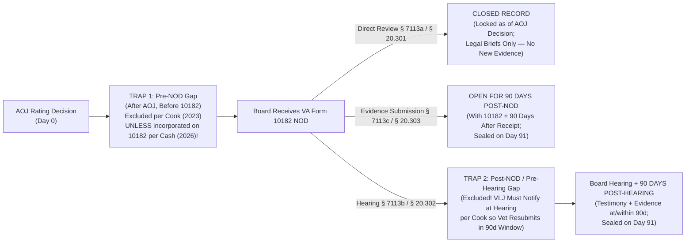

# AMA Three-Lane Strategy, Evidentiary Windows & Board of Veterans' Appeals Litigation Manual (`38 U.S.C. §§ 5104C, 7104, 7105, 7113`; `38 C.F.R. Parts 3, 19 & 20`)

Effective **February 19, 2019**, the **Veterans Appeals Improvement and Modernization Act of 2017 (`AMA`, `Pub. L. 115-55`, `131 Stat. 1105`; `84 FR 138`, published Jan. 18, 2019)** replaced VA's single-track Legacy open-record system (`NOD -> SOC -> VA Form 9`) with a modular **three-lane architecture** coupled with **rigid, non-discretionary Board evidentiary windows (`38 U.S.C. § 7113`; `38 C.F.R. §§ 20.300–20.303`)**. Selecting the wrong AMA lane—or uploading a `$4,000` private medical nexus opinion during an `"in-between"` Board dead zone without invoking *Cash v. Collins*—routinely costs veterans years of delay or forfeits multi-year retroactive effective dates.

> [!IMPORTANT]
> **Single Source of Truth & Cross-References:** For verbatim primary-source text of `38 C.F.R. Part 20` (`§§ 20.202, 20.300–20.303, 20.800–20.802, 20.1400–20.1411`) and `38 C.F.R. § 14.636`, consult [`38-cfr-part-20-ama-evid-windows-and-part-14-fees.md`](../authorities/part-20/38-cfr-part-20-ama-evid-windows-and-part-14-fees.md). For historical side-by-side regulatory diffs (`1992` `57 FR 4104` Legacy vs. `2019` `84 FR 138` AMA, `Subpart O` Board CUE, and `Part 14` fee triggers), see [`ama-part-19-20-and-part-14-fee-evolution.md`](../cfr-diffs/part-20/ama-part-19-20-and-part-14-fee-evolution.md). Pair this manual with the [`Duty to Assist, Medical Nexus Adequacy & Lay Credibility Treatise`](evidence-medical-exams-and-lay-credibility.md), the [`Master Effective-Date & Staged-Rating Treatise`](effective-dates-and-staged-ratings-treatise.md), [`Procedural Vehicles for Piercing Finality`](procedural-vehicles-piercing-finality.md), and the [`Historical & Modern VA Forms Lexicon`](forms-and-codesheet-lexicon.md).

---

## 1. Tactical Three-Lane Architecture (`38 U.S.C. §§ 5104C, 5104B, 5108, 7105`; `38 C.F.R. §§ 3.2500–3.2601`)

Within **`1 year`** of the mailing of an initial or supplemental AOJ decision (`38 U.S.C. § 5104C(a)(1)`; `38 C.F.R. § 3.2500(c)`), a claimant may maintain **continuous pursuit (`38 U.S.C. § 5110(a)(2)`)** by electing one of three mutually exclusive review lanes *per issue*. Under **`38 C.F.R. § 3.2500(d)`**, **issue-splitting across lanes is expressly permitted**: if a single Rating Decision grants PTSD at an underrated `30%` (where the existing `DBQ` already shows `70%` criteria) while denying sleep apnea for lack of nexus (requiring a new private `IME`), counsel can simultaneously file **`VA Form 20-0996` (`HLR`)** on the PTSD rating and **`VA Form 20-0995` (`Supplemental Claim`)** with the new `IME` on sleep apnea!

| Tactical Dimension | Lane 1: **Higher-Level Review (`HLR`)** | Lane 2: **Supplemental Claim** | Lane 3: **Board Appeal (`BVA`)** |
| :--- | :--- | :--- | :--- |
| **Prescribed Form & Deadline** | **`VA Form 20-0996`** (`1 year` from AOJ decision; **barred** after HLR or BVA) | **`VA Form 20-0995`** (`1 year` from AOJ, BVA, or **CAVC** decision for continuity; anytime `>1 yr` under `§ 5110(a)(3)`) | **`VA Form 10182` (`NOD`)** (`1 year` from AOJ decision) |
| **Statute & `38 C.F.R.`** | `38 U.S.C. § 5104B`; `38 C.F.R. § 3.2601` | `38 U.S.C. § 5108`; `38 C.F.R. §§ 3.156(d), 3.2501` | `38 U.S.C. §§ 7105, 7113`; `38 C.F.R. §§ 20.202, 20.300–20.303` |
| **Evidentiary Record** | **Strictly Closed** as of prior AOJ decision (`§ 3.2601(f)`). | **Open:** Requires presenting or identifying **"new and relevant"** evidence (`§ 3.2501(a)`). | **Docket-Dependent (`§ 7113`):** Closed (`Direct`), `90d` post-NOD (`Evidence`), or Hearing + `90d` post-hearing (`Hearing`). |
| **`§ 5103A` Duty to Assist** | **None proactively**—*except* mandatory **`§ 3.2601(g)` DTA error return**! | **Full `§ 5103A` Duty** (including fetching identified records per `§ 3.2501(b)` + ordering exams). | **None proactively**—*except* mandatory **`§ 20.802(a)` remand** for pre-AOJ DTA error! |
| **Optimal Firm Use Case** | `(1)` Clear rater legal/VASRD math error on existing `DBQ`; `(2)` **Fast `90–150 day` DTA conversion** via informal conference! | `(1)` Submitting a new private `IME`/`DBQ`/buddy statement; `(2)` Protective post-BVA or post-CAVC filing (`§ 5110(a)(2)(D)–(E)`). | `(1)` Complex credibility/*Nieves-Rodriguez* weighing; `(2)` Setting up CAVC judicial review (`§ 7252`) & EAJA fees. |

---

### A. Lane 1 Deep Dive: Higher-Level Review (`VA Form 20-0996`; `38 C.F.R. § 3.2601`)

1. ***De Novo* Adjudication & Closed-Record Discipline (`§ 3.2601(d)–(f)`):** Conducted *de novo* by an experienced Decision Review Officer (`DRO`) / Higher-Level Adjudicator who did not participate in the prior decision (`§ 3.2601(e)`). While the reviewer owes zero deference to the prior rater's adverse conclusions, **`38 U.S.C. § 5104A` (`§ 3.104(c)`) favorable findings bind the DRO** unless rebutted by clear and unmistakable evidence.
2. **Mastering the Informal Conference (`38 C.F.R. § 3.2601(h)`):**
   * Counsel may request **one** optional telephonic informal conference (`§ 3.2601(h)`) for the sole purpose of pointing out **errors of fact or law** in the prior decision.
   * **Operational Rule:** Never attempt to read new post-decision medical findings or unsubmitted lay facts into the phone call—the DRO is barred by `§ 3.2601(f)` from considering them. Instead, prepare a 1-page citation script referencing **exact VBMS document dates and PDF page numbers** already in the eFolder before the appealed rating decision.
3. **The "DTA Conversion" Gambit (`38 C.F.R. § 3.2601(g)`):**
   * Waiting `2–4 years` at the Board merely to get a *McLendon* exam remand or *Barr* exam-adequacy remand is rarely optimal when an HLR can achieve the **exact same remand in `3–5 months`**!
   * Under **`§ 3.2601(g)`**, if the DRO discovers during HLR (often prompted by counsel at the `§ 3.2601(h)` conference) that VA committed a **pre-decisional `§ 5103A` duty-to-assist error** prior to the appealed decision and cannot grant the maximum benefit outright, the DRO **must return the claim for corrective development**.
   * **Crucial Effect:** Once the HLR issues a `"Duty to Assist Error"` return, **the closed record REOPENS** as an expedited Supplemental development stream—allowing counsel to immediately upload a private nexus opinion, `DBQ`, or `VA Form 21-8940` (`TDIU`) into VBMS before the new rating decision issues!
4. **Jurisdictional Kill-Switches (`38 C.F.R. § 3.2601(b)`):**
   * **No HLR-of-an-HLR:** You **cannot** request an HLR of a decision issued on a prior HLR (`38 U.S.C. § 5104B(b)(2)`). *(Nuance: If an HLR triggers a `§ 3.2601(g)` DTA return and the AOJ subsequently issues a **new supplemental rating decision** after development, that new AOJ decision IS once again eligible for HLR!)*
   * **No HLR-of-a-Board Decision & No Contested Claims:** HLR is strictly unavailable to review a BVA decision or simultaneously contested claims (`§ 3.2601(b)`).

---

### B. Lane 2 Deep Dive: Supplemental Claims (`VA Form 20-0995`; `38 U.S.C. § 5108`; `38 C.F.R. § 3.2501`)

1. **`"New and Relevant"` vs. Legacy `"New and Material"` (`§ 3.2501(a)(1)` vs. `Former § 3.156(a)`):**
   * Congress deliberately **lowered** the readjudication gate in `38 U.S.C. § 5108(a)` (`38 C.F.R. §§ 3.156(d), 3.2501(a)(1)`):
     * **Legacy `"New and Material"` (`former § 3.156(a)`):** Required evidence not previously of record that related to an **unestablished fact** necessary to substantiate the claim **AND raised a reasonable possibility of substantiating the claim**.
     * **AMA `"New and Relevant"` (`§ 3.2501(a)(1)`):** **`"New"`** means evidence not previously part of the **actual record** before agency adjudicators (meaning VAMC clinical notes that existed in VistA/CAPRI but were never pulled into the actual VBMS eFolder qualify as `"new"`!). **`"Relevant"`** means **"information that tends to prove or disprove a matter at issue in a claim, including evidence that raises a theory of entitlement not previously addressed"** (aligning with ***Kisor v. Wilkie*, `969 F.3d 1333, 1337–40 (Fed. Cir. 2020)`** that `"relevant"` speaks to a disputed issue without demanding outcome-changing weight!).
2. **VA's Affirmative `§ 5103A` Duty to Gather `"New and Relevant"` Evidence (`38 C.F.R. § 3.2501` introductory text & `(b)`):**
   * A veteran need **not** attach physical copies of medical records to `VA Form 20-0995`. Under `§ 3.2501` (introductory text & `(b)`), if the claimant adequately identifies relevant federal (`VAMC`, `SSA`, `STR`/`JSRRC`) or private records (with `VA Form 21-4142`), **VA must exercise its `§ 5103A` duty to assist (`§ 3.159`) to obtain those records** before deciding whether new and relevant evidence has been presented or secured!
3. **Post-BVA & Post-CAVC Continuous Pursuit (`38 U.S.C. § 5110(a)(2)(D)–(E)` & *MVA v. Sec'y*):**
   * Unlike Legacy law (where filing a reopening at the RO after a BVA or CAVC denial forfeited the original effective date), **`38 U.S.C. § 5110(a)(2)(D)`** (`within 1 year of a BVA decision`) and **`§ 5110(a)(2)(E)`** (`within 1 year of a CAVC decision`) preserve the **initial claim's effective date** via a `20-0995` Supplemental Claim!
   * Under ***Military-Veterans Advocacy v. Sec'y of Veterans Affairs*, `7 F.4th 1110, 1134, 1142 (Fed. Cir. 2021)`**:
     1. The Federal Circuit **invalidated `38 C.F.R. § 3.2500(b)`**, allowing claimants appealing an adverse CAVC judgment to the Federal Circuit to **simultaneously file a protective `§ 5108` Supplemental Claim within `1 year` of the CAVC decision** (essential because `§ 5110(a)(2)` has no post-Federal-Circuit clause!); and
     2. The Federal Circuit **invalidated `§ 3.155`'s Supplemental Claim exclusion**, restoring **`VA Form 21-0966` Intent-to-File (`ITF`)** placeholders to Supplemental Claims ([`Master Effective-Date Treatise`](effective-dates-and-staged-ratings-treatise.md)).

---

### C. Lane 3 Deep Dive: Board Dockets, `90-Day` Evidentiary Windows, *Cash v. Collins* & Docket Switching (`38 U.S.C. § 7113`; `38 C.F.R. §§ 20.202, 20.300–20.303`)

Filing **`VA Form 10182` (`Notice of Disagreement`)** within `1 year` of the AOJ decision requires selecting one of three statutory Board dockets under **`38 U.S.C. § 7113`**:

1. **Direct Review Docket (`38 U.S.C. § 7113(a)`; `38 C.F.R. § 20.301`):**
   * **Evidentiary Scope:** Strictly limited to the evidence of record **at the time of the AOJ decision on appeal** (`§ 20.301`). Written legal argument pointing to record errors is permitted, but new factual/medical evidence is barred.
   * **Best Use:** Fastest Board lane when the record at the time of the rating decision already contains a winning private `IME`, an unaddressed `§ 5104(b)` *Hamill* pending claim, mathematical VASRD/`SMC` error, or a glaring *Nieves-Rodriguez*/*Barr* pre-decisional exam defect (`§ 20.802(a)`).
2. **Evidence Submission Docket (`38 U.S.C. § 7113(c)`; `38 C.F.R. § 20.303`):**
   * **Evidentiary Scope:** AOJ record **plus** evidence and argument submitted by the appellant or representative **with the `VA Form 10182` NOD OR within `90 days` following the Board's receipt of the NOD** (`§ 20.303(b)(1)`). No hearing is held, and VA has no `§ 5103A` duty to develop new evidence submitted in that `90-day` window—instead, the VLJ weighs it **in the first instance** (`§§ 20.300(a), 20.801`).
   * **Trap 1 — The AOJ-to-NOD `"In-Between"` Gap (*Cook* vs. *Cash*):**
     * In ***Cook v. McDonough*, `36 Vet. App. 175, 180–85 (2023)`**, the CAVC held that `38 U.S.C. § 7113(c)` enforces a hard closed-record rule: evidence uploaded to VBMS *after* the AOJ decision but *before* the `VA Form 10182` NOD is filed does **not** automatically roll into the Board's record, though if the Board excludes out-of-window evidence it must give accurate notice (`38 C.F.R. § 20.205(c)`) explaining the exclusion and the right to file a `§ 5108` Supplemental Claim.
     * **LANDMARK RESCUE — *Cash v. Collins*, `No. 24-1811 (Fed. Cir. Feb. 5, 2026)`:** Reversing VA's hyper-technical refusal to read gap-period submissions referenced on the NOD, the Federal Circuit held under **`38 U.S.C. § 7113(c)(2)(A)`** (`"evidence submitted... with the notice of disagreement"`) that **when a `VA Form 10182` NOD (or accompanying brief) clearly identifies or incorporates by reference probative evidence submitted during an AMA `"in-between"` window that is already in VA's possession (`VBMS`), the Board MUST consider that evidence without requiring physical resubmission!** *(Firm Protocol: Always attach an addendum to every `10182` explicitly listing and incorporating by date/document ID all post-AOJ submissions in `VBMS` under Cash v. Collins AND re-uploading clean copies inside the `90-day` window as belt-and-suspenders!)*
3. **Hearing Docket (`38 U.S.C. § 7113(b)`; `38 C.F.R. § 20.302`):**
   * **Evidentiary Scope:** AOJ record **plus** testimony presented at the Board hearing **plus** evidence submitted **at the Board hearing or within `90 days` following the Board hearing** (`§ 20.302(a)`). *(If the appellant withdraws the hearing request or fails to appear without good cause, the `90-day` evidence window runs from the date the withdrawal is received or the date of the scheduled hearing per `§ 20.302(b)–(c)`).*
   * **Trap 2 — The Post-NOD / Pre-Hearing Dead Zone & VLJ Hearing Notice Duty (*Cook* / `§ 20.705`):** Because Board Hearing appeals frequently wait `2–4 years` for a hearing date, unrepresented veterans and prior VSOs routinely upload medical records *after* filing the `10182` NOD *before* the hearing—a period **excluded** by `§ 7113(b)(2)`! Under ***Cook v. McDonough*, `36 Vet. App. 175 (2023)`** and the VLJ's hearing duties (`38 C.F.R. § 20.705`; cf. *Bryant v. Shinseki*, `23 Vet. App. 488 (2010)`), when pre-hearing submissions sit in VBMS outside the window, the VLJ/Board has an obligation at the hearing (and in accurate notice) to alert the claimant that pre-hearing evidence fell outside the statutory window so the claimant can **formally resubmit it during the hearing or within the `90-day` post-hearing window**! *(Hearing Script: At every AMA Board hearing, formally move on the record to re-submit and incorporate all post-AOJ VBMS documents and immediately upload a consolidated evidentiary packet within `90 days` post-hearing!)*
4. **Docket Switching (`38 C.F.R. § 20.202(c)(2)`) — *Williams*, *Brack* & *Cardoza*:**
   * Under **`38 C.F.R. § 20.202(c)(2)`**, an appellant may modify a `VA Form 10182` to switch Board dockets (by filing a new `VA Form 10182` checking the new docket) until the **LATER** of:
     1. **`1 year`** from the date the AOJ mailed notice of the decision on appeal; **OR**
     2. **`60 days`** after the Board receives the initial `VA Form 10182` NOD—
     ***PROVIDED*** the appellant has **not yet submitted evidence (`§ 20.303`) or testified at a hearing (`§ 20.302`)** under the original election!
   * ***Williams v. McDonough*, `37 Vet. App. 305, 310–11 (2024)` (Premature Board Decisions Barred):** Because `§ 20.202(c)(2)` confers an affirmative right to switch dockets throughout that `1-year` / `60-day` window, **the Board is prohibited from issuing a final decision BEFORE the `§ 20.202(c)(2)` window expires** unless the appellant expressly waives the remaining modification time!
   * ***Brack v. McDonough*, `37 Vet. App. 172 (2024)`, *aff'd sub nom. Brack v. Collins*, `No. 25-1205 (Fed. Cir. Sept. 8, 2026)` (Strict Post-Window Cut-Off):** Conversely, once the `§ 20.202(c)(2)` deadline has expired, docket-switch requests are strictly time-barred—and on the Direct Review docket, the "fair process" doctrine does **not** obligate the Board to delay issuing its decision for `90 days` after VA fulfills a Privacy Act C-file request.
   * ***Cardoza v. McDonough*, `37 Vet. App. 407 (2024)`:** If the Board sends an administrative letter refusing to docket or accept a `VA Form 10182` NOD (or dismissing a docket request as untimely), that refusal letter constitutes a **final, appealable Board decision** within CAVC jurisdiction (`120-day` NOA clock!).

---

## 2. Board Adjudication Standards, `AOD` & *Stegall* Remand Compliance

### A. Statutory Architecture of a Board Decision (`38 U.S.C. §§ 5104A, 7104`)

1. **`§ 7104(a)` (`One Review on Appeal` & Sympathetic Scope):** Decisions of the Board are based on the entire record in the proceeding (bounded by `§ 7113` in AMA appeals) and upon consideration of all applicable provisions of law and regulation, including all **reasonably raised theories of entitlement** (*Roberson v. Principi*, `251 F.3d 1378 (Fed. Cir. 2001)`).
2. **`§ 7104(c)` (Binding Authorities vs. `M21-1`):** The Board is bound by statutes, VA regulations, and precedent opinions of the VA General Counsel (`VAOPGCPREC`, [`Master VAOPGCPREC Digest`](vaopgcprec-index.md)). Under **`38 C.F.R. § 20.105`**, the `M21-1` Adjudication Procedures Manual does **not** bind the Board—**HOWEVER**, under ***Overton v. Wilkie*, `30 Vet. App. 257, 263–65 (2018)`**, if a claimant relies on a relevant substantive `M21-1` provision (such as an exposure concession or stressor rule), the Board **must** address that `M21-1` provision and explain its reasons for following or departing from it!
3. **`§ 7104(d)(1)` (`Reasons or Bases` — *Gilbert* & *Caluza*):** Every Board decision must include a written statement of the Board's findings and conclusions, and the **reasons or bases** for those findings and conclusions, on all material issues of fact and law presented on the record—analyzing the credibility and probative value of all material favorable evidence and explaining why any rejected favorable evidence was discounted (*Gilbert v. Derwinski*, `1 Vet. App. 49, 56–57 (1990)`; *Caluza v. Brown*, `7 Vet. App. 498, 506 (1995)`).
4. **`§ 5104A` & `§ 20.801(a)` (Binding Favorable Findings):** Any finding favorable to the claimant recorded by the AOJ (`in-service event`, `TERA participation`, `current diagnosis`, `combat service`) binds the Board unless rebutted by **clear and unmistakable evidence**!
5. **First-Instance Evidence Consideration (*Bernard* Legacy Waiver vs. AMA `§§ 20.300(a), 20.801`):**
   * **Legacy Appeals (`Part 19` / `§ 20.1304`):** Under ***Bernard v. Brown*, `4 Vet. App. 384, 393–94 (1993)`**, the Board **cannot** adjudicate pertinent new evidence in the first instance unless `(a)` the AOJ already reviewed it in an `SOC`/`SSOC`, `(b)` the claimant **affirmatively waives initial AOJ consideration in writing**, OR `(c)` the Board grants the full benefit sought.
   * **AMA Appeals (`§§ 20.300(a), 20.801`):** Congress eliminated the `SSOC` ping-pong in AMA—the Board is statutorily authorized to evaluate timely `90-day` Evidence/Hearing submissions in the first instance without a *Bernard* waiver!

### B. Advancement on the Docket (`AOD`, `38 U.S.C. § 7107(b)`; `38 C.F.R. § 20.800(c)`)

Because non-expedited AMA Evidence Submission and Hearing appeals routinely sit `2–4+ years` in the Board queue, screen **every** Board client at intake for mandatory **Advancement on the Docket (`AOD`)** under `38 U.S.C. § 7107(b)` and `38 C.F.R. § 20.800(c)` (`Legacy § 20.900(c)`):
* **Age `75+` (`§ 20.800(c)(1)`):** Automatic upon age `75` (though always file a `1-page` written `AOD` notice flagging the veteran's `DOB` when a client turns `75` mid-appeal so Board docketing clerks update the queue flag!).
* **Serious Illness (`§ 20.800(c)(1)`):** Active cancer, severe cardiopulmonary/renal failure, `ALS`, terminal illness, suicidal ideation / inpatient psychiatric crisis, or advanced neurodegenerative decline (attach `1–3` corroborating clinical pages).
* **Severe Financial Hardship (`§ 20.800(c)(1)`):** Foreclosure/eviction notice, utility shutoff, homelessness/HUD-VASH enrollment, Chapter 7/13 bankruptcy, or repossession.
* **Other Sufficient Cause (`§ 20.800(c)(1)`):** Administrative error by VA that caused substantial prior delay (e.g., *Freund* unlawful `VACOLS` closure or lost remand) or federal disaster declaration affecting the veteran's residence.

### C. Enforcing Remand Directives (*Stegall v. West* & *D'Aries v. Peake*)

> [!CAUTION]
> ***Stegall v. West*, `11 Vet. App. 268, 271 (1998)` — Remand Orders Are Law, Not Suggestions:**
> * **Core Rule:** *"A remand by this Court or the Board confers on the veteran or other claimant, **as a matter of law, the right to compliance with the remand orders**... and imposes upon the Secretary a concomitant duty to ensure compliance with the terms of the remand."*
> * **Substantial Compliance Standard (*D'Aries v. Peake*, `22 Vet. App. 97, 105 (2008)`):** While VA need only demonstrate **substantial** (not rigid literal) compliance, any failure to execute the core substantive instruction of a prior Board or CAVC remand—such as `(1)` ordering an NP/PA exam when the remand specified a board-certified neurologist/orthopedist, `(2)` failing to obtain records identified in the remand, or `(3)` accepting an addendum opinion that **repeats the exact factual error or skips the exact etiological question** identified in the remand—is an automatic *Stegall* violation requiring vacatur!
> * **Audit Step:** Whenever a case returns from an HLR `§ 3.2601(g)` DTA return, a Board `§ 20.802` remand, or a CAVC `JMPR`, **place the prior remand order side-by-side with the new C&P addendum line by line** before choosing the next review lane!

---

## 3. Surviving Legacy `Part 19` Appeals & *Freund v. Collins* (`2026`) Class Restoration

### A. Legacy `Part 19` Mechanics for Pre-Feb. 19, 2019 Appeals (`38 C.F.R. §§ 3.2400(b), 19.20–19.52`)

Under `38 C.F.R. §§ 3.2400(b) and 19.2`, any appeal stemming from an initial AOJ rating decision issued **prior to February 19, 2019** (that was never opted into AMA via `RAMP` or a post-Feb. 19, 2019 `SOC`/`SSOC` election under `§ 3.2400(c)`)—including multi-cycle Board and CAVC remands of pre-2019 claims—remains governed by **Legacy `38 C.F.R. Part 19`**:
1. **Notice of Disagreement (`NOD`):** Written communication expressing dissatisfaction and desire for appellate review filed within **`1 year`** of mailing of the AOJ rating notice (`VA Form 21-0958` became mandatory for Legacy compensation NODs eff. **March 24, 2015**, `79 FR 57660`).
2. **Statement of the Case (`SOC`, `Pub. L. 87-666`, eff. Jan. 1, 1963):** Mandatory VA summary of evidence, laws, and reasons. **Goldmine:** If a claimant filed a timely post-1962 Legacy `NOD` and VA **never issued an `SOC`**, the Legacy appeal **never became final and remains legally pending today**!
3. **Substantive Appeal (`VA Form 9`, `38 U.S.C. § 7105(d)(3)` `[pre-AMA]`; `38 C.F.R. § 19.52(b)`):** Must be filed within **`60 days` from the date the `SOC` is mailed OR within the remainder of the `1-year` period from the date of mailing of the original AOJ decision notice, whichever period ends LATER**.
4. **Supplemental Statement of the Case (`SSOC`, `38 C.F.R. § 19.31, 19.38`) & Open Continuous Record:** Whenever new evidence arrives in a perfected Legacy appeal prior to Board decision (without a *Bernard* waiver), the AOJ must readjudicate via an `SSOC` with a `30-day` response window—**no second `VA Form 9` is ever required after a timely initial `VA Form 9`!** Moreover, the `§ 5103A` duty to assist and open evidentiary record remain active throughout Legacy Board pendency (`38 C.F.R. § 20.1304` `90-day` post-certification window).
5. **Opt-In Caution (`38 C.F.R. § 3.2400(c)`):** Electing to opt a Legacy appeal into AMA within `60 days` of receiving an `SOC` or `SSOC` is **irrevocable**—do **not** opt a complex Legacy remand out of `Part 19`'s open continuous record unless an immediate closed-record grant is certain!

### B. *Freund v. Collins*, `No. 21-4168 (Vet. App. Class Certified Mar. 2026)` — Auditing Unlawfully Closed `VACOLS` Appeals

In ***Freund v. Collins*, `No. 21-4168 (Vet. App. class certified Mar. 2026)`**, the CAVC certified a sweeping `Rule 23` class action covering **`~28,000+` Legacy appeals** improperly closed in VA's Veterans Appeals Control and Locator System (`VACOLS`) between **December 12, 1990 and February 6, 2025**:
* **The Systemic Agency Error:** Automated `VACOLS` scripts and RO clerks routinely closed timely Legacy appeals as `"Withdrawn"` or `"Failed to File Substantive Appeal"` when `(1)` VA issued a post-`NOD` partial grant or `SSOC` and expected a redundant `Form 9`, `(2)` a claimant filed a timely `Form 9` inside the remainder of the `1-year` rating-notice window rather than `60 days` post-`SOC`, or `(3)` an `SOC` was returned undeliverable or never mailed to counsel ([`Procedural Vehicles`](procedural-vehicles-piercing-finality.md)).
* **C-File Intake Protocol:** In **every** C-file containing a `1990–2019` Legacy `NOD`, pull the **`VACOLS` printouts / Caseflow appeal history** alongside every `SOC`, `SSOC`, and `VA Form 9`. Whenever `VACOLS` shows an administrative closure without an explicit written withdrawal by the veteran (`38 C.F.R. § 20.205` `[Legacy § 20.204]`) or a final BVA merits decision, demand **immediate reinstatement of the pending Legacy appeal** with full retroactive continuity back to the original claim!
