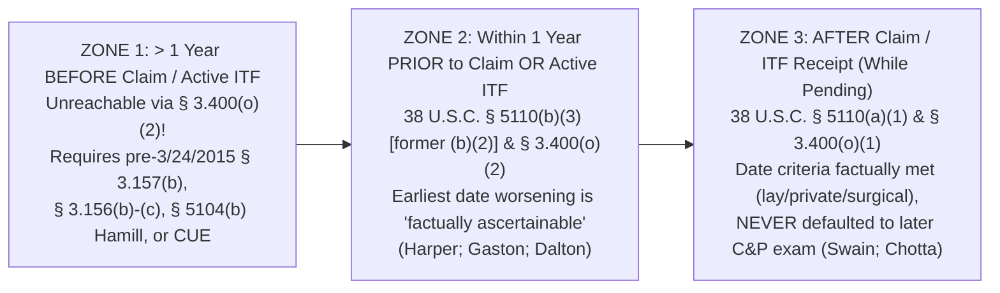

# Master Effective-Date & Staged-Rating Legal Treatise (`38 U.S.C. § 5110`; `38 C.F.R. §§ 3.114, 3.155, 3.400, 3.2500`)

Winning substantive service connection or a `100%` disability evaluation is only half of a Veterans Law firm's representation: **effective-date selection and historical staging** routinely separate an `$8,000` award from a `$280,000+` retroactive recovery (and determine the corresponding `38 U.S.C. § 5904` past-due fee base). Regional Office (`RO`) raters and the Board of Veterans' Appeals (`BVA`) systematically commit four recurring effective-date errors: `(1)` defaulting to the **date of a VA C&P examination** rather than the date entitlement factually arose; `(2)` ignoring the **`1-year` prior lookback** on increased-rating and TDIU claims (`§ 5110(b)(3)` `[former § 5110(b)(2)]` / `§ 3.400(o)(2)`); `(3)` misapplying **`§ 3.114(a)` liberalizing-law**, **PACT Act**, and **AMA continuous-pursuit (`§ 3.2500`)** rules; and `(4)` failing to assign **staged ratings** across multi-year appeals.

> [!IMPORTANT]
> **Single Source of Truth & Operational Cross-References:** Keep doctrinal synthesis distinct from verbatim regulatory text and post-grant math checklists. For verbatim primary-source text of `38 C.F.R. §§ 3.114, 3.400, and 3.700`, consult [`38-cfr-3.114-3.400-3.700-effective-dates-offsets.md`](../authorities/part-3/38-cfr-3.114-3.400-3.700-effective-dates-offsets.md) (alongside [`38-cfr-3.274-3.279-3.353-1.965-pension-competency-waivers.md`](../authorities/part-3/38-cfr-3.274-3.279-3.353-1.965-pension-competency-waivers.md) and [`38-cfr-3.155-3.157b-informal-claims-pre-2015.md`](../authorities/part-3/38-cfr-3.155-3.157b-informal-claims-pre-2015.md)). For chronological regulatory diffs (`1962–2026`), see [`pension-net-worth-and-effective-date-diffs.md`](../cfr-diffs/part-3/pension-net-worth-and-effective-date-diffs.md). For operational military retiree (`CRDP`/`CRSC`), severance/separation recoupment, overpayment waiver, and award-audit procedures, use [Playbook 20](../playbooks/20-backpay-offsets-crdp-crsc-severance-recoupment.md), [Playbook 21](../playbooks/21-overpayment-waivers-incompetency-and-wartime-pension.md), and the [`Award Letter & Withholding Audit Checklist`](../checklists/award-letter-and-withholding-audit-checklist.md).

---

## 1. Master Architecture of `38 U.S.C. § 5110` & `38 C.F.R. § 3.400`

### A. Historical Codification & The Baseline Two-Variable Formula (`§ 5110(a)(1)`)

Modern effective-date law originates in **`Pub. L. 87-825` (`76 Stat. 948`, enacted Oct. 15, 1962, effective December 1, 1962)**, codified from `1959` through `May 6, 1991` as **`former 38 U.S.C. § 3010`** and renumbered **`38 U.S.C. § 5110`** on **May 7, 1991** by `Pub. L. 102-40, § 402(b)(1)` ([Three-Era Title 38 Statutory Crosswalk](title-38-statutory-crosswalk.md)). *(Practitioner Kill-Switch: Section `7` of `Pub. L. 87-825` bars using post-1962 liberalized effective-date provisions to award payments prior to December 1, 1962).*

Unless a specific statutory exception in `§ 5110(b)–(n)` or a finality-piercing rule (`38 C.F.R. §§ 3.105(a), 3.156(c), 3.816`) governs, **`38 U.S.C. § 5110(a)(1)`** and **`38 C.F.R. § 3.400` (introductory text)** set the default effective date at the **LATER** of two dates:
1. **Date of Receipt of the Application** (or active `38 C.F.R. § 3.155(b)` Intent to File / pre-March 24, 2015 informal claim); **OR**
2. **Date Entitlement Arose ("Facts Found")** — the earliest date the evidence of record (medical *or* competent lay evidence) establishes that the legal criteria for service connection or a specific evaluation tier were factually met.

> [!CAUTION]
> **Cardinal Litigation Rule — "Date Entitlement Arose" Is NEVER "Date of the VA C&P Examination" (*Swain* & *McGrath*):**
> * ***McGrath v. Gober*, `14 Vet. App. 28, 35 (2000)`:** The date a medical diagnosis or nexus opinion is written down is merely the date of *documentation*, not necessarily the date the disability first manifested or worsened. Adjudicators must weigh lay testimony, private records, and retrospective medical inferences to determine when entitlement factually arose.
> * ***Swain v. McDonald*, `27 Vet. App. 219, 224–25 (2015)`:** Even where a VASRD code requires a specialized objective test—such as Maryland CNC speech discrimination / puretone audiometry under `38 C.F.R. § 4.85(a)`—`§ 4.85(a)` is an *evaluative* rule, **not an effective-date rule**! When a veteran files a claim (or experiences observable hearing/functional decline during a pending appeal) and VA does not administer the confirmatory C&P test until years later, VA **cannot** mechanically assign the C&P examination date without adjudicating when the compensable impairment factually began.

### B. Complete Subsection-by-Subsection Statutory Map of `38 U.S.C. § 5110(a)–(n)`

> [!NOTE]
> **Statutory Citation Disambiguation (`§ 5110(b)(2)` vs. `(b)(3)` & `§ 5110(f)` vs. `(n)`):**
> 1. **`Pub. L. 112-154, § 506(a)` (`126 Stat. 1165`, Aug. 6, 2012):** Inserted a temporary `2-year` Fully Developed Claim (`FDC`) incentive (`Aug. 6, 2013 – Aug. 5, 2015`) as current **`§ 5110(b)(2)`**, redesignating the classic `1-year` increased-compensation lookback (`Pub. L. 94-71`, `1975`) from `former § 5110(b)(2)` to **`§ 5110(b)(3)`** and the `1-year` permanent-and-total pension lookback from `former § 5110(b)(3)` to **`§ 5110(b)(4)`**. Because pre-2012 Federal Circuit/CAVC cases (*Harper*, *Gaston*, *Dalton*) and `38 C.F.R. § 3.400(o)(2)` authority notes cite `§ 5110(b)(2)`, **always cite `38 U.S.C. § 5110(b)(3) [former § 5110(b)(2)]`** in briefs!
> 2. **`§ 5110(f)` vs. `(i)` vs. `(n)`:** Subsection **`(f)`** governs adding existing dependents within `1 year` of reaching a **`30%+` combined rating**; subsection **`(n)`** governs `1-year` lookbacks for **marriage, birth, or adoption** (`§ 3.401(b)`); and subsection **`(i)`** governs **`10 U.S.C. §§ 1552/1553` military record corrections and discharge upgrades** (`§ 3.400(g)`).

| `38 U.S.C. § 5110` Subsection | Companion `38 C.F.R.` | Triggering Claim / Event & Filing Window | Effective Date Assigned & Controlling Precedent |
| :--- | :--- | :--- | :--- |
| **`§ 5110(a)(1)`** | `§ 3.400` *(intro)*; `§ 3.155(b)` | Initial claim or timely-pursued Supplemental Claim | **Later** of date of receipt of claim/ITF OR date entitlement factually arose (*Swain*, `27 Vet. App. 219`; *McGrath*, `14 Vet. App. 28`). |
| **`§ 5110(a)(2)(A)–(E)`** | `§ 3.2500(c), (g), (h)` | AMA review option filed within **`1 year`** of AOJ `(A)–(C)`, BVA `(D)`, or CAVC `(E)` decision | Preserves initial claim/ITF application date, still bounded by "facts found" (*MVA v. Sec'y*, `7 F.4th 1110 (Fed. Cir. 2021)`). |
| **`§ 5110(a)(3)`** | `§ 3.2500(h)(2)` | Supplemental Claim (`§ 5108`) filed **`> 1 year`** after prior decision | No earlier than receipt of Supplemental Claim (or its active ITF), *unless* `§ 3.156(c)`, CUE, `§ 3.114(a)`, PACT, or *Nehmer* applies. |
| **`§ 5110(b)(1)`** | `§ 3.400(b)(2)(i)` | Original disability compensation claim received within **`1 year` after discharge/release** | **Day following discharge or release** (assuming disability existed at/within 1-yr window). **NO equitable tolling** (***Arellano v. McDonough*, `598 U.S. 1 (2023)`** `9–0`). |
| **`§ 5110(b)(2)`** *(Historical FDC Pilot)* | `79 FR 57660` note | Original Fully Developed Claim (`FDC`) received **`Aug. 6, 2013 – Aug. 5, 2015`** (`Pub. L. 112-154, § 506`) | Up to **`1 year` prior** to receipt of original FDC (sunset Aug. 6, 2015 upon standardization of `VA Form 21-0966` ITF). |
| **`§ 5110(b)(3)`** `[former (b)(2)]` | **`§ 3.400(o)(2)`** | Claim or ITF for **increased disability compensation** (including **TDIU** & **SMC**) received within **`1 year`** of ascertainable worsening | **Earliest date factually ascertainable** increase occurred within `1 year` prior to complete claim or ITF (*Harper*, `10 Vet. App. 125`; *Gaston*, `605 F.3d 979`; *Dalton*, `21 Vet. App. 23`). |
| **`§ 5110(b)(4)`** `[former (b)(3)]` | `§ 3.400(b)(1)(ii)(B)` | **Wartime Disability Pension (`Ch. 15`)** claim received within **`1 year`** of becoming permanently & totally (`P&T`) disabled | Date veteran became `P&T` disabled if `P&T` severity prevented applying for `>= 30 days` immediately after onset ([Playbook 21](../playbooks/21-overpayment-waivers-incompetency-and-wartime-pension.md)). |
| **`§ 5110(c)`** | `§ 3.400(i)` | **`38 U.S.C. § 1151`** VA medical care / VR&E injury claim received within **`1 year`** of injury/aggravation | **Exact date injury or aggravation was suffered** (if filed `> 1 year` later, date of claim receipt). |
| **`§ 5110(d)`** | `§ 3.400(c)(2)` | **Survivor DIC (`Ch. 13`)** or **Survivors Pension** claim received within **`1 year`** of veteran's death | **First day of the month in which death occurred** (even if veteran died on the `31st` of the month!). |
| **`§ 5110(e)(1)–(2)`** | `§ 3.400(c)(4)` | Child's separate DIC claim (`(e)(1)`) within **`1 year`** of entitlement arising, or child turning `18` (`(e)(2)`) | First day of month child's entitlement arose (`(e)(1)`), or statutory age-`18` / school-attendance transition date (`(e)(2)`). |
| **`§ 5110(f)`** | `§ 3.401(b)(3)` | Proof of existing dependents submitted within **`1 year` of notification** of a rating action establishing **`>= 30%`** combined SC | **Relates back to the effective date of the qualifying `30%+` rating** (frequently worth years of retroactive dependency add-ons!). |
| **`§ 5110(g)`** | **`§ 3.114(a)(1)–(3)`** | Award or increase pursuant to a **liberalizing Act or administrative VA issue** | Facts found, **never earlier than effective date of the Act/issue**, and **max `1 year` prior** to claim/ITF or VA-initiated review (*McCay*, `106 F.3d 1577`; *Ortiz v. McDonough*, `6 F.4th 1285`). *(Superseded for PACT DIC re-evaluations by `38 U.S.C. § 1305` notwithstanding `§ 5110`!)* |
| **`§ 5110(h)`** | `§ 3.660(b)` | Improved Pension deferred/reduced on anticipated income where actual lower `IVAP` proof arrives **before end of next calendar year** | Retroactive adjustment per facts found for that calendar/medical-expense year ([Playbook 21](../playbooks/21-overpayment-waivers-incompetency-and-wartime-pension.md)). |
| **`§ 5110(i)`** | **`§ 3.400(g)(1)–(3)`** | Readjudication following **`10 U.S.C. § 1552` (BCMR/BCNR)** correction or **`10 U.S.C. § 1553` (DRB)** discharge upgrade | Original VA claim within `1 yr` of upgrade: **date upgrade application filed** (`DD-149`/`DD-293`); reopened disallowed VA claim: **latest** of `(1)` upgrade filing, `(2)` prior disallowed VA claim, or `(3)` `1 yr` prior to VA reopening *(unless `§ 3.156(c)(3)` pre-existing STRs pierce the cap — [Playbook 03](../playbooks/03-service-department-records-38-cfr-3-156c.md))*. |
| **`§ 5110(j)`** | `§ 3.400(c)(1)` | Active-duty death report/finding by Service Secretary (claim within **`1 year`** of report/finding) | First day of month of death fixed in report (excluding periods covered by active-duty pay/allotments). |
| **`§ 5110(k)` & `(l)`** | `§ 3.400(u)–(v)` | Surviving spouse / child reinstatement within **`1 year`** of final annulment decree (`(k)`) or death/divorce ending remarriage (`(l)`) | Date judicial annulment/divorce decree became final or date of subsequent spouse's death. |
| **`§ 5110(m)`** | *Repealed* | Repealed by `Pub. L. 103-446, § 1201(i)(8)` (`108 Stat. 4688`, Nov. 2, 1994) | Historical provision removed as obsolete. |
| **`§ 5110(n)`** | **`§ 3.401(b)(1)`** | Proof of **marriage, birth, or adoption** received within **`1 year`** of the event | **Exact date of marriage, birth, or adoption** (assuming veteran already held `>= 30%` SC on that date). |

---

## 2. Legacy Continuous Prosecution (`§ 20.1103`) vs. AMA Continuous Pursuit (`§ 5110(a)(2)(A)–(E)`, `§ 3.2500`)

### A. AMA Lane-Switching Mechanics (`38 U.S.C. § 5110(a)(2)(A)–(E)`; `38 C.F.R. § 3.2500`)

Effective **February 19, 2019** (`Pub. L. 115-55`; `84 FR 138, 170`), Congress replaced single-track Legacy appellate prosecution with **AMA continuous pursuit**. An initial claim's filing date (or ITF date) remains continuously alive across multiple sequential reviews so long as the claimant files a permitted action **within `1 year`** after notice of each decision:
* **After an Initial or Supplemental AOJ Decision (`§ 5110(a)(2)(A)–(C)`):** Within `1 year`, file `(A)` a Higher-Level Review (`VA Form 20-0996`, `§ 5104B`), `(B)` a Supplemental Claim with new and relevant evidence (`VA Form 20-0995`, `§ 5108`), **or** `(C)` a Board Notice of Disagreement (`VA Form 10182`, `§ 7105`). *(Note: You cannot file back-to-back HLRs on an HLR decision—switch to `0995` or `10182`).*
* **After an AMA Board (`BVA`) Decision (`§ 5110(a)(2)(D)` & `§ 7266`):** Either appeal to the CAVC within **`120 days`** (`38 U.S.C. § 7266(a)`) **OR** file a **`§ 5108` Supplemental Claim (`VA Form 20-0995`)** with new and relevant evidence within **`1 year`** of the BVA decision (`§ 5110(a)(2)(D)`). *(An HLR is barred after BVA review under `§ 5104B(b)(2)`).*
* **After a `CAVC` Decision (`§ 5110(a)(2)(E)`):** File a **`§ 5108` Supplemental Claim (`VA Form 20-0995`)** with new and relevant evidence within **`1 year`** after the CAVC decision!

### B. The Two Judicial-Appeal Continuous-Pursuit Traps (`Legacy` vs. `AMA` + *MVA v. Sec'y*)

| Judicial Posture | Governing Rule | Fatal Trap & Mandatory Protective Strategy |
| :--- | :--- | :--- |
| **Trap 1: Legacy CAVC Affirmance Break** *(Appeals NOT in AMA)* | `38 U.S.C. § 7291(a)`; `38 C.F.R. § 20.1103` | In a **Legacy** appeal, a CAVC affirmance (once mandate issues) renders the underlying BVA denial **final** (`§ 7291`), permanently severing Legacy continuous prosecution! Unlike AMA, filing a reopening request within 1 year after a Legacy CAVC affirmance **does NOT preserve the original claim date**—any subsequent grant takes the **date of reopening** unless `38 C.F.R. § 3.156(c)` service records or CUE applies ([Procedural Vehicles Piercing Finality](procedural-vehicles-piercing-finality.md)). |
| **Trap 2: AMA Post-CAVC (`§ 5110(a)(2)(E)`) vs. The Federal Circuit Gap (*MVA v. Sec'y*)** | `38 U.S.C. § 5110(a)(2)(E)`; ***Military-Veterans Advocacy v. Sec'y of Veterans Affairs*, `7 F.4th 1110, 1131–45 (Fed. Cir. 2021)`** | Under AMA, `§ 5110(a)(2)(E)` preserves continuous pursuit for `1 year` after a **CAVC** decision via a `§ 5108` Supplemental Claim—**even after a CAVC affirmance**! **HOWEVER**, Congress omitted a `1-year post-Federal Circuit / SCOTUS` subparagraph in `§ 5110(a)(2)`! Originally, VA promulgated `38 C.F.R. § 3.2500(b)` (barring concurrent Supplemental Claims while a Federal Circuit appeal was pending) and `§ 3.155` intro language (barring ITFs for Supplemental Claims), trapping veterans whose Federal Circuit appeals lasted `> 1 year` past the CAVC judgment. • **The *MVA v. Sec'y* Rescue (`7 F.4th at 1134, 1142`):** On July 30, 2021, the Federal Circuit **invalidated both `38 C.F.R. § 3.2500(b)`'s concurrent federal-court bar and `§ 3.155`'s exclusion of Supplemental Claims from the ITF framework** (as well as `§ 14.636(c)(1)(i)`'s fee restriction on `>1-yr` Supplemental Claims). • **Mandatory Appellate Protocol:** Whenever a firm appeals an AMA CAVC affirmance to the Federal Circuit (`§ 7292`), **calendar `Day 330` from the CAVC decision** and file a **protective `VA Form 21-0966` Intent to File AND/OR `VA Form 20-0995` Supplemental Claim** (with new and relevant evidence) **within `1 year` of the CAVC decision** so the initial AMA effective date survives even if the Federal Circuit affirms `18 months` later! |

### C. Intent-to-File Consumption (`§ 3.155(b)`) vs. Pre-2015 Informal Claims (*Pacheco* & *Hazan*)

1. **Pre-March 24, 2015 Informal Claims (`former §§ 3.155(a), 3.157(b)`):** Before `79 FR 57660` (eff. **March 24, 2015**, [`38-cfr-3.155-3.157b-informal-claims-pre-2015.md`](../authorities/part-3/38-cfr-3.155-3.157b-informal-claims-pre-2015.md)), *any* written communication identifying the benefit sought (`Shea v. Wilkie`, `926 F.3d 1362 (Fed. Cir. 2019)`) or any VAMC/uniformed-services examination or hospitalization report for an already service-connected condition (`former § 3.157(b)`) operated as an informal claim. In ***Pacheco v. Gibson*, `27 Vet. App. 21, 29–30 (2014) (en banc)`**, the CAVC held that where a veteran had a decades-long series of VAMC treatment reports for a `0%` or compensable SC disability, the **earliest** qualifying VAMC report showing worsening—not merely the last report within a year of a formal filing—triggered an unadjudicated `§ 3.157(b)` claim for increase (*see also* ***Hazan v. Gober*, `10 Vet. App. 511, 518–21 (1997)`** on non-abandonment of pending increase claims). *(Citation Disambiguation: Do not confuse pre-2015 informal-claim case law with [`VAOPGCPREC 8-97`](vaopgcprec-index.md), `62 FR 15567`, which governs secondary service connection under `§ 3.310` for `38 U.S.C. § 1151` disabilities).*
2. **Post-March 24, 2015 Single-Active-ITF Consumption Rule (`38 C.F.R. § 3.155(b)(4)–(6)`; *Sellers v. Wilkie*, `965 F.3d 1328 (Fed. Cir. 2020)`):**
   * **One Active ITF Per Benefit Type (`§ 3.155(b)(6)`):** A claimant may have **only ONE active `VA Form 21-0966` Intent to File** at a time for each general benefit category (`compensation`, `pension`, or `survivors benefits`). Submitting a second compensation ITF while an earlier compensation ITF is still active marks the second ITF as an **invalid duplicate**—it does **not** extend the 1-year window or create a backup placeholder!
   * **Immediate Consumption on First Complete Claim (`§ 3.155(b)(4)–(5)`):** The **first** complete claim (`VA Form 21-526EZ` or, post-*MVA v. Sec'y*, `VA Form 20-0995` Supplemental Claim) received within `1 year` **immediately consumes** the active ITF (covering all conditions filed on that same calendar day). If counsel intends to file an additional claim the next week, counsel **must file a brand-new `VA Form 21-0966` AFTER** submitting the first claim!

---

## 3. Increased-Rating `1-Year` Prior Lookback (`§ 5110(b)(3)` `[former (b)(2)]`, `§ 3.400(o)(2)`) vs. Pending-Claim Increases

When adjudicating an increased evaluation (including **TDIU** under ***Dalton v. Nicholson*, `21 Vet. App. 23, 32–35 (2007)`** and **SMC** as an ancillary rate increase), practitioners must separate the timeline into **three distinct legal zones** anchored around receipt of the complete claim or active ITF:

### Zone 1 (`> 1 Year` Prior to Complete Claim or Active ITF)
* **Rule:** Barred under `§ 5110(b)(3)` / `§ 3.400(o)(2)` (*Harper v. Brown*, `10 Vet. App. 125, 126 (1997)`).
* **Bypass Vehicles:** Screen exclusively for `(a)` pre-March 24, 2015 `former § 3.157(b)` VAMC outpatient/hospitalization reports (*Pacheco*), `(b)` Legacy `§ 3.156(b)` `1-year` post-decision VAMC records (*Lang v. Wilkie*, `971 F.3d 1348 (Fed. Cir. 2020)`), `(c)` newly associated service department records (`§ 3.156(c)`), `(d)` post-Feb. 19, 2019 AMA silent omissions (`§ 5104(b)` / *Hamill v. Collins*, `166 F.4th 1030 (Fed. Cir. 2026)`), or `(e)` `§ 3.105(a)` / `§ 7111` CUE ([Playbook 04](../playbooks/04-unadjudicated-tdiu-informal-claims-smc.md)).

### Zone 2 (Within `1 Year` *Prior* to Complete Claim or Active ITF — `§ 5110(b)(3)` / `§ 3.400(o)(2)`)
* **Governing Standard (*Harper*, *Gaston*, *Dalton*):**
  1. ***Harper v. Brown*, `10 Vet. App. 125, 126 (1997)`:** When medical or lay evidence demonstrates a factually ascertainable increase within the `1-year` window preceding claim receipt, the effective date is the **exact date of that ascertainable increase**; if the increase occurred *more* than `1 year` before the claim and remained static without further escalation during the 1-year window, the effective date defaults to **date of claim receipt**.
  2. ***Gaston v. Shinseki*, `605 F.3d 979, 983–86 (Fed. Cir. 2010)`:** Affirming *Harper*, the Federal Circuit held that `"an increase in disability had occurred"` within `1 year` prior to the claim requires evidence of **identifiable worsening/escalation during that 1-year lookback window**, not merely proof that the veteran *already* suffered static higher-level severity years earlier. *(Litigation Tip: Audit emergency-room visits, medication escalations, assistive-device prescriptions, flare logs, or **date of work cessation / termination** within the 12-month pre-claim window to satisfy Gaston!).*
  3. ***Dalton v. Nicholson*, `21 Vet. App. 23, 32–35 (2007)`:** Because TDIU (`38 C.F.R. § 4.16`) is legally an increased-compensation evaluation once service connection is in place, **`§ 5110(b)(3)` `[former (b)(2)]` / `§ 3.400(o)(2)` applies in full to TDIU claims**—meaning a veteran who stops working due to SC disabilities on June 1, 2024 and files a TDIU claim (or ITF) by June 1, 2025 wins a **June 1, 2024** TDIU effective date! (*Dalton*, `21 Vet. App. at 38–40`, also independently bars C&P examiners from rejecting lay symptom onset solely for lack of contemporaneous medical records).
* **Exact `eCFR` `§ 3.400(o)(2)` + `§ 3.155(b)` ITF Mechanics (No False "2-Year Pre-ITF" Stacking!):**
  * Verbatim `38 C.F.R. § 3.400(o)(2)` (`79 FR 57660`, [`38-cfr-3.114-3.400-3.700-effective-dates-offsets.md`](../authorities/part-3/38-cfr-3.114-3.400-3.700-effective-dates-offsets.md)) awards the earliest factually ascertainable date *"if a **complete claim or intent to file a claim** is received within 1 year from such date, otherwise, date of receipt of claim."*
  * **Lawful `~24-Month` Span From Formal Claim:** If worsening occurs on **May 1, 2024**, the veteran submits `VA Form 21-0966` (ITF) on **April 25, 2025** (within `1 year` of May 1, 2024!), and files `VA Form 21-526EZ` on **April 20, 2026** (within `1 year` of the ITF), the **May 1, 2024** effective date is locked in—almost **two full years** before the `21-526EZ` arrived!
  * **Kill-Switch:** You **cannot** reach *more* than `1 year` prior to the ITF itself (`§ 3.400(o)(2)` measures `1 year` prior to the ITF when perfected via ITF, or `1 year` prior to the complete claim when no ITF was used—never `1 year` before the ITF *plus* another year!).

### Zone 3 (*After* Claim or ITF Receipt While Claim/Appeal Is Pending — `§ 5110(a)(1)` / `§ 3.400(o)(1)`)
* **Rule (*Swain* & *Chotta*):** Once the claim or ITF has been received, `Gaston`'s 1-year lookback hurdle **disappears**; under `§ 5110(a)(1)` and `§ 3.400(o)(1)`, any increase occurring while the claim or appeal is pending takes effect on the **date the factual criteria were met** (lay testimony of worsening, surgery date, CPAP prescription, work cessation), **never** reflexively delayed to a later VA C&P exam (*Swain*, `27 Vet. App. at 224`). Under ***Chotta v. Peake*, `22 Vet. App. 80, 84–86 (2008)`**, when lay or clinical evidence suggests higher historical severity during an unexamined multi-year gap, VA's duty to assist (`§ 5103A(d)`) requires requesting a **retrospective medical opinion** assessing historical disability levels!

---

## 4. Liberalizing Laws & VA Issues (`38 U.S.C. § 5110(g)`; `38 C.F.R. § 3.114(a)`) vs. PACT Act & *Nehmer*

### A. What Qualifies as a `"Liberalizing Law or VA Issue"` (*Spencer*, *Routen*, *Ortiz v. McDonough*)

Under `38 U.S.C. § 5110(g)` and `38 C.F.R. § 3.114(a)`, not every favorable legal development triggers a `1-year` liberalizing lookback:
1. ***Spencer v. Brown*, `17 F.3d 368, 372–73 (Fed. Cir. 1994)` & *Routen v. West*, `142 F.3d 1434, 1440–42 (Fed. Cir. 1998)`:** A liberalizing law or VA issue must be a **statute enacted by Congress** or an **administrative regulation/issue promulgated by the Secretary** that brings about a **substantive change** creating a new basis of entitlement or removing an evidentiary hurdle. **Judicial decisions** of the Supreme Court, Federal Circuit, or CAVC reinterpreting existing statutes or regulations (e.g., *Barry*, *Laska*, *Walker*) **are NOT `§ 3.114(a)` liberalizing laws**—courts declare what the statute/regulation *always* meant!
2. ***Ortiz v. McDonough*, `6 F.4th 1285, 1292–97 (Fed. Cir. 2021)`:** Reversing *Foreman v. Shulkin*, `29 Vet. App. 146 (2018)`, the Federal Circuit held that `38 C.F.R. § 3.304(f)(3)` (`75 FR 39843` / `41092`, eff. July 13, 2010—relaxing stressor corroboration for fear-of-hostile-military-activity PTSD) **IS a liberalizing VA issue under `§ 3.114(a)`**, confirming that regulatory amendments eliminating corroboration or evidentiary proof barriers qualify even when the underlying diagnosis (`PTSD`) already existed! *(Citation Note: Always distinguish **Ortiz v. McDonough**, `6 F.4th 1285 (Fed. Cir. 2021)` on `§ 3.114(a)` from **Ortiz v. Principi**, `274 F.3d 1361 (Fed. Cir. 2001)` on `§ 5107(b)` benefit-of-the-doubt equipoise).*

### B. Strict Effective-Date Mechanics Under `§ 3.114(a)(1)–(3)` (*McCay v. Brown*)

In ***McCay v. Brown*, `106 F.3d 1577, 1580–82 (Fed. Cir. 1997)`**, the Federal Circuit established the three ironclad temporal boundaries of `§ 5110(g)` / `§ 3.114(a)`:
1. **Continuous Substantive Eligibility:** The claimant must have met all substantive eligibility criteria **on the effective date of the liberalizing Act/issue**, and that eligibility must have existed **continuously** from that date through the date of claim or administrative determination (`§ 3.114(a)` intro).
2. **Absolute Statutory Floor (`§ 5110(g)`):** The effective date can **NEVER precede the effective date of the liberalizing Act or VA issue** (*McCay*, `106 F.3d at 1581`). *(If the disease was not diagnosed until *after* the Act's effective date, `§ 3.114(a)` continuous eligibility on the Act's effective date fails and standard `§ 5110(a)`/`(b)` rules govern).*
3. **`Within 1 Year` (`§ 3.114(a)(1)`) vs. `More Than 1 Year` (`§ 3.114(a)(3)`):**
   * **Reviewed within `1 year` of the Act/issue's effective date** (`(a)(1)`): Effective on the **effective date of the Act or VA issue**.
   * **Claim/ITF or VA review `> 1 year` after the Act/issue's effective date** (`(a)(2)–(3)`): Retroactive **up to `1 year` prior to receipt of the claimant's application/ITF** (or date of administrative determination on VA-initiated review), capped no earlier than the Act's effective date!

### C. Contrast Matrix: `§ 3.114(a)` vs. PACT Act (`Pub. L. 117-168`) vs. *Nehmer* (`§ 3.816`) & `§ 1305` DIC

| Legal Regime | Governing Authority | Exact Effective-Date Rule & Critical Carve-Outs |
| :--- | :--- | :--- |
| **Standard Liberalizing Rule** | `38 U.S.C. § 5110(g)`; `38 C.F.R. § 3.114(a)(1)–(3)` | Floor = effective date of Act/regulation (e.g., **June 25, 2024** for `89 FR 32361` COD overhaul; **Jan. 2, 2025** / **Jan. 10, 2025** for `§§ 3.320a–3.320b` burn-pit IFRs). Up to **`1 year` prior** to claim/ITF if filed `> 1 year` later (`§ 3.114(a)(3)`). |
| **PACT Act Veteran Disability Claims** *(`Pub. L. 117-168`, enacted **Aug. 10, 2022**)* | `Pub. L. 117-168` (`136 Stat. 1759`); VA Aug. 2023 extension notice; `38 C.F.R. § 3.114(a)(3)` | • **Filed (or ITF submitted) on or before `August 14, 2023`** *(extended from Aug. 9, 2023 due to `va.gov` portal volume)*: Effective **August 10, 2022**, provided the presumptive condition existed on Aug. 10, 2022 (or date of post-Aug. 10, 2022 diagnosis if later). • **Filed `after August 14, 2023`:** Governed by **`38 C.F.R. § 3.114(a)(3)`**—eligible for up to **`1 year` prior lookback** from receipt of the claim or active ITF (never earlier than **Aug. 10, 2022**), provided the PACT presumptive condition existed continuously from Aug. 10, 2022! |
| **PACT Act Survivor DIC Re-Evaluations** | **`38 U.S.C. § 1305`** (`Pub. L. 117-168, § 204`); **`38 C.F.R. § 3.33(d)(1)`** | **SUPERSEDES `§ 5110(g)`!** Where a prior DIC claim was denied and the survivor elects re-evaluation under a post-Aug. 10, 2022 presumption (including PACT hypertension/MGUS or burn-pit cancers), payment takes effect *"notwithstanding section 5110"* **all the way back to the original denied DIC claim** ([Playbook 08](../playbooks/08-survivor-dic-direct-and-1318-hypothetical.md))! |
| ***Nehmer* Herbicide Class Claims & Blue Water Navy** | `38 C.F.R. § 3.816(c)`; `38 U.S.C. § 1116A(c)`; [`VAOPGCPREC 3-2019`](vaopgcprec-index.md) | **OVERRIDES `§ 3.114(a)`** for covered Republic of Vietnam / `§ 1116A` offshore herbicide conditions denied or pending `>= Sept. 25, 1985`—paying back to the **original denied/pending claim date** (or date disability arose), *except* that PACT-added **hypertension and MGUS** (and newly added Thailand/Laos/Cambodia/Guam locations outside `§ 1116A`) are excluded from *Nehmer* class retroactivity ([Playbook 06](../playbooks/06-nehmer-herbicide-presumptions-crsc.md)). |

---

## 5. Staged Ratings Across Multi-Year Appeals & The `§§ 3.343 / 3.344` Stabilization Distinction

### A. Mandatory Staging on Both Initial (`Fenderson`) and Increased-Rating (`Hart`) Appeals

1. **Initial Service-Connection Appeals (***Fenderson v. West*, `12 Vet. App. 119, 126 (1999)`**):** Whenever service connection is initially granted following a multi-year claim or appeal, VA **cannot** fixate solely on the veteran's current severity at the time of the final C&P examination (`"snapshot rating"`). Separate **"staged" disability percentages** must be assigned for distinct historical periods whenever the evidence demonstrates fluctuating or progressive severity from the effective date forward. *(Citation Precision: Always cite **Fenderson v. West**, `12 Vet. App. 119 (1999)`—never mis-cite as "Fenderson v. Gober").*
2. **Increased-Rating Appeals (***Hart v. Mansfield*, `21 Vet. App. 505, 509–10 (2007)`**):** Extended *Fenderson* in full to **claims for increased evaluation** (spanning Zone 2's `1-year` pre-claim lookback through Zone 3's entire multi-year appellate pendency), requiring staged evaluations whenever disability severity rose or fluctuated across distinct intervals.

### B. What *Reizenstein* & *Singleton* Actually Held on Retrospective Staged Downgrades (`§§ 3.343(a) & 3.344`)

A classic appellate trap arises when the Board grants a multi-year retroactive appeal via staged ratings that **step UP and then step DOWN** inside the same decision—for example, awarding `100%` from `2014 to 2020` (`6 years`!) and `50%` from `2020 to present`:
* **Why `38 C.F.R. §§ 3.343(a)` and `3.344` Do NOT Apply (*Reizenstein* & *Singleton*):**
  1. ***Reizenstein v. Shinseki*, `583 F.3d 1331, 1336–38 (Fed. Cir. 2009)`:** Held that `38 C.F.R. § 3.343(a)` (requiring proof of "material improvement" before reducing a total disability rating) applies **prospectively** to reductions of *ongoing, running awards* upon which a beneficiary relies for living expenses—**NOT** to a temporary retrospective `100%` stage assigned simultaneously alongside a lower subsequent stage in a single retroactive decision.
  2. ***Singleton v. Shinseki*, `659 F.3d 1332, 1341–44 (Fed. Cir. 2011)`:** Extended *Reizenstein* to **`38 C.F.R. § 3.344`** (`5-year` stabilized-rating heightened proof under [`38-cfr-3.105e-3.344-3.951-3.957-reductions.md`](../authorities/part-3/38-cfr-3.105e-3.344-3.951-3.957-reductions.md) and [Playbook 05](../playbooks/05-void-rating-reductions-stabilized-ratings.md)), holding that even when an earlier retrospective stage exceeds `5 years` in duration (`e.g., 2014–2020`), `§ 3.344`'s "sustained improvement under the ordinary conditions of life" standard does **not** govern a retrospective staged rating, nor does staging violate Fifth Amendment due process.
* **HOW TO WIN ANYWAY — The Affirmative Evidentiary & Reasons-or-Bases Burden:** Even though `§§ 3.343(a)` and `3.344` do not apply to retrospective staging, *Singleton* and *Fenderson* do **not** give the Board license to guess or manufacture an arbitrary downgrade date! To step a staged rating *down* on Date `X`, the Board must cite **affirmative, adequate medical/factual evidence** (`Chotta`, `22 Vet. App. at 84`; `38 U.S.C. § 5107(b)` equipoise; `§ 7104(d)(1)` reasons or bases) demonstrating that the veteran's symptomatology *actually improved* below the higher DC criteria on Date `X` (and did not merely reflect temporary medication masking barred under *Ingram* where the DC lacks medication language, or a single isolated "good day" exam!). Conversely, once a running award *is* placed into active monthly payment, any *subsequent* VA proposal to reduce a `5-year+` running tier triggers the full void-ab-initio shield of `§§ 3.105(e)` and `3.344` ([Playbook 05](../playbooks/05-void-rating-reductions-stabilized-ratings.md))!

---

## 6. Bitemporal *George v. McDonough* Matrix (`CUE` vs. `Open-Claim Only`)

Before attacking a historical effective-date error, screen every theory through ***George v. McDonough*, `596 U.S. 740 (2022)`**, **`38 C.F.R. § 20.1403(e)`**, and the [`Mandatory Board CUE Pre-Filing Gate`](../checklists/board-cue-pre-filing-gate.md):

| Effective-Date Error / Doctrine | Bitemporal Scope | Operational Pleading Rule (`CUE` vs. Open / Finality-Piercing Vehicle) |
| :--- | :--- | :--- |
| **Ignoring Undisputed `1-Year` Post-Discharge Filing (`§ 5110(b)(1)`) or `1-Year` Post-Death DIC Filing (`§ 5110(d)`)** | **`cue-and-open-claim`** | Positive statutory text since **Dec. 1, 1962** (`Pub. L. 87-825`). If the C-file date-stamp proves receipt within `1 year` of discharge/death and undisputed record facts show the disability existed, assigning claim-receipt date is textbook **RO/Board CUE (`§ 3.105(a)` / `§ 7111`)**. |
| **Omitting Undisputed `1-Year` Pre-Claim Worsening (`§ 5110(b)(3)` `[former (b)(2)]` / `§ 3.400(o)(2)`)** | **`cue-and-open-claim`** *(post-Aug. 1, 1975)* | Positive statute since `Pub. L. 94-71` (`1975`). However, because CUE bars re-weighing debatable facts (`§ 20.1403(d)(3)`), CUE succeeds only where **undisputed** contemporaneous records (e.g., inpatient surgical/test results in VA possession post-July 21, 1992 per [`VAOPGCPREC 12-95`](vaopgcprec-index.md)) left **zero room for debate** that the higher DC criteria were met on an earlier date within the `1-year` window. On open/pending claims, invoke `§ 5107(b)` equipoise! |
| **Unadjudicated Pre-Mar. 24, 2015 `§ 3.157(b)` VAMC Report (*Pacheco*) or AMA `§ 5104(b)` Silent Omission (*Hamill*)** | **`cue-and-open-claim`** *(Pending Unadjudicated Claim — No CUE Burden!)* | Better than CUE: an unadjudicated pre-March 24, 2015 `§ 3.157(b)` report (where no subsequent final decision adjudicated the increase) or a silent post-Feb. 19, 2019 AMA omission (*Hamill v. Collins*, `166 F.4th 1030`) remains **legally pending**, adjudicated under `§ 5107(b)` benefit of the doubt ([Authority Verification Log](authority-verification-log.md); [Forms & Code-Sheet Lexicon](forms-and-codesheet-lexicon.md))! |
| **Post-*MVA v. Sec'y* (`2021`) Concurrent Supplemental Claim (`§ 3.2500(b)`) or Supplemental ITF (`§ 3.155`)** | **`open-claim-only-george-restricted`** *(for pre-July 30, 2021 final decisions)* | Under *George* and [`VAOPGCPREC 25-95`](vaopgcprec-index.md), faithful application of `38 C.F.R. § 3.2500(b)` or `§ 3.155` *before* the Federal Circuit invalidated them on **July 30, 2021** (`7 F.4th 1110`) **cannot** constitute CUE against a prior final pre-July 30, 2021 decision; applies to all open/pending claims and post-July 30, 2021 filings. |
| **Post-*Ortiz v. McDonough* (`2021`) `§ 3.114(a)` Liberalizing Stressor-Rule Claims** | **`open-claim-only-george-restricted`** *(for `2018–2021` final decisions under Foreman)* | Final `2018–July 2021` denials applying *Foreman v. Shulkin* are shielded from CUE by `§ 20.1403(e)` change-in-interpretation rules; pursue via open appeal, `§ 3.156(c)` service records, or a new `VA Form 20-0995` (`1-year` lookback under `§ 3.114(a)(3)`). |
| **Newly Associated Official Service Records (`38 C.F.R. § 3.156(c)(1), (3)`)** | **`cue-and-open-claim`** *(Bypasses Finality & `§ 5110(a)(3)`)* | Associating missing STRs, unit/deck logs, or military clinical files mandates reconsideration and carries the effective date back to the **original previously denied claim** ([`38-cfr-3.156c-service-records-evolution.md`](../authorities/part-3/38-cfr-3.156c-service-records-evolution.md), [Playbook 03](../playbooks/03-service-department-records-38-cfr-3-156c.md)). |
