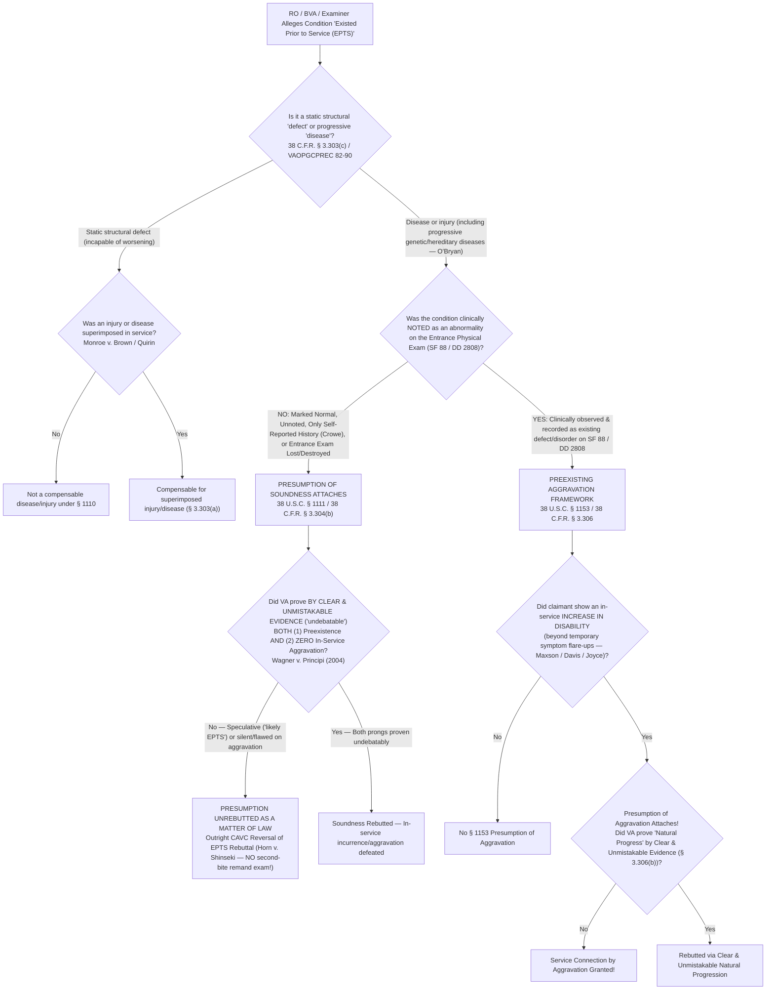

# Substantive Service Connection Treatise: Direct Nexus (`§ 3.303`), Chronicity Post-*Walker*, Presumption of Soundness (`§ 1111`), In-Service Aggravation (`§ 1153`) & Congenital Defects vs. Hereditary Diseases

Under **`38 U.S.C. §§ 1110` (wartime)** and **`1131` (peacetime)** (`former §§ 310, 331` in `1959–Aug. 5, 1991`; `Veterans' Regulation No. 1(a), Part I, par. I(a)` & `Part II, par. I(a)` in `1933–1958`; see [Three-Era Title 38 Statutory Crosswalk](title-38-statutory-crosswalk.md)), the United States compensates any veteran disabled by an **injury suffered or disease contracted in line of duty, or for aggravation of a preexisting injury suffered or disease contracted in line of duty**, during active military, naval, air, or space service.

While statutory presumptions ([Playbook 06](../playbooks/06-nehmer-herbicide-presumptions-crsc.md); [Playbook 07](../playbooks/07-statutory-presumptions-chronic-tropical-pow-als.md)) streamline specific cohorts, the vast majority of contested Veterans Law merits appeals and CAVC reversals turn on **three foundational Chapter 11 causation architectures**:
1. **Three-Element Direct Service Connection & Post-*Walker* Continuity (`38 C.F.R. § 3.303(a)–(d)`)**;
2. **Entrance Examination Architecture: The Statutory Presumption of Soundness (`38 U.S.C. § 1111`; `38 C.F.R. § 3.304(b)`) vs. Aggravation of Noted Preexisting Conditions (`38 U.S.C. § 1153`; `38 C.F.R. § 3.306`)**; and
3. **Congenital/Developmental *Defects* vs. Progressive Hereditary/Familial *Diseases* (`38 C.F.R. § 3.303(c)`; `VAOPGCPREC 82-90`)**.

> [!IMPORTANT]
> **Orthogonal Causation Cross-References:** For secondary causation, `§ 3.310(b)` aggravation (*Ward v. Wilkie*), medication side effects, and the three-link obesity intermediate step (`VAOPGCPREC 1-2017` / *Walsh*), use [Playbook 14](../playbooks/14-secondary-service-connection-aggravation-obesity.md) and verbatim [`38-cfr-3.310-secondary-aggravation-evolution.md`](../authorities/part-3/38-cfr-3.310-secondary-aggravation-evolution.md). For PTSD stressor pathways (`§ 3.304(f)(1)–(5)`), Military Sexual Trauma (`MST`) behavioral markers, and the non-PTSD acquired psychiatric bypass, use [Playbook 16](../playbooks/16-ptsd-stressors-and-mst-corroboration.md) and verbatim [`38-cfr-3.304f-ptsd-evolution.md`](../authorities/part-3/38-cfr-3.304f-ptsd-evolution.md). For National Guard/Reserve `ADT`/`IADT` active-service gates (`38 U.S.C. § 101(24)`) and line-of-duty rules (`§ 105(a)`), consult [Playbook 11](../playbooks/11-guard-reserve-adt-iadt-and-line-of-duty.md).

---

## 1. Three-Element Direct Service Connection (`38 U.S.C. §§ 1110, 1131`; `38 C.F.R. § 3.303(a)–(d)`)

### A. Reconciling *Shedden*, *Hickson*, and *Caluza*
Under **`38 C.F.R. § 3.303(a)`**, service connection may be granted for any disability resulting from disease or injury incurred in or aggravated by active service, evaluated upon "the entire history of the veteran's service as shown by official records and other pertinent medical and lay evidence." The Federal Circuit and CAVC express the governing tripartite test in two complementary formulations—***Shedden v. Principi*, `381 F.3d 1163, 1166–67 (Fed. Cir. 2004)`** and ***Hickson v. West*, `12 Vet. App. 247, 253 (1999)`** (refining ***Caluza v. Brown*, `7 Vet. App. 498, 506 (1995)`**, *aff'd per curiam*, `78 F.3d 604 (Fed. Cir. 1996)`):

1. **Element 1 — Current Disability:** Competent evidence of a present disability.
   * **Timing Rule (*McClain* & *Romanowsky*):** Under ***McClain v. Nicholson*, `21 Vet. App. 319, 321 (2007)`**, Element 1 is satisfied if the claimant had the disability **at the time the claim was filed OR at any time during the pendency of the claim**—even if the condition temporarily resolves before a C&P examination or Board decision (potentially warranting staged ratings). Under ***Romanowsky v. Shinseki*, `26 Vet. App. 289, 293–94 (2013)`**, a clinical diagnosis recorded shortly *before* claim filing is probative evidence of a current disability at filing and cannot be ignored merely because symptoms were in remission on the day of a later VA exam.
   * **Functional Pain Without Formal Pathology (*Saunders*) vs. Psychiatric DSM-5 Carve-Out (*Martinez-Bodon*):** Under ***Saunders v. Wilkie*, `886 F.3d 1356, 1368 (Fed. Cir. 2018)`**, "disability" in `§ 1110` means **functional impairment of earning capacity**; thus, orthopedic or somatic pain that causes functional loss satisfies Element 1 even without an identified underlying pathological diagnosis. **Critical Exception:** In ***Martinez-Bodon v. McDonough*, `28 F.4th 1241, 1246 (Fed. Cir. 2022)`**, the Federal Circuit held that because **`38 C.F.R. §§ 4.125(a)` and `4.130`** explicitly require a mental-health diagnosis conforming to the **DSM-5**, psychiatric claims **cannot** use *Saunders* to establish Element 1 without a formal DSM diagnosis ([mental-health-dc-9400-9411.md](../cfr-diffs/vasrd/mental-health-dc-9400-9411.md)).
2. **Element 2 — In-Service Incurrence or Aggravation:** Medical or, in certain circumstances, lay evidence of in-service incurrence or aggravation of a disease or injury (reinforced for combat veterans by **`38 U.S.C. § 1154(b)`**, where satisfactory lay evidence consistent with combat service suffices absent clear and convincing evidence to the contrary).
3. **Element 3 — Causal Nexus:** Competent evidence of a causal link ("at least as likely as not" / `50%` equipoise under `38 U.S.C. § 5107(b)` and `38 C.F.R. § 3.102`; reviewed on CAVC appeal for clear error under ***Bufkin v. Collins*, `604 U.S. 369 (2025)`**) between the present disability and the in-service disease, injury, or event.
   * *Note on Shedden's Terminology:* *Shedden* explained that while "service connection" is often used colloquially for Element 3, strictly speaking "service connection" denotes the overall three-element entitlement, whereas Element 3 is the **causal relationship (nexus)** between current disability and in-service event (`381 F.3d at 1166–67`).

### B. `38 C.F.R. § 3.303(b)` Chronicity & Continuity Post-*Walker v. Shinseki* (`2013`)
For two decades (`1993–2013`), CAVC precedent (*Savage v. Gober*, `10 Vet. App. 488 (1997)`) permitted veterans to bypass a medical nexus opinion for *any* condition under **`38 C.F.R. § 3.303(b)`** by showing either "chronicity" in service or continuous post-service symptoms.

In ***Walker v. Shinseki*, `708 F.3d 1331, 1338–39 (Fed. Cir. 2013)`**, the Federal Circuit **abrogated *Savage*** and confined `§ 3.303(b)` strictly to the **enumerated list of "chronic diseases" in `38 C.F.R. § 3.309(a)`** ([Playbook 07](../playbooks/07-statutory-presumptions-chronic-tropical-pow-als.md)):

| Evidentiary Pathway | Covered Conditions Post-*Walker* (`2013`) | How It Operates in Practice |
| :--- | :--- | :--- |
| **`§ 3.303(b)` Chronicity in Service** | **ONLY `38 C.F.R. § 3.309(a)` listed chronic diseases** (e.g., arthritis, cardiovascular disease, psychosis, organic nervous system disease/sensorineural hearing loss/tinnitus per *Fountain v. McDonald*, `27 Vet. App. 258 (2015)`, malignant tumors, peptic ulcers). | If the `§ 3.309(a)` disease was shown as **chronic** (*definite and persistent*, not merely isolated/acute) in service, subsequent manifestations of the **same chronic disease** at any later date—however remote—are service-connected **unless clearly attributable to intercurrent causes** (no new medical nexus opinion needed!). |
| **`§ 3.303(b)` Continuity of Symptomatology** | **ONLY `38 C.F.R. § 3.309(a)` listed chronic diseases** noted in service without established in-service chronicity. | If a condition noted during service was *not* clearly chronic at discharge, continuous post-service symptoms linked to the `§ 3.309(a)` condition establish SC without satisfying the `1-year` presumptive manifestation window of `§ 3.307(a)(3)`. |
| **`§ 3.303(a)` Direct Nexus + Lay Continuity (*Jandreau* / *Barr* / *Buchanan*)** | **ALL non-`§ 3.309(a)` conditions** (e.g., orthopedic strains, meniscal tears, radiculopathy, OSA, GERD, non-psychotic mental disorders such as MDD/GAD/PTSD). | `§ 3.303(b)` does **not** apply as a standalone legal shortcut; the claim proceeds under **`§ 3.303(a)`**. **HOWEVER**, under ***Jandreau v. Nicholson*, `492 F.3d 1372, 1377 (Fed. Cir. 2007)`**, ***Barr v. Nicholson*, `21 Vet. App. 303, 308–10 (2007)`**, and ***Buchanan v. Nicholson*, `451 F.3d 1331, 1336–37 (Fed. Cir. 2006)`**, a layperson is **competent to report observable continuous symptoms** (pain, limping, ringing in ears, panic attacks), the Board **may never reject lay testimony solely due to the absence of contemporaneous post-service treatment records**, and a medical nexus examiner **must account for credible lay continuity** (*Dalton v. Nicholson*, `21 Vet. App. 23 (2007)`)! |

### C. `38 C.F.R. § 3.303(d)` Post-Service Initial Diagnosis (*Cosman* & *Combee*)
Under **`38 C.F.R. § 3.303(d)`**, *"Service connection may be granted for any disease diagnosed after discharge, when all the evidence, including that pertinent to service, establishes that the disease was incurred in service."*
* **Presumptive Periods Never Foreclose Direct SC:** As held in ***Cosman v. Principi*, `3 Vet. App. 503, 505 (1992)`** and ***Combee v. Brown*, `34 F.3d 1039, 1043–44 (Fed. Cir. 1994)`** (codified in **`38 C.F.R. § 3.307(d)`**), presumptive provisions (`§§ 3.307–3.309`, `3.317`, `3.320`) are evidentiary shortcuts—**not ceilings**. Even when a disease (e.g., multiple sclerosis, cancer, psychosis, or delayed-onset PTSD) is first diagnosed 20 years after separation and long after any presumptive period expired, VA **must** adjudicate direct service connection under `§ 3.303(a)` and `(d)` whenever in-service symptoms or exposures are linked via medical nexus.

---

## 2. Entrance Examination Architecture: `38 U.S.C. § 1111` Soundness vs. `38 U.S.C. § 1153` Aggravation

Every preexistence ("EPTS — Existed Prior to Service") dispute begins with **one binary factual audit** of the service entrance physical examination (`SF 88` / `DD Form 2808` *Report of Medical Examination*, distinct from the self-report medical history form `SF 93` / `DD Form 2807-1`!):

### A. Threshold Rules on Entrance Exam "Notations" & Lost Records (`§ 1111`)
Under **`38 U.S.C. § 1111`** (`extended to peacetime service after Dec. 31, 1946 by 38 U.S.C. § 1132`), *"every veteran shall be taken to have been in sound condition when examined, accepted, and enrolled for service, except as to defects, infirmities, or disorders noted at the time of the examination, acceptance, and enrollment."*
1. **Recruit Self-Report Questionnaires Do NOT Defeat Soundness (*Crowe v. Brown*):** In ***Crowe v. Brown*, `7 Vet. App. 238, 245 (1994)`**, the CAVC held that a recruit's check-mark or historical mention of a past childhood condition (e.g., childhood asthma, murmur, or knee sprain) on the **medical history questionnaire (`SF 93` / `DD Form 2807-1`)** is **NOT** a clinical "notation" of a defect when the examining physician evaluates that body system as **"Normal"** on the official **Report of Medical Examination (`SF 88` / `DD Form 2808`)**! Only an affirmative clinical abnormality recorded by the entrance examiner strips `§ 1111` soundness.
2. **Missing, Incomplete, or Fire-Destroyed Entrance Examinations:** Where an entrance physical examination was lost, destroyed (e.g., in the **1973 NPRC St. Louis fire**; see [`VA Forms & Code-Sheet Lexicon`](forms-and-codesheet-lexicon.md)), or left blank, VA **cannot** presume a condition was noted at entry. Unless contemporaneous induction records affirmatively record an entrance clinical notation of the condition, the **`§ 1111` presumption of soundness attaches in full** (with heightened Board explanation duties under *O'Hare v. Derwinski*, `1 Vet. App. 365 (1991)`). *(Note: For Guard/Reserve `ADT` without a formal entrance exam, `§ 1111` generally requires having been "examined, accepted, and enrolled," and `§ 1111` does **not** apply to `IADT` per *Smith v. Shinseki*, `24 Vet. App. 40 (2010)`—see [Playbook 11](../playbooks/11-guard-reserve-adt-iadt-and-line-of-duty.md)).*

### B. `38 U.S.C. § 1111` Two-Prong Clear-and-Unmistakable Rebuttal (*Wagner v. Principi* & *Vanerson*)
For decades prior to 2004, `38 C.F.R. § 3.304(b)` departed from the text of `38 U.S.C. § 1111` by stating that VA could rebut the presumption of soundness merely by showing clear and unmistakable evidence that the condition **existed prior to service**—omitting the statutory requirement that VA *also* prove lack of in-service aggravation (`VAOPGCPREC 3-2003` attempted to defend following the narrower regulation).

In ***Wagner v. Principi*, `370 F.3d 1089, 1096 (Fed. Cir. 2004)`**, the Federal Circuit **invalidated that omission in `38 C.F.R. § 3.304(b)` (and `VAOPGCPREC 3-2003`)**, holding that the plain text of `38 U.S.C. § 1111` is unambiguous: when no preexisting disorder was noted at entrance, **VA bears the burden of proving by CLEAR AND UNMISTAKABLE EVIDENCE BOTH**:
1. **Prong 1 (Preexistence):** The disease or injury existed prior to entrance into active service; **AND**
2. **Prong 2 (Zero Aggravation):** Any in-service worsening was **NOT aggravated** by active service (or that there was zero increase in disability during service).

VA formally amended `38 C.F.R. § 3.304(b)` to conform to *Wagner* at **`70 FR 23027` (published & effective May 4, 2005; applicable to open claims)**.
* **What "Clear and Unmistakable Evidence" Means (*Vanerson v. West*):** Under ***Vanerson v. West*, `12 Vet. App. 254, 258–61 (1999)`**, "clear and unmistakable evidence" under `§ 1111` is an **onerous, undebatable standard**—meaning the facts and medical principles cannot be misinterpreted and allow **no room for reasonable debate** when viewing the entire record as a whole. Crucially, while underlying factual findings are reviewed for clear error, **whether the evidence of record rises to the level of "clear and unmistakable evidence" sufficient to rebut `§ 1111` is a question of law reviewed *de novo* by the CAVC** (`12 Vet. App. at 261`)!
* **Claimant Has ZERO Threshold Burden on Aggravation Under `§ 1111`:** Unlike `§ 1153` (where the claimant must first show in-service worsening of a *noted* condition), under `§ 1111` (*Wagner*, `370 F.3d at 1096`), if VA proves Prong 1 (preexistence) and the claimant merely points to in-service symptoms or disability, **the veteran does NOT have to prove permanent worsening before the burden shifts**—VA itself must affirmatively prove *lack of aggravation* by clear and unmistakable evidence!

> [!WARNING]
> **THE *GEORGE v. McDONOUGH* BITEMPORAL CUE BOUNDARY (`596 U.S. 740 (2022)`):** Remember that *George v. McDonough* itself arose out of a 1977 BVA denial under **pre-*Wagner* `38 C.F.R. § 3.304(b)`**! The Supreme Court held (`596 U.S. at 747–53`) that when a pre-June 1, 2004 RO or BVA decision **faithfully applied the then-extant text of `§ 3.304(b)`** (finding clear and unmistakable preexistence without requiring VA to disprove aggravation), *Wagner*'s subsequent invalidation of `§ 3.304(b)` on June 1, 2004 (`70 FR 23027`, eff. May 4, 2005) **cannot support a CUE motion** (`38 C.F.R. § 20.1403(e)`; `VAOPGCPREC 25-95` — `open-claim-only-george-restricted`).
> * **How to Win Pre-2004 Soundness Cases Despite *George*:**
>   1. **Reopen / Supplemental Claim + `§ 3.156(c)` Service Records ([Playbook 03](../playbooks/03-service-department-records-38-cfr-3-156c.md)) or `§ 3.156(b)` 1-Yr VAMC Records ([Playbook 04](../playbooks/04-unadjudicated-tdiu-informal-claims-smc.md)):** Any open, pending, or `§ 3.156(b)/(c)` reconsidered claim applies *Wagner* with full retroactive force!
>   2. **Prong-1 CUE Sword (`cue-and-open-claim`):** Even under pre-2004 `§ 3.304(b)`, VA *always* had to prove **Prong 1 (preexistence)** by **clear and unmistakable ("undebatable") evidence** (`38 C.F.R. § 3.304(b) (1977)`). If the pre-2004 RO/BVA relied on speculative medical conjecture ("probably EPTS") or treated a self-report history box as an entrance notation (*Crowe*) without undebatable proof of preexistence, **that violated the extant pre-2004 regulation itself and REMAINS CUE-SAFE**!

### C. Outright CAVC Reversal Remedy (*Horn v. Shinseki* & *Adams v. Principi*)
One of the highest-value appellate weapons in Veterans Law is **outright CAVC reversal**—rather than vacatur and remand—when VA relies on a legally insufficient medical opinion to rebut `§ 1111` soundness.

In ***Horn v. Shinseki*, `25 Vet. App. 231, 239–44 (2012)`** (relying on ***Adams v. Principi*, `256 F.3d 1318, 1321–22 (Fed. Cir. 2001)`** and *Miller v. West*, `11 Vet. App. 345, 348 (1998)`), the CAVC established two lethal litigation rules:
1. **Equivocal / Speculative Examiner Language Fails `§ 1111` as a Matter of Law:** If a VA C&P examiner opines that an unnoted condition *"likely," "probably,"* or *"at least as likely as not"* existed prior to service, uses unexplained conclusory assertions, or fails to provide undebatable medical principles disproving in-service aggravation, that opinion is **legally incapable** of rising to "clear and unmistakable evidence."
2. **NO Second Bite at the Apple (Reversal, Not Remand):** When VA has had a full opportunity to develop the record to carry *its own* statutory affirmative burden under `38 U.S.C. § 1111` (just as in unlawful rating reductions under [Playbook 05](../playbooks/05-void-rating-reductions-stabilized-ratings.md)) and its evidence falls short of "clear and unmistakable," **remanding for a new VA medical opinion impermissibly gives the Secretary a second bite at the apple to build evidence *against* the veteran** (`Horn`, `25 Vet. App. at 243–44`). Instead, the CAVC **reverses the Board's rebuttal finding outright**, ordering that the `§ 1111` presumption of soundness stands **unrebutted as a matter of law** (leaving only Element 1 current disability and Element 3 post-service nexus if contested)!

### D. `38 U.S.C. § 1153` & `38 C.F.R. § 3.306`: Aggravation of *Noted* Preexisting Conditions
When—and **only** when—a preexisting injury or disease **was clinically noted** as an active defect or disorder on the entrance physical (`SF 88` / `DD Form 2808`), `§ 1111` does not attach to that condition, and adjudication shifts to **`38 U.S.C. § 1153`** (`former § 353`) and **`38 C.F.R. § 3.306(a)–(c)`**:

| Analytical Step | Governing Precedent & Regulatory Standard | Key Litigation Traps & Distinctions |
| :--- | :--- | :--- |
| **Step 1: Claimant's Threshold Showing ("Increase in Disability")** | `38 U.S.C. § 1153`; `38 C.F.R. § 3.306(a)`; ***Maxson v. Gober*, `230 F.3d 1330, 1333 (Fed. Cir. 2000)`**; ***Davis v. Principi*, `276 F.3d 1341, 1346–47 (Fed. Cir. 2002)`**; ***Joyce v. Nicholson*, `443 F.3d 845, 847–49 (Fed. Cir. 2006)`** | Claimant bears the initial burden (`50%` equipoise under `§ 5107(b)`) of showing an **increase in disability during active service**: • ***Davis* Temporary Flare-Up Rule:** Temporary or intermittent flare-ups of **symptoms** alone during service, without an underlying worsening of the disability itself, do **not** establish `§ 1153` aggravation unless the underlying condition worsened. • ***Maxson* No Mandatory "Permanent" Post-Service Hurdle:** Conversely, VA **may not** require objective proof of "permanent" measurable worsening persisting decades after discharge as an extra-statutory barrier; the question is whether the condition **increased in disability during service** based on the entire medical and lay history (*Joyce* confirmed both medical and lay evidence can prove the in-service increase). |
| **Step 2: Statutory Presumption of Aggravation Attaches** | `38 U.S.C. § 1153`; `38 C.F.R. § 3.306(a)` | Once an in-service increase in disability is shown (`50%` equipoise), **aggravation by service is presumed by law** without the veteran needing a causal nexus linking the worsening to a specific military trauma! |
| **Step 3: VA's Rebuttal Burden ("Natural Progress")** | **`38 C.F.R. § 3.306(b)`** *(Wartime & Post-Dec. 31, 1946 Peacetime)* vs. **`§ 3.306(c)`** *(Pre-Dec. 7, 1941 Peacetime)* | • **Wartime Service & ALL Peacetime Service After Dec. 31, 1946 (`§ 3.306(b)`):** VA can rebut the presumption of aggravation **ONLY by a specific finding based on CLEAR AND UNMISTAKABLE EVIDENCE** (obvious/manifest medical facts and principles) that the increase in disability was due to the **natural progress** of the disease! *(Note: `Pub. L. 93-177` / `38 U.S.C. § 1137` & `§ 3.306(b)` aligned post-1946 peacetime service with wartime `clear and unmistakable` rebuttal—removing the old 6-month peacetime service gate that previously sat in `§ 3.306(c)`! Note `§ 3.306(b)(2)` combat/POW rule: due regard must be given to combat or POW hardships, though temporary symptom flare-ups still require underlying worsening).* • **Pre-Dec. 7, 1941 Peacetime Service Only (`§ 3.306(c)`):** Uses the historical lower "available evidence of a nature generally acceptable as competent" natural-progress standard. |

*(Rating Deduction Note under `38 C.F.R. § 4.22`: When SC by aggravation is granted, VA deducts the preexisting entrance degree of disability **only if** that pre-service baseline was **compensably ascertainable (`>= 10%`)** at entry; if the pre-service condition was mild/`0%` or unascertainable, the veteran receives the **full schedular evaluation** without deduction, and if post-service severity reaches `100%` total disability, **zero deduction** is permitted under `§ 4.22`!)*

---

## 3. Congenital / Developmental *Defects* vs. Hereditary / Familial *Diseases* (`38 C.F.R. § 3.303(c)`)

Few provisions in `38 C.F.R. Part 3` generate more unlawful Regional Office denials—and more **high-dollar CUE victories (`cue-and-open-claim`)**—than **`38 C.F.R. § 3.303(c)`**, which states:
> *"Congenital or developmental defects, refractive error of the eye, personality disorders and mental deficiency as such are not diseases or injuries within the meaning of applicable legislation."*

### A. The Controlling Dichotomy: Static *Defects* vs. Progressive Genetic *Diseases* (`VAOPGCPREC 82-90`, `67-90`, *Winn*, *Terry*, *O'Bryan*, *Quirin*)
For decades, VA examiners and raters saw the words *"genetic," "hereditary," "familial,"* or *"congenital"* in a medical textbook and reflexively denied service connection under `§ 3.303(c)`.

In two landmark binding precedent opinions issued **July 18, 1990**—**[`VAOPGCPREC 82-90`](vaopgcprec-index.md) (`55 FR 45711`, Oct. 31, 1990)** and **[`VAOPGCPREC 67-90`](vaopgcprec-index.md) (`55 FR 43253`, Oct. 26, 1990)**—subsequently endorsed by the Federal Circuit and CAVC in ***Winn v. Brown*, `110 F.3d 56, 59 (Fed. Cir. 1997)`**, ***Terry v. Principi*, `340 F.3d 1378, 1382–86 (Fed. Cir. 2003)`**, ***Quirin v. Shinseki*, `22 Vet. App. 390, 394–97 (2009)`**, and ***O'Bryan v. McDonald*, `771 F.3d 1376, 1378–80 (Fed. Cir. 2014)`**, the courts established the bright-line legal test:

* **Non-Compensable Congenital / Developmental *Defect*:** A **static structural or anatomical abnormality** existing from birth or development that is **more or less stationary in nature and largely incapable of improvement or deterioration** (e.g., pure uncomplicated refractive myopia/astigmatism, extra digit, static pilonidal dimple without infection, pure DSM personality trait without superimposed disorder, intellectual developmental disability). Because a true static defect is not a "disease or injury" under `§§ 1110, 1111`, **the `§ 1111` presumption of soundness does not apply to pure defects** (*Winn*; *Terry*).
* **Compensable Hereditary / Familial / Genetic *Disease*:** Any condition—**even if 100% genetically determined at conception!**—that involves a **pathological process capable of improving or deteriorating (progressing) over time**! Under `VAOPGCPREC 82-90`, `VAOPGCPREC 67-90`, *Quirin*, and *O'Bryan*, **every progressive genetic or familial disorder IS a "disease" under `38 U.S.C. §§ 1110` and `1111`**!

### B. Master Classification & Litigation Matrix (`§ 3.303(c)` Screening)

| Clinical Condition Seen in C-File | Legal Classification (`VAOPGCPREC 82-90` / *O'Bryan* / *Quirin*) | Does `§ 1111` Soundness Apply if Unnoted on `SF 88` / `DD 2808`? | Winning Litigation & CUE Strategy |
| :--- | :--- | :--- | :--- |
| **Retinitis Pigmentosa, Leber's Optic Atrophy (*O'Bryan*), Keratoconus, Fuchs' Dystrophy** | **Compensable Hereditary *Disease*** (progressive degenerative pathology; explicitly analyzed in `VAOPGCPREC 67-90` & *O'Bryan*, `771 F.3d 1376`) | **YES!** Full `§ 1111` *Wagner* two-prong protection! | Even if VA proves genetic preexistence via DNA/family history (Prong 1), **VA must still prove by clear & unmistakable ("undebatable") evidence that active service did NOT aggravate progression** (Prong 2)! Speculative examiner remarks lose under *Horn*! |
| **Hypertrophic Cardiomyopathy (`HCM`), Brugada / Long-QT Arrhythmias, Marfan Aortopathy** | **Compensable Hereditary *Disease*** (capable of worsening, hypertrophy, remodeling, and decompensation) | **YES!** Full `§ 1111` protection! | Physical training (`PT`), deployment exertion, and adrenergic stress frequently accelerate cardiac remodeling; VA almost never has *undebatable* medical proof of zero service aggravation. |
| **Autosomal Dominant Polycystic Kidney Disease (`ADPKD`), Hereditary Hemochromatosis, Sickle Cell Disease (*vs. asymptomatic trait*), Wilson's Disease** | **Compensable Hereditary *Disease*** (progressive organ pathology) | **YES!** Full `§ 1111` protection! | Categorical post-July 18, 1990 RO/BVA denials calling ADPKD, hemochromatosis, or sickle cell disease a "congenital defect under `§ 3.303(c)`" violate binding `VAOPGCPREC 82-90` -> **prime `cue-and-open-claim` CUE target**! |
| **Charcot-Marie-Tooth (`CMT`) Hereditary Neuropathy, Ehlers-Danlos Syndrome (`EDS` with progressive joint/vascular deterioration), Muscular Dystrophies, Huntington's Disease** | **Compensable Hereditary *Disease*** (progressive neuromuscular / connective-tissue deterioration) | **YES!** Full `§ 1111` protection! | Challenge any C&P opinion conflating genetic etiology with "congenital defect." Under *O'Bryan*, genetic origin at conception proves *at most* Prong 1 preexistence—never "defect" status and never Prong 2 non-aggravation! |
| **Optic Nerve Hypoplasia (*Quirin*), Pes Planus ( Congenital Flatfoot ), Spondylolisthesis / Spina Bifida Occulta, Bicuspid Aortic Valve, Chiari Malformation** | **Fact-Specific Inquiry (*Quirin*, `22 Vet. App. at 395–97`)** — Board cannot assume "defect" by label; requires medical evidence on whether the condition is **capable of improving or deteriorating** | **YES if progressive disease**; if truly static defect, proceed to **Superimposed Injury/Disease Rule** below! | Under *Quirin* (`22 Vet. App. at 396`) and *Monroe v. Brown*, `4 Vet. App. 513, 515 (1993)`, **even if** the baseline structural anomaly is a static defect, if active-duty rucking, trauma, or infection **superimposes an acquired disease or injury** (e.g., degenerative arthritis, plantar fasciitis, disc herniation, infective endocarditis, or symptomatic syringomyelia) onto that defect, **the superimposed disability IS fully compensable**! |
| **Personality Disorders & Intellectual Disability ("Mental Deficiency") (`38 C.F.R. §§ 3.303(c), 4.127`)** | **Excluded *as such*** unless an acquired psychiatric disorder is **superimposed** | Excluded *as such*, **EXCEPT** superimposed `§ 4.130` disorders (`PTSD`, `MDD`, `GAD`, psychosis, bipolar) | Under ***Carpenter v. Brown*, `8 Vet. App. 240, 245 (1995)`** and `38 C.F.R. § 4.127`, service connection **must be granted** when a service-related acquired psychiatric disorder (e.g., PTSD from combat or MST; [Playbook 16](../playbooks/16-ptsd-stressors-and-mst-corroboration.md)) is **superimposed upon** a personality disorder! Always audit historical "personality disorder" discharges for misdiagnosed in-service PTSD, bipolar disorder, or MST markers ([Playbook 10](../playbooks/10-character-of-discharge-insanity-upgrades.md)). |

---

## 4. Bitemporal CUE vs. Open-Claim Audit Summary (`George v. McDonough` Gate)

Before selecting a procedural vehicle ([Procedural Vehicles Piercing Finality](procedural-vehicles-piercing-finality.md); [`Mandatory Board CUE Pre-Filing Gate`](../checklists/board-cue-pre-filing-gate.md)), classify the historical causation error against this bitemporal gate:

1. **`cue-and-open-claim` (Safe for RO CUE `§ 3.105(a)` & Board CUE `§ 7111`):**
   * **Post-July 18, 1990 `§ 3.303(c)` Categorical "Congenital Defect" Denials of Progressive Hereditary Diseases:** Directly violates extant, binding `VAOPGCPREC 82-90` and `VAOPGCPREC 67-90` (`38 U.S.C. § 7104(c)`).
   * **Post-June 1, 2004 (*Wagner*) / Post-May 4, 2005 (`70 FR 23027`) `§ 1111` Denials Without Undebatable Proof of Both Preexistence AND Non-Aggravation.**
   * **Pre-2004 `§ 1111` Denials Lacking Clear & Unmistakable Proof of *Preexistence* (Prong 1):** Even pre-*Wagner* `§ 3.304(b)` required clear and unmistakable evidence of preexistence (and *Crowe* confirmed recruit history checkboxes on `SF 93` are not clinical entrance notations).
   * **Ignoring Listed `§ 3.309(a)` In-Service Chronicity Under `§ 3.303(b)`:** Undisputed STR chronicity of a `§ 3.309(a)` disease denied for lack of a post-service nexus opinion.
2. **`open-claim-only-george-restricted` (Use `§ 3.156(b)` *Lang*, `§ 3.156(c)` STRs, *Hamill* Explicit Notice, or Supplemental `20-0995` — DO NOT File CUE):**
   * **Pre-June 1, 2004 `§ 3.304(b)` Soundness Denials Where Preexistence *Was* Undebatable and the Adjudicator Relied on Pre-*Wagner* `§ 3.304(b)` to Omit VA's Non-Aggravation Burden:** Explicitly barred from CUE by ***George v. McDonough*, `596 U.S. 740 (2022)`** and `38 C.F.R. § 20.1403(e)`.
   * **Pre-2018 Denials of Undiagnosed Pain Before *Saunders v. Wilkie*, `886 F.3d 1356 (Fed. Cir. 2018)`** (where prior CAVC precedent *Sanchez-Benitez v. West*, `13 Vet. App. 282 (1999)` had barred pain-alone SC). Reopen via Supplemental Claim (`VA Form 20-0995`) or capture pending Legacy/AMA claims!
