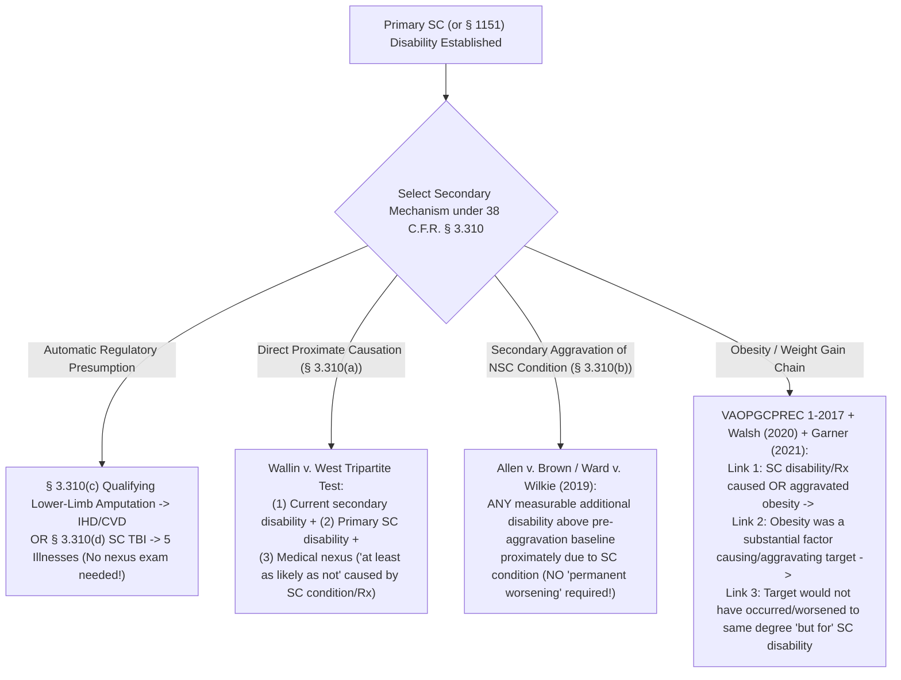

# Playbook 14: Secondary Service Connection (`§ 3.310(a)`), Incremental Aggravation (`§ 3.310(b)` / *Ward v. Wilkie*), Medication Side Effects & The Obesity Intermediate Step (`VAOPGCPREC 1-2017` / *Walsh*)

In law-firm disability practice, **secondary service connection (`38 C.F.R. § 3.310`)** is the single most reliable engine for transforming low-rated orthopedic or mental-health awards (`10%–30%`) into `100%` schedular, `TDIU` (`§ 4.16`), Statutory Housebound **`SMC(s)`** (`§ 1114(s)`), and Creative-Organ **`SMC(k)`** (`§ 1114(k)`) entitlements. Under `§ 3.310(a)`, a disability that is proximately due to, the result of, or aggravated (`§ 3.310(b)`) by a service-connected disease or injury **"shall be service connected" and "considered a part of the original condition"** for compensation entitlement.

> [!IMPORTANT]
> **Single Source of Truth & Orthogonal Links:** Do not duplicate multi-paragraph regulatory text in pleadings without checking the exact CFR edition in force on the rating date. Consult [`38-cfr-3.310-secondary-aggravation-evolution.md`](../authorities/part-3/38-cfr-3.310-secondary-aggravation-evolution.md) for verbatim pre- and post-October 10, 2006 text of `38 C.F.R. § 3.310(a)–(d)` (`71 FR 52744`, `78 FR 76196`). Pair this playbook with the [Direct SC, Soundness & Aggravation Treatise](../docs/service-connection-direct-soundness-aggravation.md), the [`VAOPGCPREC` Master Digest](../docs/vaopgcprec-index.md), [Playbook 11](11-guard-reserve-adt-iadt-and-line-of-duty.md) (*Allen* secondary substance abuse), [Playbook 17](17-section-1151-va-malpractice-and-ftca-interplay.md) (`§ 1151` secondary chains), and the [Master SMC Treatise](../docs/smc-complete-treatise-and-step-math.md).

---

## 1. Preconditions: VBMS / VHA Pharmacy, Vitals & Code-Sheet Audit

Before drafting a `VA Form 21-526EZ`, `20-0995` Supplemental Claim, or private Independent Medical Opinion (`IMO`) instruction letter, extract four datasets from the VBMS eFolder and VHA `CAPRI`/`VistA` (`Blue Button`) clinical chart ([VA Forms & Code-Sheet Lexicon](../docs/forms-and-codesheet-lexicon.md)):

1. **Active Primary SC Anchor (`Rating Code Sheet`):** Confirm at least one already-service-connected (or concurrently claimed) disability—including any **`38 U.S.C. § 1151`** disability, which supports full `§ 3.310` secondary service connection under binding **[`VAOPGCPREC 8-97`](../docs/vaopgcprec-index.md) (`62 FR 15567`, Feb. 11, 1997)**!
2. **VHA Longitudinal Vitals (`BMI` & Blood Pressure Trajectory):** Pull chronological VAMC weight/`BMI` readings (`BMI >= 30.0` clinical obesity; `25.0–29.9` overweight intermediate progression) alongside orthopedic flare-ups, surgeries, PTSD/MDD onset, and sleep-study (`PSG` / CPAP `DC 6847`), `HbA1c` (`DC 7913`), or blood-pressure (`DC 7101`) diagnoses.
3. **VHA Active & Historical Medication Ledger (`Pharmacy Outpatient Profile`):** Map every chronic medication prescribed to treat an SC disability (dosage, start date, duration) against downstream organ, metabolic, dental, or sexual-dysfunction diagnoses.
4. **Prior Negative Secondary C&P Addenda:** Screen every prior negative VA medical opinion for **three classic legal errors**:
   * Addressing **only direct causation (`§ 3.310(a)`)** while ignoring **aggravation (`§ 3.310(b)`)** (*El-Amin v. Shinseki*, `26 Vet. App. 136 (2013)`);
   * Demanding **"permanent worsening"** or **"worsening beyond natural progression"** in a `§ 3.310(b)` opinion (*Ward v. Wilkie*, `31 Vet. App. 233 (2019)`); or
   * Dismissing obesity as *"merely a lifestyle/metabolic risk factor, not an SC disease"* without analyzing the `VAOPGCPREC 1-2017` / *Walsh* / *Garner* intermediate chain!

---

## 2. Bitemporal Pathway Gate (`George v. McDonough` & Regulatory Effective Dates)

Because `38 C.F.R. § 3.310` combines decades-old en banc judicial rules (*Allen v. Brown*, `1995`), prospective regulatory presumptions (`§ 3.310(d)` TBI eff. `Jan. 16, 2014`), and modern CAVC reinterpretations (*Ward*, `2019`; *Walsh*, `2020`), select your finality vehicle strictly from this bitemporal table ([Procedural Vehicles Piercing Finality](../docs/procedural-vehicles-piercing-finality.md)):

| Substantive `§ 3.310` Doctrine | Key Effective / Issuance Date | Bitemporal CUE Scope (*George*, `596 U.S. 740`) | Optimal Procedural Vehicle |
| :--- | :--- | :--- | :--- |
| **En Banc Secondary Aggravation (`Allen v. Brown`, `7 Vet. App. 439`)** | **Mar. 17, 1995** *(codified at `§ 3.310(b)`, `71 FR 52744`, pub. Sept. 7, 2006, **eff. Oct. 10, 2006**)* | **`cue-and-open-claim`** (`>= Mar. 17, 1995` for flatly refusing to recognize secondary aggravation as a legal theory) | Open appeal; `§ 3.156(b)` (*Lang*); or RO/Board CUE if undisputed record established SC aggravation and adjudicator held `§ 3.310` covered causation only. |
| **Incremental / Non-Permanent Aggravation (`Ward v. Wilkie`, `31 Vet. App. 233`)** | **June 14, 2019** | **`open-claim-only-george-restricted`** for pre-June 14, 2019 final decisions | **DO NOT file CUE on pre-June 2019 "no permanent worsening" denials!** File `VA Form 20-0995` Supplemental Claim with a *Ward*-compliant IMO, or check *Hamill* (`§ 5104(b)`) / `§ 3.156(b)`. |
| **Obesity Intermediate Step (`VAOPGCPREC 1-2017`, *Walsh*, `2020` & *Garner*, `2021`)** | **Jan. 6, 2017** (`1-2017`); **Feb. 24, 2020** (*Walsh*); **Jan. 26, 2021** (*Garner*) | `1-2017` causation (`>= Jan. 6, 2017` undisputed record): `cue-and-open-claim`; **Pre-2020 *Walsh* aggravation of obesity: `open-claim-only-george-restricted`** | `VA Form 20-0995` Supplemental Claim + 3-link IMO (fastest path), active appeal (`0996`/`10182`/`CAVC`), or *Hamill* silent-omission audit if raised post-Feb. 19, 2019! |
| **Amputation -> Cardiovascular (`38 C.F.R. § 3.310(c)`)** | **Aug. 28, 1979** (`44 FR 50339, 50340`) | **`cue-and-open-claim`** (`>= Aug. 28, 1979`) | **Prime RO/Board CUE Sword!** If C-file/VAMC records (`Bell` post-July 21, 1992) showed qualifying SC amputation + IHD/HTN and rater denied nexus, file CUE! |
| **TBI -> 5 Secondary Illnesses (`38 C.F.R. § 3.310(d)`)** | **Jan. 16, 2014** (`78 FR 76196`, pub. Dec. 17, 2013) | **`prospective-liberalizing-3.114`** (`38 C.F.R. § 3.114` 1-yr lookback to `Jan. 16, 2014` floor; CUE-safe for post-Jan. 16, 2014 denials ignoring `(d)`) | Supplemental Claim / `§ 3.114` audit (`>= Jan. 16, 2014` for presumptive shortcut; earlier dates require `§ 3.310(a)` medical nexus). |
| **Secondary SC from `§ 1151` Disability (`VAOPGCPREC 8-97`)** | **Feb. 11, 1997** (`62 FR 15567`) | **`cue-and-open-claim`** (`>= Feb. 11, 1997`) | Direct `21-526EZ` / `20-0995` or CUE against any post-Feb. 11, 1997 refusal to grant secondary SC off a `§ 1151` disability. |

---

## 3. Merits Mechanics: Causation (`§ 3.310(a)`), *Ward* Aggravation (`§ 3.310(b)`), Medications & Obesity

### A. `§ 3.310(a)` Proximate Causation vs. `§ 3.310(b)` Aggravation (*Wallin*, *Allen*, *Ward*, *El-Amin*)
1. **Tripartite Causation Test (`§ 3.310(a)` — *Wallin v. West*, `11 Vet. App. 509, 512 (1998)`):** Requires `(1)` a current disability; `(2)` a service-connected disability; and `(3)` medical evidence establishing a nexus (`>= 50%` probability) showing the secondary condition was **proximately due to or the result of** the SC condition (e.g., lumbar IVDS `DC 5243` -> bilateral sciatic radiculopathy `DC 8520`; right knee instability -> altered gait -> contralateral left knee/hip osteoarthritis).
2. **Mandatory Dual-Theory Duty (*El-Amin v. Shinseki*, `26 Vet. App. 136, 140–41 (2013)`):** Because `§ 3.310` encompasses *both* initial causation (`(a)`) and aggravation (`(b)`), a VA C&P examination that opines an SC disability *"did not cause"* a secondary condition—while failing to address whether the SC disability **aggravated** it—is **legally inadequate** whenever the record suggests potential worsening!
3. ***Ward v. Wilkie*, `31 Vet. App. 233, 238–40 (2019)` — Death of the "Permanent Worsening" Myth:**
   * Following *Allen v. Brown*, `7 Vet. App. 439, 448 (1995) (en banc)` and VA's October 10, 2006 rulemaking (`71 FR 52744, 52747`; verbatim text in [`38-cfr-3.310-secondary-aggravation-evolution.md`](../authorities/part-3/38-cfr-3.310-secondary-aggravation-evolution.md)), VA's `M21-1` manual and DBQ templates unlawfully instructed examiners that `§ 3.310(b)` aggravation required **"permanent worsening beyond natural progression."**
   * In ***Ward v. Wilkie*, `31 Vet. App. 233 (2019)`**, the CAVC **invalidated the "permanent worsening" requirement**, holding that neither `38 U.S.C. § 1110` nor `38 C.F.R. § 3.310(a)–(b)` requires permanence: **ANY incremental, measurable additional disability (including recurrent/intermittent increases in pain or functional loss) above the non-service-connected baseline proximately caused by an SC condition is compensable!**
4. **Baseline Severity Mechanics & Defeating Lazy *"Jones Speculation"* Cop-Outs (`§ 3.310(b)`):**
   * Under `38 C.F.R. § 3.310(b)`, the pre-aggravation **baseline level of severity** is established by medical evidence created before the onset of aggravation or by the **earliest medical evidence created at any time between the onset of aggravation and the receipt of medical evidence establishing the current severity** of the NSC condition. VA deducts that baseline *only* if it is ascertainable; if baseline severity was `0%` / sub-compensable, full schedular compensation applies.
   * **Attacking *"Cannot Speculate on Baseline"* C&P Opinions:** Examiners routinely try to dodge `§ 3.310(b)` by stating *"I cannot determine baseline severity or separate natural progression without resorting to mere speculation."* Under ***Jones v. Shinseki*, `23 Vet. App. 382, 390 (2010)`** and ***Sharp v. Shulkin*, `29 Vet. App. 26, 33–36 (2017)`**, that excuse is **legally invalid** unless the examiner `(i)` reviewed **all procurable clinical and lay evidence** (including spouse/veteran testimony of pre- vs. post-onset symptom frequency), `(ii)` explains **specifically what data is missing**, and `(iii)` demonstrates that the limitation reflects the **limits of medical science at large** rather than the examiner's personal failure to analyze the history!

### B. High-Yield Medication Side-Effect Chains & *Ingram v. Collins* (`2025–2026`)
Disability caused or aggravated by **medications prescribed to treat a service-connected condition** is compensable under `38 C.F.R. § 3.310(a)–(b)` on the exact same footing as direct anatomical causation:

| Primary SC Medication Class | Common Primary SC Anchors | High-Value Secondary Target Conditions & Unlocks |
| :--- | :--- | :--- |
| **Chronic `NSAIDs`** (`meloxicam`, `ibuprofen`, `naproxen`, `diclofenac`, `indomethacin`) | Spine (`DC 5237–5243`), knees/shoulders/hips (`DC 5003–5261`), migraines (`DC 8100`) | **GERD (`DC 7206`)**, **Peptic/Duodenal Ulcer (`DC 7304–7305`)**, **Chronic Kidney Disease / Renal Dysfunction (`DC 7530` — up to `60%–100%`!)**, upper GI bleeding/anemia (`DC 7700`). *(Note May 19, 2024 Digestive VASRD overhaul at `89 FR 19735`—see [`tdiu-digestive-respiratory-diffs.md`](../cfr-diffs/part-4-policy/tdiu-digestive-respiratory-diffs.md)).* |
| **`SSRIs` / `SNRIs` & Atypical Antipsychotics** (`sertraline`, `fluoxetine`, `paroxetine`, `venlafaxine`, `quetiapine`, `olanzapine`, `risperidone`, `mirtazapine`) | PTSD (`DC 9411`), MDD (`DC 9434`), GAD (`DC 9400`), TBI behavioral (`DC 8045`) | **Erectile Dysfunction (`DC 7522` `0%` + statutory `SMC(k)` `~$139+/mo` creative-organ add-on!)** or **Female Sexual Arousal Disorder (`FSAD` + `SMC(k)`)**; **Bruxism / Secondary TMJ Disorder (`DC 9905`)**; **Metabolic Syndrome / Weight Gain -> Obesity Intermediate Chain (`OSA`, `DMII`, `HTN`)**; **Tardive Dyskinesia**. |
| **Systemic / Intra-Articular Corticosteroids** (`prednisone`, `methylprednisolone`, `dexamethasone`, `triamcinolone`) | Asthma (`DC 6602`), COPD, autoimmune/skin (`DC 7806`), severe radiculopathy | **Diabetes Mellitus Type II (`DC 7913`)** + tertiary diabetic peripheral neuropathy (`DC 8520`), nephropathy, retinopathy; **Hypertension (`DC 7101`)**; **Avascular Necrosis (`AVN` of femoral head -> hip replacement `DC 5054`!)**; **Osteoporosis**. |
| **Opioids, Gabapentinoids & Muscle Relaxants** (`oxycodone`, `hydrocodone`, `morphine`, `gabapentin`, `pregabalin`, `cyclobenzaprine`, `tizanidine`) | Severe orthopedic/neuropathic pain, post-laminectomy syndrome | **Central or Mixed Sleep Apnea (`DC 6847`)** (respiratory drive depression & upper-airway hypotonia); **Opioid-Induced Bowel Dysfunction / Functional Constipation / IBS (`DC 7319`)**; **Daytime Sedation (`TDIU` vocational multiplier)**; **Hypogonadism / ED (`SMC(k)`)**. |
| **Antihypertensives** (`thiazides`, `beta-blockers`, `ACE inhibitors`) | SC Hypertension (`DC 7101`), IHD (`DC 7005`) | **Erectile Dysfunction (`DC 7522` + `SMC(k)`)**; gout (`DC 5017` from thiazide hyperuricemia); chronic ACE-inhibitor cough/angioedema. |

> [!CAUTION]
> **Medication Amelioration Quarantine (*Ingram v. Collins*, `38 Vet. App. 130 (2025)` & Rescinded `91 FR 7118`):** When evaluating the primary or secondary musculoskeletal/systemic disability itself, under ***Ingram v. Collins*, `38 Vet. App. 130 (2025)`**, raters and examiners **may NOT discount a veteran's disability rating based on the ameliorative symptom-masking effects of medication** unless the specific Diagnostic Code explicitly incorporates medication into its rating criteria! Quarantined Alert: VA's reactive February 17, 2026 `38 C.F.R. § 4.10` Interim Final Rule (`91 FR 7118`) attempting to overturn *Ingram* was **formally rescinded 10 days later on February 27, 2026 (`91 FR 9712`)** ([authority-verification-log.md](../docs/authority-verification-log.md)). Audit any rating decision issued in February 2026 that cited the rescinded `91 FR 7118` IFR!

### C. The Three-Link Obesity Intermediate-Step Chain (`VAOPGCPREC 1-2017`, *Walsh* & *Garner*)
Under binding **[`VAOPGCPREC 1-2017`](../docs/vaopgcprec-index.md) (Jan. 6, 2017; `84 FR 13755`)**, while obesity *per se* is not a standalone ratable "disease or injury" under `38 U.S.C. §§ 1110, 1131`, **obesity is a valid "intermediate step" establishing secondary service connection under `38 C.F.R. § 3.310`**! Two subsequent precedential CAVC decisions dramatically expanded its reach:
* ***Walsh v. Wilkie*, `32 Vet. App. 300, 306–08 (2020)`:** Held that `VAOPGCPREC 1-2017` is **not limited to cases where an SC condition *initially caused* obesity**—VA **must equally adjudicate whether the SC condition *aggravated* preexisting overweight/obesity** as the intermediate link!
* ***Garner v. Tran*, `33 Vet. App. 241, 247–50 (2021)`:** Held that VA and the Board **must address the obesity intermediate-step theory** whenever it is explicitly argued **OR reasonably raised by the record**—identifying three classic record triggers: `(1)` orthopedic/pain-induced immobility or reduced exercise capacity; `(2)` psychiatric symptoms (PTSD/MDD anhedonia, hyperphagia/binge eating, inability to sustain diet/exercise); and `(3)` weight-gain side effects of SC medications!

#### Exact Three-Link Proof Blueprint for Your Private IMO (`VAOPGCPREC 1-2017` + *Walsh*)
Instruct every medical expert drafting an obesity-chain nexus opinion (for **Obstructive Sleep Apnea `DC 6847`**, **Hypertension `DC 7101`**, **Type II Diabetes `DC 7913`**, **GERD `DC 7206`**, or **weight-bearing hip/knee/ankle degeneration**) to address **all three links explicitly**:
1. **Link 1 (Primary SC -> Obesity Causation or Aggravation):** The veteran's service-connected disability(ies) (e.g., lumbar spine/knee orthopedic exercise intolerance, PTSD/MDD emotional eating and cortisol dysregulation, hypothyroidism, or `SSRI`/`quetiapine`/`gabapentin`/`prednisone` pharmacotherapy) *at least as likely as not* **caused OR aggravated** the veteran's obesity (cite objective VAMC `BMI` climb from `X` to `Y` following SC injury/Rx).
2. **Link 2 (Obesity -> Target Disability Substantial Factor):** The obesity was a **substantial factor** in **causing OR aggravating** (`Ward` incremental worsening!) the target secondary disability (e.g., pharyngeal fat-pad deposition and reduced lung volume narrowing the upper airway in `OSA DC 6847`; insulin resistance in `DMII DC 7913`; neurohormonal/sympathetic activation in `HTN DC 7101`).
3. **Link 3 ("But-For" Proximate Nexus):** The target secondary disability **would not have occurred—or, under *Walsh* and *Ward*, would not have worsened to the same degree—but for** the service-connected disability's causation or aggravation of the veteran's obesity!

> [!NOTE]
> **Quarantine Watchlist — Proposed Sleep Apnea Rule (`RIN 2900-AQ72`):** VA published a **proposed (unfinalized)** rule in February 2022 (`87 FR 8474`, `RIN 2900-AQ72`; supplemental notice `89 FR 74162`, Sept. 2024) proposing to restrict `50%` CPAP ratings under `DC 6847`. **That proposed rule has NOT been finalized**—current `38 C.F.R. § 4.97, DC 6847` (`50%` for medically required breathing assistance device such as CPAP) **remains binding active law**, and filing an ITF (`VA Form 21-0966`) / `21-526EZ` / `20-0995` now locks in grandfathering protection under `38 U.S.C. § 1155` and *Karnas v. Derwinski*!

---

## 4. Statutory/Regulatory Secondary Presumptions & Special Chains

1. **Secondary Alcohol / Substance-Use Disorder & Organic Sequelae (*Allen v. Principi*, `237 F.3d 1368 (Fed. Cir. 2001)`):**
   * While `38 U.S.C. §§ 105(a), 1110` and `38 C.F.R. § 3.301(d)` bar *primary* direct service connection for willful-misconduct alcohol or drug abuse, the Federal Circuit in ***Allen v. Principi*, `237 F.3d 1368, 1376–81 (Fed. Cir. 2001)`** (invalidating `VAOPGCPREC 7-99` and codified in `38 C.F.R. § 3.310(a)–(b)` at `71 FR 52747`) held that **alcohol or substance-use disorder caused or aggravated by an SC disability (e.g., self-medication of SC PTSD, MDD, or chronic orthopedic pain) IS compensable as part of the primary condition AND unlocks secondary service connection (and `§ 1310` DIC!) for all downstream organic sequelae**: hepatic cirrhosis (`DC 7312`), hepatocellular carcinoma, chronic pancreatitis (`DC 7347`), alcoholic peripheral neuropathy, gastritis, and cardiomyopathy ([Playbook 11](11-guard-reserve-adt-iadt-and-line-of-duty.md)).
2. **Automatic Amputation -> Cardiovascular Presumption (`38 C.F.R. § 3.310(c)`):**
   * Enacted at **`44 FR 50339, 50340` (Aug. 28, 1979)**: **Ischemic heart disease or other cardiovascular disease** (including hypertension, `DC 7101`, arteriosclerosis, `DC 7005`, cardiomyopathy) developing in a veteran who has a service-connected amputation of **one lower extremity at or above the knee** OR service-connected amputations of **both lower extremities at or above the ankles** *"shall be held to be the proximate result of the service-connected amputation or amputations"*—**zero medical nexus opinion required**!
3. **Automatic SC Traumatic Brain Injury (`TBI`) -> Five Secondary Illnesses (`38 C.F.R. § 3.310(d)`):**
   * Enacted at **`78 FR 76196` (pub. Dec. 17, 2013, eff. Jan. 16, 2014)**: Absent clear evidence to the contrary, five diagnosable illnesses are **presumed secondary to an in-service SC TBI (`DC 8045`)** based on initial TBI severity (`§ 3.310(d)(3)` stratification table: imaging, `LOC`, `AOC`, `PTA`, `GCS`):
     1. **Parkinsonism** (including Parkinson's disease, `DC 8004`) following **moderate or severe** TBI *(no time limit)*;
     2. **Unprovoked seizures** (`DC 8910–8914`) following **moderate or severe** TBI *(no time limit)*;
     3. **Certain dementias** (presenile Alzheimer-type, frontotemporal, and Lewy body dementia) manifesting within **15 years** of **moderate or severe** TBI;
     4. **Depression** (`DC 9434`) manifesting within **3 years** of **moderate or severe** TBI, **OR within 12 months of mild TBI**; and
     5. **Diseases of hormone deficiency** resulting from hypothalamo-pituitary changes manifesting within **12 months** of **moderate or severe** TBI.
   * *Fallback Mandate (`§ 3.310(d)(2)`):* Even if a veteran had a **mild** TBI or manifested outside the `12-month / 3-year / 15-year` window (e.g., Parkinsonism or seizures after blast-related mild TBI), VA **must still adjudicate standard secondary nexus under `§ 3.310(a)`-(b)**!

---

## 5. Invariants / Kill-Switches & Postconditions (Effective-Date Traps & Ancillary Unlocks)

### A. Fatal Invariants / Kill-Switches
* **The *Ellington* / *Ross* Secondary Effective-Date Trap (`38 U.S.C. § 5110(a)` vs. `§ 5110(b)(2)`):** Under ***Ellington v. Peake*, `541 F.3d 1364, 1369–70 (Fed. Cir. 2008)`**, ***Ross v. Peake*, `21 Vet. App. 528, 532–35 (2008)`**, and ***Roper v. Nicholson*, `20 Vet. App. 173, 180–81 (2006)`**, although `§ 3.310(a)` states a secondary disability is *"considered a part of the original condition,"* a secondary service-connection claim is an **original/supplemental claim for a separate disability—NOT an "increased rating" claim**! Therefore:
  1. It does **NOT** inherit the primary disability's earlier effective date; and
  2. It does **NOT** receive the `1-year` pre-claim lookback of `38 U.S.C. § 5110(b)(2)` / `38 C.F.R. § 3.400(o)(2)`!
  * **How to Capture Earlier Secondary Effective Dates Lawfully:** Audit the C-file for `(a)` an **earlier pre-March 24, 2015 informal claim** (`former § 3.155(a)` / *Shea v. Wilkie*, `926 F.3d 1362 (Fed. Cir. 2019)`) or `VA Form 21-526EZ` pointing to VAMC notes of the secondary symptom; `(b)` **sympathetic scope (`Clemons`)** where a neurological/psychiatric/orthopedic symptom was part of a pending primary appeal; or `(c)` **AMA silent omission (`§ 5104(b)` / *Hamill v. Collins*, `166 F.4th 1030 (Fed. Cir. 2026)`)** ([Playbook 04](04-unadjudicated-tdiu-informal-claims-smc.md)).
* **Anti-Pyramiding Check (`38 C.F.R. § 4.14` & `§ 4.130`):** Secondary mental disorders (`MDD`/`anxiety` secondary to orthopedic pain) merge into a **single combined `§ 4.130` mental-health evaluation** if the veteran already holds SC PTSD—though adding secondary somatic/depressive symptoms frequently pushes a `30%–50%` mental rating up to `70%` or `100%` + `TDIU`!

### B. Postconditions & Downstream Multipliers
Upon granting secondary SC under `§ 3.310(a)–(d)`, immediately audit ([`SMC & Ancillary Audit Worksheet`](../checklists/smc-and-ancillary-audit-worksheet.md)):
1. **`SMC(k)` (`§ 1114(k)`):** Mandatory inferred add-on for `SSRI`/antihypertensive/diabetic/prostate **Erectile Dysfunction (`DC 7522`)**, `FSAD`, or severe secondary peripheral neuropathy causing **foot-drop / functional loss of use of a foot or hand** (*Payne v. Derwinski*, `1 Vet. App. 85 (1990)`).
2. **`SMC(s)` (`§ 1114(s)`) & *Barry* Intermediate Steps:** Secondary `OSA` (`50%`), `GERD`, radiculopathy (`20%+20%` bilateral), or depression (`50%–70%`) routinely supplies the **`>= 60%` independent combined rating** needed to unlock Statutory Housebound **`SMC(s)`** atop a `100%` schedular or single-disability *Bradley* `TDIU` award—or additional `50%`/`100%` half-step and full-step bumps under ***Barry v. McDonough*, `101 F.4th 1348 (Fed. Cir. 2024)`** ([Playbook 12](12-aid-and-attendance-smc-l-r1-r2-and-smc-t.md))!
3. **Survivor `§ 1310` Direct/Contributory DIC:** Secondary `OSA`, `IHD` (`§ 3.310(c)`), `DMII`, renal failure, and *Allen* cirrhosis are leading causes of death that unlock lifetime tax-free survivor **DIC (`38 U.S.C. § 1310`; `38 C.F.R. § 3.312`)** even when the veteran had NOT held `100%` P&T for 10 years under `§ 1318` ([Playbook 08](08-survivor-dic-direct-and-1318-hypothetical.md))!
