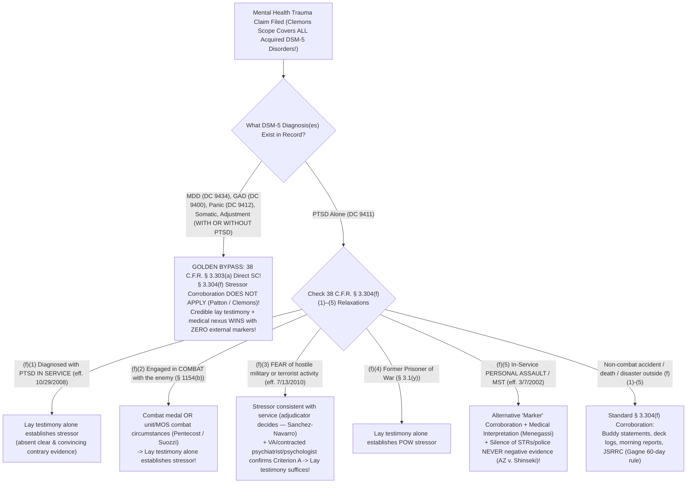

# Playbook 16: PTSD Stressor Pathways (`38 C.F.R. § 3.304(f)(1)–(5)`), Military Sexual Trauma (`MST`) Marker Litigation (*AZ* & *Menegassi*) & The Non-PTSD Psychiatric Bypass

Psychiatric disability claims (`DC 9400–9440`, `38 C.F.R. § 4.130`) routinely drive `70%` (`TDIU` gateway under `§ 4.16(a)`), `100%` schedular, Statutory Housebound **`SMC(s)`**, and Regular Aid & Attendance **`SMC(l)`** awards. Yet Regional Offices (`ROs`) unlawfully deny thousands of valid trauma claims every year by misapplying **`38 C.F.R. § 3.304(f)`**—demanding non-existent official military police reports in Military Sexual Trauma (`MST`) claims, botching `JSRRC` unit searches, or illegally imposing `§ 3.304(f)` PTSD stressor-corroboration hurdles onto **Major Depressive Disorder (`DC 9434`)** and **Generalized Anxiety Disorder (`DC 9400`)**!

> [!IMPORTANT]
> **Single Source of Truth & Orthogonal Cross-References:** For the verbatim chronological text of `38 C.F.R. § 3.304(f)` across its `1993` (`58 FR 29110`), `2002` (`67 FR 10330`), `2008` (`73 FR 64208`), and `July 13, 2010` (`75 FR 39843` / `75 FR 41092`) overhauls, consult [`38-cfr-3.304f-ptsd-evolution.md`](../authorities/part-3/38-cfr-3.304f-ptsd-evolution.md). For historical vs. current `§ 4.130` rating criteria (`DSM-III -> DSM-IV -> DSM-5` and quarantined unfinalized proposal `RIN 2900-AQ82`), consult [`mental-health-dc-9400-9411.md`](../cfr-diffs/vasrd/mental-health-dc-9400-9411.md). Pair this playbook with [Playbook 03](03-service-department-records-38-cfr-3-156c.md) (`§ 3.156(c)` `JSRRC`/`CID`/`NCIS` retroactive effective dates), [Playbook 10](10-character-of-discharge-insanity-upgrades.md) (June 2024 `§ 3.12(e)` MST compelling-circumstances COD rescue & `DRB`/`BCMR` Kurta upgrades), and the [Direct SC Treatise](../docs/service-connection-direct-soundness-aggravation.md).

---

## 1. Preconditions: OMPF Personnel File, `21-0781`, `CID`/`NCIS` & `Clemons` Scope Audit

Never evaluate a PTSD or MST denial from the `DD Form 214` and STRs alone. Before pleading, obtain and cross-index four archival sources ([VA Forms & Code-Sheet Lexicon](../docs/forms-and-codesheet-lexicon.md); [`C-File Audit Protocol`](../checklists/c-file-audit-protocol.md)):

1. **Complete Official Military Personnel File (`OMPF`) from NPRC:** Including `DA Form 20` / `DA Form 2-1` (Army), `NAVPERS 1070/604` & `605` enlisted evaluations/awards (Navy), `MCTFS`/SRB page 3 & 11 entries (USMC), and `AF Form 910` EPRs (Air Force)—tracking **exact semi-annual performance/conduct grades**, unit transfers, MOS reclassifications, `Article 15` / `NJP` dates, and campaign/expeditionary medals.
2. **Stressor Statements & VHA Vet Center / `§ 1720D` MST Records:**
   * Review historical `VA Form 21-0781` (combat/non-combat) and `21-0781a` (personal trauma)—consolidated by VA into the modern unified **`VA Form 21-0781`** (*Statement in Support of Claim for Service Connection for PTSD*).
   * Request **Vet Center readjustment counseling records** (which VHA stores *outside* standard `CAPRI`/`VistA` unless specifically authorized by the veteran!) and VHA MST Coordinator (`38 U.S.C. § 1720D`) positive-screen notes.
3. **Military Law Enforcement & Sexual Assault Archives (`§ 3.156(c)` Triggers):** Check whether VA ever requested **Army `CID`**, **Naval `NCIS`**, **Air Force `AFOSI`**, Provost Marshal blotters, **DoD `DSAID` / Restricted-to-Unrestricted `DD Form 2910` SAPR reports**, or **`JSRRC` / `CRUR` (Center for Research of Unit Records)** operational logs!
4. **Full Psychiatric Diagnostic Inventory (*Clemons* Check):** List **every** DSM-5 diagnosis recorded by VHA, Vet Center, or private clinicians (`PTSD`, `MDD`, `GAD`, `Panic Disorder`, `Persistent Depressive Disorder`, `Bipolar`, `Somatic Symptom Disorder`, `Adjustment Disorder`, secondary `AUD`/`SUD`).

---

## 2. Architecture of `38 C.F.R. § 3.304(f)` & The Five Stressor Relaxations

Under the unrelaxed introductory baseline of **`38 C.F.R. § 3.304(f)`** (`58 FR 29110`, May 19, 1993; *Cohen v. Brown*, `10 Vet. App. 128, 138 (1997)`), service connection for **PTSD (`DC 9411`)** requires **(1)** medical evidence diagnosing PTSD in accordance with **`38 C.F.R. § 4.125(a)` (`DSM-5`)**; **(2)** a link, established by medical evidence, between current symptoms and an in-service stressor; and **(3)** **credible supporting evidence that the claimed in-service stressor occurred**—**UNLESS** the claim qualifies under one of **five regulatory stressor relaxations (`(f)(1)–(5)`)** (verbatim text in [`38-cfr-3.304f-ptsd-evolution.md`](../authorities/part-3/38-cfr-3.304f-ptsd-evolution.md)):

### Detailed Mechanics & Traps Across `(f)(1)–(4)`

| Subsection & Effective Date | Exact Legal Standard & Controlling Precedents | Bitemporal Trap & Practitioner Execution |
| :--- | :--- | :--- |
| **`§ 3.304(f)(1)` — In-Service PTSD Diagnosis** (`73 FR 64208`, **eff. Oct. 29, 2008**; finalized `74 FR 14491`, Mar. 31, 2009) | If the evidence establishes a **diagnosis of PTSD during active service** and the claimed stressor is related to that service, **the veteran's lay testimony alone** establishes the stressor absent clear and convincing evidence to the contrary (consistent with service circumstances). | Check mental-health clinic STRs, deployment combat-stress detachments, and `MEB`/`PEB` narratives. *(Prospective rule eff. Oct. 29, 2008—cannot assert `(f)(1)` as CUE against pre-Oct. 29, 2008 final denials).* |
| **`§ 3.304(f)(2)` — Combat with the Enemy** (`38 U.S.C. § 1154(b)`; `58 FR 29110`, `1993`) | If the veteran **engaged in combat with the enemy**, lay testimony alone establishes the combat stressor absent clear and convincing evidence to the contrary. Under ***Pentecost v. Principi*, `16 Vet. App. 124, 128–29 (2002)`** and ***Suozzi v. Brown*, `10 Vet. App. 307, 311 (1997)`**, combat is proven **EITHER** by individual combat awards (`CIB`, `CAR`, `CMB`, `CAB`, Purple Heart, valor medals) **OR** by unit/MOS records showing the veteran's unit received enemy fire, mortar/rocket attacks, or hostile action while the veteran was present! | **CUE-Safe (`cue-and-open-claim`):** `38 U.S.C. § 1154(b)` (`former § 354(b)`) dates back to `1941`! If an earlier `DD-214` / `DA Form 20` already in the C-file listed a `CIB`, `CAR`, or Purple Heart and the RO denied PTSD for "unverified combat stressor," file **RO/Board CUE**! If unit logs arrive later, invoke **`§ 3.156(c)`** ([Playbook 03](03-service-department-records-38-cfr-3-156c.md)). |
| **`§ 3.304(f)(3)` — Fear of Hostile Military or Terrorist Activity** (`75 FR 39843`, pub. **July 13, 2010**, corrected from "July 12" typo at **`75 FR 41092`** [July 15, 2010] to **eff. July 13, 2010**) | Applies to veterans who did *not* personally engage in direct combat (`(f)(2)`)—e.g., fobbit/supply/aviation/medic/Navy/DMZ personnel—whose stressor relates to **fear of hostile military or terrorist activity** (IEDs, incoming mortars/rockets, sniper threat, body/casualty handling, drone/SCUD alerts) when: 1. **A VA psychiatrist or psychologist, or a psychiatrist or psychologist with whom VA has contracted**, confirms the claimed stressor is adequate to support a PTSD diagnosis (`DSM-5` Criterion A) and symptoms are related to it; **AND** 2. The stressor is consistent with the places, types, and circumstances of service, with no clear and convincing contrary evidence. | **THREE CRITICAL `(f)(3)` RULES:** 1. **Private IMO Trap (*NOVA*, `669 F.3d 1340 (Fed. Cir. 2012)`):** The Federal Circuit upheld VA's rule that a **private** clinician's report *alone* **cannot** satisfy `(f)(3)` stressor relaxation! **HOWEVER**, under ***Sanchez-Navarro v. McDonald*, `774 F.3d 1380, 1384–86 (Fed. Cir. 2014)`**, **VA adjudicators** (not examiners) decide whether the claimed stressor is consistent with service, and once consistency is shown (plus a private diagnosis or lay symptoms), **VA is legally obligated under `38 U.S.C. § 5103A(d)` to schedule a VA psychiatric exam**! (*Acevedo v. Shinseki*, `25 Vet. App. 286 (2012)` governs exam adequacy). 2. **CUE Temporal Floor:** **NEVER** cite `(f)(3)` to allege CUE in a final pre-July 13, 2010 non-combat PTSD denial (`38 C.F.R. § 3.114` floor = **July 13, 2010**)! 3. **`Gagne` JSRRC Rule:** For non-`(f)(3)` unit stressors, under ***Gagne v. McDonald*, `27 Vet. App. 397, 405 (2015)`**, VA cannot give up after a single failed `JSRRC` request—it must submit **multiple targeted 60-day window searches** until further requests are futile! |
| **`§ 3.304(f)(4)` — Prisoner of War (`POW`)** (`38 C.F.R. § 3.1(y)`) | If the veteran is a former `POW` (`§ 3.1(y)`) and the claimed stressor is related to POW internment, lay testimony alone establishes the stressor absent clear and convincing contrary evidence. | Pair with automatic POW presumptive anxiety/dysthymic/psychosis rules under `38 U.S.C. § 1112(b)` / `38 C.F.R. § 3.309(c)` ([Playbook 07](07-statutory-presumptions-chronic-tropical-pow-als.md)). |

---

## 3. `38 C.F.R. § 3.304(f)(5)`: Personal Assault & Military Sexual Trauma (`MST`) Litigation

Codified on **March 7, 2002 (`67 FR 10330`)** following ***Patton v. West*, `12 Vet. App. 272 (1999)`** and ***YR v. West*, `11 Vet. App. 393 (1998)`** (originally numbered `(f)(3)`, redesignated `(f)(4)` in 2008 and **`(f)(5)`** in July 2010), `§ 3.304(f)(5)` recognizes that in-service sexual assault, domestic battery, hazing, and homophobic/racial violent assaults are overwhelmingly **unreported in official military channels** due to retaliation, stigma, and command pressure.

### A. Three Controlling Appellate Pillars in MST Litigation
1. ***AZ v. Shinseki*, `731 F.3d 1303, 1315–18 (Fed. Cir. 2013)` — Silence of STRs/Military Logs Is NEVER Negative Evidence:**
   * In a landmark precedential opinion surveying empirical DoD sexual-assault underreporting data (`80%–90%+` unreported), the Federal Circuit held that **VA and the Board may NEVER treat the absence of an official service record, STR entry, or military law-enforcement report of an in-service sexual assault—or a servicemember's failure to report the assault to family/friends—as pertinent affirmative evidence that the assault did not occur**, nor use non-reporting to impugn the survivor's credibility! Any BVA or C&P rationale citing *"no report in STRs"* as a reason to doubt the stressor commits reversible legal error!
2. ***Menegassi v. Shinseki*, `638 F.3d 1379, 1382–83 (Fed. Cir. 2011)` & *Patton v. West*, `12 Vet. App. 272, 280 (1999)` — Medical Opinions as Marker Corroboration:**
   * Under *Menegassi* (clarifying *Moreau v. Brown*, `9 Vet. App. 389 (1996)` and *YR v. West*, `11 Vet. App. 393 (1998)`), while a post-service medical nexus opinion resting *solely* on the veteran's uncorroborated verbal account does not by itself corroborate a PTSD `(f)(5)` stressor, **a psychiatrist's or psychologist's clinical opinion evaluating documented in-service or post-service behavioral changes ("markers") and explaining that those behavioral shifts are clinically consistent with an in-service sexual assault CAN ITSELF constitute the "credible supporting evidence" required to corroborate the stressor under `§ 3.304(f)(5)`**! *(Note: Under *Hall v. Shinseki*, `717 F.3d 1369, 1373–74 (Fed. Cir. 2013)`, `(f)(5)` relaxes how corroboration is proven—it does not eliminate corroboration entirely for `DC 9411` PTSD, making the *Menegassi* clinical marker-interpretation opinion and the Section 4 Non-PTSD Bypass below essential!)*
3. **Heightened Notice & Development Duty (`§ 3.304(f)(5)` Last Two Sentences; *Gallegos v. Peake* & *Bradford v. Nicholson*):**
   * Under the mandatory text of `§ 3.304(f)(5)`, ***Patton*, `12 Vet. App. at 283–85`**, ***Bradford v. Nicholson*, `20 Vet. App. 200, 205–06 (2006)`**, and ***Gallegos v. Peake*, `22 Vet. App. 329, 334–36 (2008)`**, VA **may not deny** a personal-assault PTSD claim for lack of stressor corroboration without **first explicitly advising the claimant** that alternative evidence from non-service sources or behavioral changes can corroborate the stressor and **giving the claimant an opportunity to identify and submit** such evidence (and requesting `CID`/`NCIS`/`AFOSI`, Vet Center, or civilian records identified by the veteran).

### B. Master C-File & OMPF Behavioral Marker Audit Matrix (`§ 3.304(f)(5)`)

When building an MST brief or instructing a *Menegassi* forensic psychologist, construct a **Before-vs.-After Chronological Marker Table** from these hidden file indicators:

| C-File / OMPF Record Source | Concrete Pre- vs. Post-Assault Behavioral Markers to Extract |
| :--- | :--- |
| **Personnel Evaluations (`DA 2-1`, `EPR`, `FITREP`, `NAVPERS` Marks)** | Sudden, unexplained drop from `4.0 / Excellent` proficiency/conduct marks to `2.8–3.2` or adverse supervisor comments (*"withdrawn," "attitude changed," "tardy," "distracted"*) following the timeframe/duty station of the assault. |
| **Disciplinary & Duty-Change Logs (`OMPF` / `SRB` / `DD-214`)** | First-time `Article 15` / `NJP` cluster (minor disrespect, missed formation, alcohol incident, short `AWOL` to escape perpetrator), **request for transfer to another unit, ship, barracks, or MOS**, or sudden early separation (`homosexuality` pretext, `"personality disorder,"` `"unsuitability,"` or pregnancy discharge). |
| **Service Treatment Records (`STRs` & Clinic Sick-Call Slips)** | Visits within days/months of the timeframe for **STI/STD panels, pregnancy tests, emergency contraception**, bruising/lacerations/jaw/rib/wrist sprains attributed to *"fell down stairs / sports injury,"* or sudden repetitive sick-call visits for **unexplained pelvic/abdominal/GI pain, insomnia, panic/hyperventilation, tension headaches, or rapid `15–40+ lb` weight loss or weight gain**! |
| **Post-Service Clinical, Academic & Relationship Trajectory** | Sudden post-discharge alcohol/substance self-medication (*Allen* chain), relationship/marital breakdown, sexual aversion/dysfunction (`FSAD` / `ED`), inability to work around male/authority supervisors, civilian crisis-center or pastoral counseling, or diary/letter entries. |
| **Lay Buddy, Roommate & Family Statements (`VA Form 21-10210`)** | Statements from a barracks roommate, battle buddy, sibling, parent, or ex-spouse—even if the veteran **never named the assault at the time**, lay witnesses are **100% competent** (*Jandreau*) to describe the dramatic personality shift (*"went from outgoing honor graduate at AIT to locking her door, crying, and drinking heavily in late 1994"*), which your *Menegassi* psychologist then clinically links to the MST! |

---

## 4. THE GOLDEN STRATEGIC BYPASS: Non-PTSD Acquired Psychiatric Disorders from MST (`§ 3.303(a)` vs. `§ 3.304(f)`)

> [!TIP]
> **The Single Most Powerful Doctrine in MST Litigation (*Patton* + *Clemons*):** **`38 C.F.R. § 3.304(f)` APPLIES EXCLUSIVELY TO POSTTRAUMATIC STRESS DISORDER (`DC 9411`)!** It does **NOT** govern *any* other acquired psychiatric disorder under `38 C.F.R. § 4.130`!

1. **Controlling Legal Authority (*Patton v. West* & *Clemons v. Shinseki*):**
   * In ***Patton v. West*, `12 Vet. App. 272, 280 (1999)`**, the CAVC squarely held that `38 C.F.R. § 3.304(f)` governs **only PTSD**; claims for **any other psychiatric disorder** resulting from an in-service personal assault are governed by **standard direct service connection under `38 C.F.R. § 3.303(a)`**!
   * In ***Clemons v. Shinseki*, `23 Vet. App. 1, 5 (2009)`**, the CAVC held that a veteran's claim for "PTSD" or mental-health benefits **encompasses ALL acquired psychiatric disorders** supported by the medical record—meaning the RO and Board **must adjudicate entitlement to Major Depressive Disorder (`DC 9434`), Generalized Anxiety Disorder (`DC 9400`), Panic Disorder (`DC 9412`), Persistent Depressive Disorder (`DC 9435`), Somatic Symptom Disorder (`DC 9422`), or Chronic Adjustment Disorder (`DC 9440`) as part of the exact same pending claim**!
2. **Why This Wins Cases With ZERO External Stressor Corroboration:**
   * Under `38 C.F.R. § 3.303(a)` ([Direct SC Treatise](../docs/service-connection-direct-soundness-aggravation.md)):
     1. **Element 1 (Current Disability):** A formal `DSM-5` diagnosis (`§ 4.125(a)` / *Martinez-Bodon*) of **`MDD` (`DC 9434`), `GAD` (`DC 9400`), `Panic Disorder` (`DC 9412`), or `Adjustment/Somatic Disorder`**.
     2. **Element 2 (In-Service Event):** Established by **the veteran's credible lay testimony alone** (`38 U.S.C. § 5107(b)`; *Buchanan v. Nicholson*, `451 F.3d 1331 (Fed. Cir. 2006)`; *AZ v. Shinseki*, `731 F.3d 1303 (Fed. Cir. 2013)` barring any negative inference from non-reporting)—**ZERO independent marker or third-party stressor corroboration is legally required**!
     3. **Element 3 (Medical Nexus):** A psychiatrist/psychologist nexus opinion linking the `MDD` / `GAD` / `Panic Disorder` *"at least as likely as not"* to the credibly reported in-service assault.
   * **Identical Dollar Payout (`38 C.F.R. § 4.130`):** Because **every** `§ 4.130` mental disorder (`DC 9400–9440`) is rated under the **exact same General Rating Formula for Mental Disorders** (`0% / 10% / 30% / 50% / 70% / 100%`), winning `70%` or `100%` for MST-induced `MDD` (`DC 9434`) under `§ 3.303(a)` pays the **exact same monthly compensation and retroactive back pay** back to the original PTSD claim date (*Clemons*) as `DC 9411` PTSD!

---

## 5. Invariants / Kill-Switches & Postconditions (`§ 3.156(c)`, `§ 3.12(e)` COD & Unlocks)

### A. Fatal Invariants / Kill-Switches
* **Pre-July 13, 2010 `§ 3.304(f)(3)` CUE Bar:** Never file CUE against a pre-July 13, 2010 non-combat PTSD denial using `(f)(3)` fear-of-hostile-activity (`75 FR 39843` / `75 FR 41092`). Instead, check whether `(a)` newly associated `JSRRC`/deck-log/morning-report records unlock **`38 C.F.R. § 3.156(c)`** back to the original claim date, or `(b)` a co-existing `MDD`/`GAD` diagnosis in the prior record was left unadjudicated!
* **DSM-5 Diagnostic Floor (*Martinez-Bodon*):** Under `38 C.F.R. §§ 4.125(a), 4.130` and *Martinez-Bodon v. McDonough*, `28 F.4th 1241 (Fed. Cir. 2022)`, ensure the clinician explicitly states a **formal DSM-5 diagnosis** rather than listing "anxiety/trauma symptoms" alone.
* **Quarantine Unfinalized `RIN 2900-AQ82` Proposal:** Never cite VA's February 2022 **proposed (unfinalized)** mental-health rating schedule (`RIN 2900-AQ82`, `87 FR 8498`) as active law; current `§ 4.130` occupational-and-social-impairment criteria govern all adjudications.

### B. Postconditions: Effective-Date Multipliers, COD Rescue & Ancillary Unlocks
1. **`38 C.F.R. § 3.156(c)` Retroactive Effective-Date Jackpots ([Playbook 03](03-service-department-records-38-cfr-3-156c.md)):** Whenever `JSRRC` / `CRUR` operational histories, Navy ship deck logs, Army morning reports, or **newly associated `CID` / `NCIS` / `AFOSI` / SAPR investigative files** are added to VBMS after a prior PTSD/MST denial, `§ 3.156(c)(1) & (3)` mandates reconsideration with an effective date **all the way back to the original denied claim** (potentially 10–40+ years of back pay)!
2. **Character-of-Discharge (`COD`) & Upgrade Rescue for MST Survivors ([Playbook 10](10-character-of-discharge-insanity-upgrades.md)):**
   * **June 25, 2024 `38 C.F.R. § 3.12(e)` Compelling-Circumstances Exception (`89 FR 32361`):** Explicitly lists **sexual abuse/assault (`MST`) and mental impairment** as compelling circumstances overcoming `180+`-day AWOL (`§ 3.12(c)(6)`) and moral-turpitude / willful-and-persistent misconduct (`§ 3.12(d)(2)`) OTH discharges directly inside VBA—plus **`38 U.S.C. § 5303(b)` insanity** (`§ 3.354`) and liberal consideration before DoD `DRB`/`BCMR` under the **Hagel (`2014`), Kurta (`2017`), and Wilkie (`2018`) Memoranda** (`10 U.S.C. §§ 1552, 1553`; [`COD Intake Audit Gate`](../checklists/cod-and-guard-reserve-intake-audit.md)).
3. **Downstream `TDIU`, `SMC(k)`, `SMC(s)` & Secondary Chains ([Playbook 14](14-secondary-service-connection-aggravation-obesity.md)):**
   * A `70%` PTSD/`MDD` grant immediately satisfies the single-disability schedular threshold for **`TDIU` (`38 C.F.R. § 4.16(a)`)** (and unlocks *Bradley* **`SMC(s)`** if other SC disabilities combine to `>= 60%`!).
   * Audit secondary `SSRI`/trauma **`FSAD` / `ED` (`SMC(k)`)**, secondary **Obstructive Sleep Apnea (`DC 6847`) via the *Walsh*/*Garner* obesity intermediate step**, secondary **migraines (`DC 8100`)**, secondary **GERD/IBS (`DC 7206`/`7319`)**, and *Allen* secondary substance-use sequelae!
