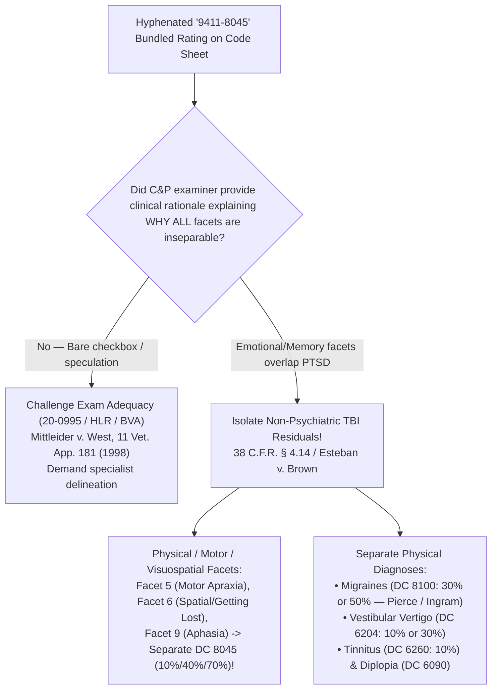

# Playbook 18: Traumatic Brain Injury (`DC 8045`) 10-Facet Audits, Note (1) Unbundling & Peripheral Nerve Radiculopathy Stacking (`DC 8510–8730`)

Neurological and peripheral-nerve claims generate two of the highest-yield compensation multipliers in Veterans Law practice:
1. **Track A — Traumatic Brain Injury (`DC 8045`):** Misapplied `10-facet` highest-score math (`0/10/40/70/100%`), unlawful absorption of migraines (`DC 8100`), vestibular vertigo (`DC 6204`), and physical TBI facets into comorbid PTSD (`§ 4.130`), five automatic secondary presumptions (`38 C.F.R. § 3.310(d)`), and top-tier **`SMC(t)` (`$11,271.67/month` eff. Dec. 1, 2025)** post-***Laska v. McDonough*, `37 Vet. App. 460 (2024)`**.
2. **Track B — Peripheral Nerve Radiculopathy & Cross-System Stacking (`DC 8510–8730`):** Concurrent stacking of Spine ROM (`§ 4.71a` Note (1)) + **Sciatic (`DC 8520`) AND Femoral (`DC 8526`)** nerves on the *same* lower extremity + Upper Radicular Groups (`DC 8510–8513`) + `§ 4.26` `10%` Bilateral Factor + **`SMC(k)` Loss of Use** (`§ 3.350(a)(2)`) without violating `§ 4.14` anti-pyramiding.

> [!IMPORTANT]
> **Pair Verbatim `38 C.F.R.` Snapshots & Sibling Modules:** Use this operational How-To playbook alongside verbatim regulatory text in [`38-cfr-4.124a-tbi-and-peripheral-nerves-evolution.md`](../authorities/part-4/38-cfr-4.124a-tbi-and-peripheral-nerves-evolution.md) and [`38-cfr-4.1-4.31-general-policy-snapshots.md`](../authorities/part-4/38-cfr-4.1-4.31-general-policy-snapshots.md), Diagnostic Code schedules in [`System 13 Neurological Diff`](../cfr-diffs/vasrd/13-neurological-tbi-nerves-4.120-4.124a.md), [`Subpart A General Rating Policy Diff`](../cfr-diffs/part-4-policy/subpart-a-general-rating-policy-4.1-4.31.md), [`Orthopedic Spine & Joints Diff`](../cfr-diffs/vasrd/orthopedic-spine-joints.md), [Playbook 12 (`SMC(l)`–`SMC(t)`)](12-aid-and-attendance-smc-l-r1-r2-and-smc-t.md), [Playbook 14 (Secondary SC & `§ 3.310(d)`)](14-secondary-service-connection-aggravation-obesity.md), and the [Master SMC Treatise & Step Math](../docs/smc-complete-treatise-and-step-math.md).

---

## 1. Preconditions: VBMS / C-File Forms, DBQs & Code-Sheet Triggers

Pull the complete **VBMS eFolder**, **CAPRI/VistA Polytrauma & Neurology records**, **DoD blast/deployment logs**, and **every internal Rating Code Sheet** ([VA Forms & Code-Sheet Lexicon](../docs/forms-and-codesheet-lexicon.md)):

* **Track A (`DC 8045` TBI) File Triggers:**
  * **DBQs & Clinical Evaluations:** *Initial* vs. *Review Evaluation of Residuals of TBI (`DBQ NEURO Residuals of TBI`)*; VHA **Comprehensive TBI Evaluation (`CTBIE`)** / Polytrauma Second-Level Screening notes; Neuropsychological testing batteries (`WAIS-IV`, Trail Making, California Verbal Learning Test); DoD **`MACE`** (*Military Acute Concussion Evaluation*), post-deployment **`PDHA` (`DD Form 2796`) / `PDHRA` (`DD Form 2900`)**, blast/IED incident reports, purple heart / combat action citations, or medevac records (`§ 3.156(c)` triggers!).
  * **Rating Code Sheet Red Flags:**
    * Pre-Oct. 23, 2008 hyphenated **`8045-9304` (`10%`)** ("post-concussion syndrome / brain disease due to trauma") with unrated contemporaneous headaches, vertigo, tinnitus, or diplopia.
    * Post-Oct. 23, 2008 **`DC 8045` (`0%` or `10%`)** when any DBQ facet box shows `Level 2`, `Level 3`, or `Total`.
    * Hyphenated **`9411-8045` (`50%` or `70%`)** ("PTSD with TBI") collapsing all TBI residuals into a single mental health code.
* **Track B (`DC 8510–8730` Peripheral Nerves) File Triggers:**
  * **DBQs & Electrodiagnostics:** *Thoracolumbar Spine DBQ*, *Cervical Spine DBQ*, and *Peripheral Nerves Conditions DBQ*; `EMG/NCS` (electromyography / nerve conduction velocity) studies; MRI reports documenting neural foraminal stenosis or nerve-root impingement at **`L2–L4`** (femoral/obturator) **and** **`L4–S3`** (sciatic), or **`C5–T1`** (cervical radicular groups); physical therapy prescriptions for an **ankle-foot orthosis (`AFO`)**, cane, walker, or wrist splint.
  * **Rating Code Sheet Red Flags:**
    * Post-Sept. 26, 2003 spine code (`DC 5237`–`5243`) with **zero** `85xx`/`86xx`/`87xx` nerve codes despite positive radiculopathy checkboxes on the Spine DBQ.
    * Lower-extremity radiculopathy coded solely as `10%` or `20%` `DC 8520` (sciatic) when the Spine DBQ *also* checked anterior thigh numbness, decreased patellar (`L4`) reflex, or quadriceps (`L2–L4`) extension weakness (**missed `DC 8526` femoral nerve!**).
    * Cervical radiculopathy affecting multiple nerve roots coded at `10%` `DC 8515` (median) instead of **`20%` minimum `DC 8510–8512`**, OR dominant (`Major`) vs. non-dominant (`Minor`) percentages reversed (`38 C.F.R. § 4.69`).

---

## 2. Bitemporal Pathway Gate & Invariants (`kill_switches`)

Sequence your finality vehicle from **lowest evidentiary burden to highest**, strictly separating plain-text regulatory errors (`cue-and-open-claim`) from later judicial reinterpretations (`open-claim-only-george-restricted` under *George v. McDonough*, `596 U.S. 740 (2022)` and `38 C.F.R. § 20.1403(e)`; see [Procedural Vehicles Piercing Finality](../docs/procedural-vehicles-piercing-finality.md)):

| Priority | Procedural Vehicle | Neurological / Nerve Archetypes Unlocked | Bitemporal Scope & Effective-Date Reach |
| :---: | :--- | :--- | :--- |
| **1** | **AMA Silent-Omission Non-Finality (`>= Feb. 19, 2019`)** (`38 U.S.C. § 5104(b)`; *Hamill v. Collins*, `166 F.4th 1030 (Fed. Cir. 2026)`) | AMA Spine DBQ checked radiculopathy (`DC 8520`/`8526`/`8510`) or TBI DBQ raised `DC 8100` migraines / `SMC(t)` / `SMC(k)` and AMA rating decision silently omitted the issue! | **Claim remains legally pending (`open-claim-only-george-restricted` doctrines apply in full!)** back to original AMA claim / ITF date ([Playbook 04](04-unadjudicated-tdiu-informal-claims-smc.md)). |
| **2** | **Newly Associated Service Dept. Records (`38 C.F.R. § 3.156(c)`)** | Declassified IED/blast logs, `MACE` concussive screenings, medevac charts, line-of-duty reports, or military inpatient `EMG`/neurology records newly associated with eFolder. | **Mandatory reconsideration (`cue-and-open-claim`)** back to original denied TBI or spine/nerve claim date ([Playbook 03](03-service-department-records-38-cfr-3-156c.md)). |
| **3** | **Legacy `§ 3.156(b)` 1-Yr VAMC Abatement (*Lang*) / Pending Informal (`< Mar. 24, 2015`)** | VAMC Polytrauma, `CTBIE`, or `EMG` records created within **1 year after** a Legacy RO decision never adjudicated for new-and-material status (*Lang v. Wilkie*, `971 F.3d 1348 (Fed. Cir. 2020)`). | **Abates Legacy finality** -> all modern precedents (*Laska*, *Duran*, *Ingram*, *Johnson*) apply retroactively to original claim date! |
| **4** | **Supplemental / Increase + `1-Year` Lookback (`38 U.S.C. § 5110(b)(2)`; `§ 3.400(o)(2)`)** | Challenging an inadequate non-specialist TBI exam (*Barr*), a speculative Note (1) "intertwined" opinion (*Mittleider*), *Ingram* medication discounting, or post-*Laska* `SMC(t)`. | Up to **1 year prior** to ITF / `21-526EZ` / `20-0995` if ascertainable clinical worsening existed during lookback year. |
| **5** | **RO / Board CUE (`38 U.S.C. §§ 5109A, 7111`; `38 C.F.R. § 3.105(a)`)** | **ONLY plain-text, closed-record errors:** `(a)` post-Oct. 23, 2008 TBI highest-facet math error; `(b)` post-Sept. 26, 2003 undisputed radiculopathy omitted in Legacy code sheet; `(c)` `Major`/`Minor` swap (`§ 4.69`); `(d)` `DC 8405` *tic douloureux* capped at `10%`; `(e)` post-Jan. 19, 2012 ALS `< 100%`. | **`cue-and-open-claim`** back to challenged decision date (pass [`Board CUE Pre-Filing Gate`](../checklists/board-cue-pre-filing-gate.md) before any `§ 7111` motion!). |

### Fatal Invariants (`kill_switches` — Stop Immediately If Triggered)
1. **Never Plead Exam Inadequacy as CUE (*Cook* Bar):** Neither an unqualified generalist conducting an initial TBI exam nor a lazy C&P examiner checking *"symptoms cannot be separated"* without rationale constitutes CUE—both are `§ 5103A` duty-to-assist errors barred from CUE by *Cook v. Principi*, `318 F.3d 1334 (Fed. Cir. 2002) (en banc)`. Litigate them via **Supplemental Claim (`20-0995`)** or timely **HLR/Board appeal**.
2. **Hard Effective-Date Floors:** Never cite the `10-facet` TBI table (`73 FR 54693`) for periods **before October 23, 2008**, `SMC(t)` (`Pub. L. 111-275, § 601(c)`) **before October 1, 2011**, `DC 8017` `100%` ALS (`76 FR 78823`) **before January 19, 2012**, or `§ 3.310(d)` TBI secondary presumptions (`78 FR 76196`) **before January 16, 2014**.
3. **Upper-Extremity Multi-Nerve Stacking Trap (`§ 4.124a` Note):** Do **not** demand separate concurrent `DC 8514` (radial) + `DC 8515` (median) + `DC 8516` (ulnar) ratings on the *same* arm for multi-root cervical radiculopathy—`§ 4.124a`'s Combined Nerve Injuries Note requires consolidating them into **`DC 8510–8513` Radicular Groups** (contrast with the **lower extremity**, where `DC 8520` sciatic + `DC 8526` femoral **do** stack!).

---

## 3. Track A Execution Recipe: Traumatic Brain Injury (`DC 8045`) Audit & CUE Engine

### Step A1 — Pre-Oct. 23, 2008 `DC 8045-9304` (`10%`) Audit
When screening a C-file with an Iraq/Afghanistan, Gulf War, Vietnam, or training head injury rated at `10%` under `DC 8045-9304` prior to October 23, 2008:
1. **Check Pending-Claim / Staged-Rating Straddle (`73 FR 54693`):** If the claim or appeal was **pending on October 23, 2008** (or kept open via `§ 3.156(b)` *Lang* VAMC records within 1 year of a late-2007/2008 decision!), VA was legally required to assign a **staged rating** applying the `10-facet` table from **October 23, 2008 forward**!
2. **Audit Missed Pre-2008 Hyphenated Focal Codes (`cue-and-open-claim`):** Pre-2008 `DC 8045` capped *only* `"purely subjective complaints"` (`DC 9304`) at `10%`. If the pre-2008 closed C-file contained a confirmed clinical diagnosis of **post-traumatic migraines (`DC 8045-8100`, `30%` or `50%`)**, **peripheral vestibular vertigo (`DC 8045-6204`, `10%` or `30%`)**, **post-traumatic seizures (`DC 8045-8910`–`8914`)**, **cranial nerve palsy (`DC 8205–8212`)**, or **tinnitus (`DC 6260`, `10%`)**, and the rater lumped everything into a single `10%` `DC 8045-9304` code, plead **RO CUE (`§ 3.105(a)`)** (or `§ 3.156(c)` if military head-trauma records were missing).

### Step A2 — Post-Oct. 23, 2008 `10-Facet` Highest-Score Math Audit (`cue-and-open-claim`)
Pull every post-Oct. 23, 2008 TBI DBQ and audit Section II (*Assessment of Cognitive Impairment and Other Residuals of TBI*) line by line against [`System 13 Diff Section 3`](../cfr-diffs/vasrd/13-neurological-tbi-nerves-4.120-4.124a.md):
* **The Highest-Facet Rule Is Mechanical:**
  * **ANY single facet at `Level 1`** -> **`10%`**
  * **ANY single facet at `Level 2`** (including `Facet 7` *Subjective Symptoms*: `3+` moderately severe subjective symptoms interfering with instrumental ADLs!) -> **`40%`**
  * **ANY single facet at `Level 3`** -> **`70%`**
  * **ANY single facet at `Total`** -> **`100%`**
* **Classic Rater Errors Supporting Immediate CUE / HLR Reversal:**
  1. **Facet Averaging / Majority Counting:** DBQ checks `9` facets at `0` or `1` and **`1` facet at `Level 2` (`40%`) or `Level 3` (`70%`)**, and the rater assigns `10%` -> **undebatable `§ 3.105(a)` math CUE**!
  2. **Violating Note (2) (Illustrative Examples):** Rater refuses to credit a checked `Level 2` or `Level 3` facet because not every bulleted clinical example in the table was documented -> reversible legal error (Note (2) states examples do *not* all need to be present).
  3. **Violating Note (4) ("Mild TBI" Cap Fallacy):** Rater caps chronic residuals at `10%` because in-service `MACE` labeled the blast concussion `"mild TBI"` -> plain error under Note (4).

### Step A3 — Note (1) Comorbid `TBI + PTSD` (`§ 4.130`) & `DC 8100` Unbundling Strategy
Raters routinely collapse `DC 8045` TBI into `DC 9411` PTSD (`"9411-8045, 70%"`), costing the veteran a separate **`40%` or `70%` TBI rating** (often the exact `60%+` independent disability needed to unlock **`SMC(s)`** or **`100%` schedular**!). Attack bundled ratings using this two-prong blueprint:

1. **Attack Bare "Inextricably Intertwined" Checkboxes:** Under *Mittleider v. West*, `11 Vet. App. 181, 182 (1998)` and `DC 8045` Note (1), VA may combine TBI and a mental disorder **only** when a qualified specialist provides a reasoned medical explanation proving why specific manifestations cannot be delineated without resort to speculation.
2. **Surgical Partial-Facet Unbundling (Win Even When Cognitive/Mood Facets Overlap!):** Even if `Facet 1` (memory/concentration), `Facet 2` (judgment), `Facet 3` (social interaction), and `Facet 8` (neurobehavioral irritability) overlap `DC 9411` PTSD:
   * **Neurological Motor/Visuospatial/Aphasic Facets (`Facets 5, 6, 9`)** are organic brain-injury deficits absent from `§ 4.130` PTSD criteria—any `Level 2` (`40%`) or `Level 3` (`70%`) score on `Facet 5`, `6`, or `9` supports a **standalone `DC 8045` rating alongside `DC 9411` PTSD**!
   * **Post-Traumatic Migraines (`DC 8100`, up to `50%`):** Always claim migraines as a **distinct secondary/residual diagnosis under `DC 8100`** rather than leaving headaches inside `Facet 7` (*Subjective Symptoms*), unless `Facet 7` (`40%`) exceeds `DC 8100` (`10%/30%`). Under ***Ingram v. Collins*, `38 Vet. App. 130 (2025)`**, ensure the examiner records **unmedicated baseline** prostrating frequency/duration without discounting for sumatriptan, gepants, Botox, or CGRP inhibitors, and under ***Pierce v. Principi*, `18 Vet. App. 440 (2004)`**, document missed work/FMLA usage for `50%`!

### Step A4 — Initial TBI Specialist Qualification Gate (`M21-1` & `2007–2015` Cohort)
* Under binding `M21-1` adjudication policy, an **initial diagnosis of TBI** must be rendered by one of **four board-eligible/certified specialists**: `(1)` **Physiatrist**, `(2)` **Psychiatrist**, `(3)` **Neurosurgeon**, or `(4)` **Neurologist**.
* Whenever an initial TBI claim was denied based on a negative C&P exam signed by a **family practitioner, internist, nurse practitioner (`NP`), or physician assistant (`PA`)** without a confirming specialist diagnosis:
  1. File a **Supplemental Claim (`VA Form 20-0995`)** or **Board appeal (`VA Form 10182`)** challenging examination adequacy under *Barr v. Nicholson*, `21 Vet. App. 303 (2007)`.
  2. If the initial non-specialist C&P exam occurred between **2007 and 2015**, check VBMS correspondence to see whether VA sent (or failed to send!) a **2016 Secretarial Equitable Relief (`38 U.S.C. § 503`)** re-examination notice offering retroactive effective-date protection!

### Step A5 — High-Dollar TBI Unlocks: `§ 3.310(d)` Secondary Presumptions & `SMC(t)`
1. **Audit All 5 `38 C.F.R. § 3.310(d)` Presumptive TBI Secondary Illnesses ([Playbook 14](14-secondary-service-connection-aggravation-obesity.md)):**
   * **Following *Moderate or Severe* SC TBI (check acute `LOC > 30 min`, `PTA > 24 hrs`, `GCS <= 12`, or positive intracranial CT/MRI!):**
     * **Parkinsonism / Parkinson's disease (`DC 8004`)** — *at any time* (`30%` baseline retained on top of separate extremity/bulbar ratings under *Duran v. McDonough*, `36 Vet. App. 230 (2023)`!).
     * **Unprovoked seizures (`DC 8910–8914`)** — *at any time*.
     * **Presenile Alzheimer's, frontotemporal, or Lewy body dementia (`DC 9310`/`9326`)** — if manifest within **`15 years`** of TBI.
     * **Hypothalamo-pituitary hormone deficiencies (`§ 4.119`: hypogonadism + `SMC(k)`, hypothyroidism `DC 7903`, growth hormone/adrenal insufficiency)** — if manifest within **`12 months`** of TBI.
   * **Following *Mild, Moderate, or Severe* SC TBI:**
     * **Depression (`DC 9434`)** — if manifest within **`12 months` of mild TBI** OR within **`3 years` of moderate/severe TBI**!
2. **Screen Every A&A-Eligible TBI Veteran for `SMC(t)` (`$11,271.67/month`):**
   * Under `38 U.S.C. § 1114(t)` and ***Laska v. McDonough*, `37 Vet. App. 460 (Sept. 6, 2024)`** (invalidating `38 C.F.R. § 3.352(b)(2)`'s `"higher level of care"` / licensed-professional requirement), a veteran who `(1)` needs regular Aid & Attendance (`§ 3.352(a)` — including **cognitive supervision, medication cueing, or protection from daily household/wandering hazards**!) due to SC TBI residuals, `(2)` does not otherwise qualify for `SMC(r)(2)`, and `(3)` **in the absence of such regular A&A** (provided by an **unlicensed spouse, family caregiver, or VHA `PCAFC` caregiver**) would require hospitalization, nursing home care, or other residential institutional care is entitled to **`SMC(t)` paid at the full `SMC(r)(2)` rate** ([Playbook 12](12-aid-and-attendance-smc-l-r1-r2-and-smc-t.md))!

---

## 4. Track B Execution Recipe: Peripheral Nerve Radiculopathy & Multi-Nerve Stacking (`DC 8510–8730`)

### Step B1 — Lower-Extremity Multi-Nerve Stacking on the *Same* Leg (`DC 8520 + DC 8526 + DC 8528/8529`)
Raters overwhelmingly default to assigning a single `DC 8520` (sciatic) rating per leg on Thoracolumbar Spine claims. Because `38 C.F.R. § 4.124a` contains **NO lower-extremity "radicular group" consolidation code**, distinct lower-extremity nerves with non-overlapping anatomical functions **stack concurrently on the exact same leg** without violating `§ 4.14` (*Esteban v. Brown*, `6 Vet. App. 259, 261–62 (1994)`):

| Anatomical Nerve & Paralysis DC | Spinal Roots | Distinct Clinical / DBQ Triggers (Non-Overlapping!) | Schedular Rating Tiers |
| :--- | :---: | :--- | :---: |
| **Sciatic Nerve (`DC 8520`)** | **`L4–S3`** | Pain/paresthesia radiating down **posterior thigh, calf, lateral/plantar foot**; weakened **knee flexion (hamstrings)**, **foot dorsiflexion (`L4–L5` drop foot)**, or **plantarflexion (`S1`)**; diminished/absent **Achilles (`S1`) reflex**. | `10%` Mild \| `20%` Mod \| **`40%` Mod. Severe** \| `60%` Severe \| `80%` Complete |
| **Femoral (Anterior Crural) Nerve (`DC 8526`)** | **`L2–L4`** | Pain/numbness over **anterior/anteromedial thigh**; weakened **knee extension (quadriceps / knee buckling on stairs)**; diminished/absent **patellar (`L4`) knee-jerk reflex**. | `10%` Mild \| `20%` Mod \| `30%` Severe \| `40%` Complete |
| **External Cutaneous of Thigh (`DC 8529`)** | **`L2–L3`** | **Meralgia paresthetica:** burning/numbness strictly over **anterolateral thigh** (often from duty-belt compression, obesity intermediate step, or upper lumbar surgical scar). | `0%` Mild/Mod \| **`10%` Severe to Complete** |
| **Obturator (`DC 8528`) / Internal Saphenous (`DC 8527`)** | **`L2–L4`** | • `8528`: Weakened **hip adduction** + medial thigh sensory loss. • `8527`: Purely sensory loss along **medial lower leg/ankle** (post-saphenous vein harvest or knee surgery!). | `0%` Mild/Mod \| **`10%` Severe to Complete** |

* **High-ROI Lower-Extremity Audit Example:** Bilateral lumbar `L2–S1` spondylosis with `25°` forward flexion (`40%` `DC 5242`) + bilateral moderately severe sciatic radiculopathy (`40%` Left `DC 8520` + `40%` Right `DC 8520`) + bilateral moderate femoral radiculopathy (`20%` Left `DC 8526` + `20%` Right `DC 8526`):
  * All **four** lower-extremity nerve ratings (`40% + 40% + 20% + 20%`) combine **first** and receive the **`+10%` `§ 4.26` Bilateral Factor** (`40` + `40` = `64` -> `64` + `20` = `71` -> `71` + `20` = `77` + `7.7` bilateral = `84.7` -> **`85%`** from leg nerves alone; combined with `40%` lumbar spine = `91%` -> **`90%`** before any cervical/tinnitus/mental rating—or **`100%` + `SMC(s)`** if `TDIU` or another `50%` exists!).

### Step B2 — Upper-Extremity Radicular Group Ceiling vs. Single-Nerve Upgrade (`DC 8510–8516`)
Apply the **`§ 4.124a` Combined Nerve Injuries Note** and ***Slaughter v. McDonough*, `29 F.4th 1351 (Fed. Cir. 2022)`** with surgical precision on Cervical Spine (`DC 5237`/`5242`/`5243`) and upper-extremity claims:

1. **The Anti-Stacking Ceiling (`§ 4.124a` Note & `M21-1`):** When cervical radiculopathy affects **two or more** upper-extremity nerves/roots on the *same* arm (e.g., `C5–C6` radial/median thumb paresthesias + `C8` ulnar 4th/5th finger numbness), VA **cannot** stack `DC 8514 + 8515 + 8516` on that arm. Instead, VA rates a single **Radicular Group (`DC 8510` Upper `C5–C6`, `DC 8511` Middle `C7`, `DC 8512` Lower `C8–T1`, or `DC 8513` All Groups)**.
2. **The Hidden `10% -> 20%` Upgrade Goldmine (`cue-and-open-claim`):**
   * Look closely at the `Mild` column in [`System 13 Diff Section 5.C`](../cfr-diffs/vasrd/13-neurological-tbi-nerves-4.120-4.124a.md): Mild Median (`DC 8515`) or Ulnar (`DC 8516`) neuropathy pays only **`10%`**, whereas **Mild Radicular Group (`DC 8510–8513`) starts at `20%` (`Major` AND `Minor`)** (and Moderate jumps from `30%/20%` up to **`40% Major / 30% Minor`**)!
   * **Audit Trigger:** Whenever a Cervical Spine DBQ checks involvement of **multiple nerve roots** (e.g., both `C5–C6` AND `C7` or `C8–T1`, or checks both median and ulnar distributions) and the rater assigned a single `10%` `DC 8515` per arm, demand reclassification to **`DC 8510`/`8511`/`8512` (`20%` minimum per arm; `40%/30%` if moderate!)**.
3. **The *Slaughter* Service-Connection Shield (`29 F.4th 1351`):**
   * VA **cannot** invoke the Combined Nerve Injuries Note when one nerve injury is **service-connected** (e.g., SC carpal tunnel `DC 8515`) and a second nerve injury in the same arm is **non-service-connected** (e.g., NSC cubital tunnel)—and even when multiple nerves are SC, the radicular group rating can **never** be used to assign a *lower* evaluation than the single nerve representing the `"major involvement"`.
4. **Verify Dominant (`Major`) vs. Non-Dominant (`Minor`) Handedness (`38 C.F.R. § 4.69`):** Confirm the veteran's dominant hand (or ambidextrous status -> more severely injured arm MUST be `Major`!). Assigning `30%` instead of `40%` for moderate `DC 8510` on a right-handed veteran's right arm is an instant **RO CUE**.

### Step B3 — Cross-System Stacking Without `§ 4.14` Pyramiding
Audit every peripheral-nerve case across these four orthogonal rating layers:
1. **Orthopedic Spine (`§ 4.71a` Note (1); *Chavis v. McDonough*, `34 Vet. App. 1 (2021)`):**
   * Rate Thoracolumbar ROM (`DC 5237–5242`, up to `40%/50%`) **and** Cervical ROM (`up to 30%/40%`)—or `DC 5243` IVDS incapacitating episodes if higher overall (*Chavis*)—**concurrently** with bilateral upper radiculopathy, bilateral lower sciatic + femoral radiculopathy, **neurogenic bladder (`DC 7512`: `20%/40%/60%` for daytime frequency or absorbent pads!)**, **bowel sphincter impairment (`DC 7332`: `10%/30%/60%/100%`)**, and **neurogenic erectile dysfunction (`DC 7522` `0%` + `SMC(k)`)** ([`Orthopedic Spine Diff`](../cfr-diffs/vasrd/orthopedic-spine-joints.md)).
2. **Bilateral Factor Math & `§ 4.26(d)` Exclusion Audit:**
   * Compensable left + right upper-extremity nerves trigger `+10%` bilateral factor; compensable left + right lower-extremity nerves trigger `+10%` bilateral factor. For periods **on or after April 16, 2023 (`88 FR 22914`)**, verify `38 C.F.R. § 4.26(d)` automatically drops the bilateral factor if—and only if—an anomalous rounding interaction would drop `95%` down to `94%` ([`TDIU & Bilateral Exclusion Diff`](../cfr-diffs/part-4-policy/tdiu-digestive-respiratory-diffs.md)).
3. **Muscle Group Injuries (`38 C.F.R. § 4.55(a)` & `DC 5301–5323`):**
   * On GSW, shrapnel, or surgical trauma files ([Playbook 01](01-penetrating-wounds-scars-vs-muscles.md), [`Muscle Injuries Diff`](../cfr-diffs/vasrd/muscle-injuries-dc-5301-5323.md)), verify whether damaged muscle groups control **different movements** from the injured peripheral nerve (`§ 4.55(a)`). If distinct (e.g., `DC 5314` Group XIV anterior thigh muscle wound + `DC 8520` sciatic posterior/distal nerve palsy), **stack both**!
4. **`SMC(k)` Loss of Use of a Foot or Hand (`38 U.S.C. § 1114(k)`; `38 C.F.R. §§ 3.350(a)(2), 4.63`):**
   * Under *Tucker v. West*, `11 Vet. App. 369 (1998)` and `§ 4.63`, whenever complete or severe `DC 8520` sciatic (`60%/80%`) or `DC 8521` common peroneal (`40%`) foot drop eliminates effective balance/propulsion (such that amputation + prosthesis would equally serve, e.g., rigid `AFO` dependence with absent push-off), OR severe upper-extremity nerve palsy eliminates functional grasping/pinching:
     * Award **`SMC(k)`** for *each* affected hand or foot (up to `3` `SMC(k)` awards—or transition to **`SMC(l)`/`(m)`** if bilateral lower-extremity or bilateral hand LOU exists!).
     * Ensure the underlying nerve rating is **no lower than the amputation/LOU floor** (`40%` for one foot under `DC 5167`; `70%/60%` for one hand under `DC 5125`)!

---

## 5. Postconditions: Effective Dates, Ancillary Grants & Net-Recovery Audit

Before closing any neurological, TBI, or radiculopathy award, verify every downstream contract postcondition ([`SMC & Ancillary Audit Worksheet`](../checklists/smc-and-ancillary-audit-worksheet.md)):

1. **Effective-Date Verification (`§ 5110` / `§ 3.400` / `§ 3.114`):**
   * Confirm staged effective dates capture `(a)` the **1-year lookback** prior to ITF/claim receipt (`38 U.S.C. § 5110(b)(2)`; `38 C.F.R. § 3.400(o)(2)`) when VAMC/private `EMG`, `MRI`, migraine logs, or TBI evaluations predate the claim; `(b)` **October 23, 2008** on straddling TBI claims; `(c)` **October 1, 2011** floor on `SMC(t)` awards; and `(d)` original AMA claim date on silent radiculopathy/SMC omissions under *Hamill v. Collins*.
2. **Mandatory Ancillary Unlocks ([Playbook 13](13-ancillary-grants-sah-auto-clothing-dea-spina-bifida.md)):**
   * **Bilateral Lower-Extremity LOU (including regular/constant `AFO` + cane/brace use per *Jensen v. Shulkin*, `29 Vet. App. 66 (2017)`):** Immediately file **`VA Form 26-4555`** for **`Chapter 21` Specially Adapted Housing (`SAH`, `> $120,000+` indexed grant)**!
   * **Single Hand or Foot LOU (`SMC(k)`):** Immediately file **`VA Form 21-4502`** for the **`Chapter 39` Automobile & Adaptive Equipment Grant** (`Pub. L. 117-333` 10-year recurring grant rule) + annual **Clothing Allowance (`VA Form 10-8678`)** for rigid `AFO`/wrist braces (*Sursely* multiple-garment rule!).
   * **`100% P&T` / `SMC(t)` Unlock:** Verify **`Chapter 35` DEA** & **`CHAMPVA`** (`38 U.S.C. § 1781`) for dependents, and flag `10-year` **`38 U.S.C. § 1318` DIC** protection for the surviving spouse.
3. **Offsets, Competency & Attorney Fee Audit:**
   * **TBI Incompetency Defense (`38 C.F.R. § 3.353`):** High-facet `DC 8045` (`Level 3` / `Total` judgment or memory) or `SMC(t)` awards frequently trigger proposed VA financial-incompetency ratings—protect the veteran's right to a pre-determination hearing, independent financial-management evidence, or spouse fiduciary selection without withholding retroactive back pay.
   * **Military Retiree & Severance Offsets:** Audit **`CRDP`** (`>= 50%` combined SC for 20-year retirees) vs. tax-free **`CRSC` (`10 U.S.C. § 1413a`)** on blast/IED TBI and combat spine/nerve injuries—applying ***Soto v. United States*, `605 U.S. 360 (2025)`** to recover uncapped retroactive CRSC arrears ([Playbook 06](06-nehmer-herbicide-presumptions-crsc.md))—and confirm non-recoupment of combat disability severance pay (`10 U.S.C. § 1212(d)(2)`).
   * **`§ 5904` + EAJA Same-Work Offset:** Reconcile `20%` direct-pay contingency fees against any CAVC `EAJA` award (`28 U.S.C. § 2412(d)`) for the same appellate work.
