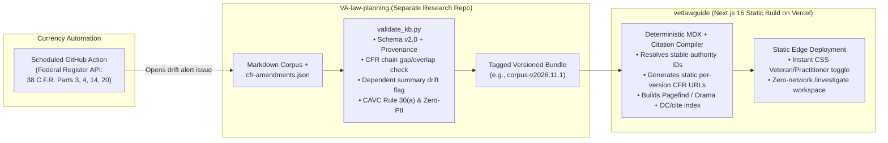

# VetLawGuide — Master Architectural & Product Vision (`vision.md` v2.0)

> *Synthesized from initial architecture planning (`v1`), ChatGPT review (`chatgpt-vision.md`), Claude review (`claude-vision.md`), and founder product direction.*

> **Core Promise:** Help Veterans, Survivors, and VA Law Practitioners connect **a specific VA decision**, **the exact historical and modern law governing it**, and **the concrete records needed to investigate what happened**—backed by inspectable primary sources rather than black-box claims.

---

## 1. Product Philosophy: Calm Research Desk Meets Modern Craft

Veterans Law online is currently split into two flawed extremes:
1. **Approachable blogs and forums** that routinely confuse *proposed* Federal Register rules with enacted law, apply modern eCFR text to 1970s rating decisions, or steer claimants into procedural traps.
2. **Primary government repositories** (`eCFR`, historical GovInfo print editions, Federal Register preambles, `VAOPGCPREC` PDFs, CAVC reporters) that are accurate, but scattered across five disconnected sites with zero bitemporal cross-indexing.

**VetLawGuide** bridges both worlds from one compiler-verified legal corpus (`VA-law-planning`), guided by four foundational design commitments:
* **Inspectable Provenance Over Marketing Claims:** Never ask users to "trust us" with slogans like *"100% verified"* or *"zero hallucination."* Show the exact `GovInfo` / `Federal Register` / reporter pinpoint citation, effective-date interval, transcription level (`verbatim` vs. `summary`), `"Checked as of YYYY-MM-DD"`, and corpus release version on every page.
* **No Silent Temporal Fallbacks:** If a user queries a historical decision date for a CFR section whose contemporaneous print text has not yet been transcribed verbatim, the UI must explicitly declare **`Summary Only`** or **`Not Yet Indexed for This Date — Do Not Rely`**—never silently substituting today's eCFR text.
* **Both Audiences First-Class From Day 1:** Keep the prominent **`Veterans` (left) | `Practitioners` (right)** toggle live from the very first release—explicitly serving Veterans and Survivors on the left, and Attorneys, Accredited Claims Agents, VSOs, and Clerks on the right.
* **Calm Authority & Purposeful Motion:** Reading regulations and appellate doctrine requires warm, high-contrast editorial clarity—not continuously moving decorative borders. Save fluid `motion/react` and Magic UI craft for moments where motion communicates structure or delight: the top-right Octocat tear-away corner, view transitions, timeline exploration, and expanding branches in the knowledge map.

---

## 2. Global Chrome: Compact Responsive Three-Tier Header + Octocat Corner Ribbon (`ADR-0006`, `ADR-0007`)

To protect vertical reading real estate on laptops, phones, and high-zoom screens (`<= 144px` desktop, `<= 120px` at `390px` mobile, and `>= 50%` usable viewport height at `320×640` `400%` zoom), persistent global chrome stays compact while keeping disclaimer, audience, navigation, and temporal context unmistakable:

```text
┌─────────────────────────────────────────────────────────────────────────────────────╲   🐙 ┐
│ Educational reference only. Not legal advice.        [Scope & CUE/Deadline Cautions] ╲ Issue│
├───────────────────────────────────────────────────────────────────────────────────────╲────┤
│ 📖 VetLawGuide  [ Veterans | Practitioners ]  Browse Ratings Investigate Law Guides Ref ⌘K │
├────────────────────────────────────────────────────────────────────────────────────────────┤
│ 📅 Law as of: Today ▾  (5-Era 1945–2026 inline ribbon on desktop temporal views; mobile chip)│
└────────────────────────────────────────────────────────────────────────────────────────────┘
```

### A. Top-Right Animated GitHub Octocat Tear-Away Corner (`<GitHubCorner />`)
* Pinned in the top-right corner of the viewport, linking directly to [`https://github.com/trustdan/vetlawguide/issues`](https://github.com/trustdan/vetlawguide/issues).
* Styled as a sleek **folded-page / tear-away corner peel** (`motion/react` spring peel + waving Octocat tentacle arm on hover/focus, with `prefers-reduced-motion` static fallback and accessible `aria-label`: *"Questions, bugs, or citation issues? Open a GitHub Issue"*).
* **Zero-PII Protection at the Destination:** Paired with structured `.github/ISSUE_TEMPLATE/` forms (`question.yml`, `citation-or-date-fix.yml`, `feature-idea.yml`) displaying a prominent top banner reminding visitors that GitHub Issues are public and **never to include SSNs, VA file numbers, DD-214s, or private medical details** (with room to add a non-public email/contact route alongside it later).

### B. Tier 1 — Slim Educational Disclaimer Bar
* Always-visible top notice bar (right-padded cleanly clear of the Octocat peel): *"Educational Reference Only — Nothing on VetLawGuide constitutes legal or medical advice or creates an attorney-client relationship."*
* Clicking **[Scope & CUE/Deadline Cautions]** opens a concise modal/drawer explaining:
  * Why applying law to an individual C-file requires an accredited VSO, claims agent, or attorney;
  * High-stakes procedural finality rules (such as `120-day` CAVC appeal windows and `38 C.F.R. § 20.1409(c)`'s bar on filing a second merits CUE motion against the same Board decision issue).

### C. Tier 2 — Primary Bar: Audience Toggle, Decision-Date Chip & Search
1. **Prominent Top Toggle — `[ 🛡️ Veterans | ⚖️ Practitioners ]`:**
   * **Left (`Veterans`):** Plain-English explanations for Veterans and Survivors, inline decoding of VA acronyms (`C&P`, `TDIU`, `SMC`, `NOD`, `SOC`), common record clues, and printable *"Questions & Records to Discuss With Your Representative"* checklists.
   * **Right (`Practitioners`):** High-density reference for Attorneys, Accredited Claims Agents, and VSOs—verbatim CFR blocks, Federal Register publication-vs.-effective dates, `VAOPGCPREC` treatment notes, legacy code-sheet shorthand, `§ 4.25` / `§ 4.26(d)` / *Barry* step math, and pleading `kill_switches`.
   * **Cross-Inspection & Clean URLs:** Both modes render into the static HTML and switch instantaneously via `<html data-mode="veteran|practitioner">` (set by a tiny blocking inline script from `localStorage`, keeping `?mode=` out of canonical URLs). Regardless of mode, Veterans can always expand **"Inspect exact legal authority"** and Practitioners can always expand **"View plain-English explanation."**
2. **Compact `📅 Decision Date` Control:**
   * Replaces a permanently pinned 60px timeline bar during reading. Clicking `[Decision Date: Current Law ▾]` opens a popover with both an exact `YYYY-MM-DD` date input *and* quick Era presets (`1946–1961`, `1962–1988`, `1988–2000`, `2000–2018`, `2019–Present`), while the full `WK-private-demo`-style fisheye timeline rail lives on `/` and `/timeline`.

---

## 3. Bitemporal Legal Engine: Solving the "Era Goggles" Problem Properly

A single `?date=` filter hiding everything after 1974 would break legal research—because investigating a 1974 decision in 2026 requires *both* the 1974 substantive text *and* modern procedural doctrines (*Lang* in 2020, *George* in 2022, `§ 3.156(c)` as amended in 2006).

Instead, selecting a **Decision Date** activates a structured **Two-Pane Bitemporal View**:

| Temporal Pane | Question Answered | What It Displays |
| :--- | :--- | :--- |
| **1. "Text & Rules in Force Then"** *(Decision Date `T₀`)* | *What substantive and procedural rules bound the adjudicator on `YYYY-MM-DD`?* | • Exact historical `38 C.F.R.` snapshot effective on `T₀` (strictly distinguishing Federal Register **Publication Date** from **Effective Date**)<br/>• Era-accurate Title 38 statutory citations via the `1933 <-> 1958 <-> 1991` crosswalk (e.g., `former 38 U.S.C. § 3010 [now § 5110]`)<br/>• Contemporaneous record-scope rules (e.g., pre-July 21, 1992 absence of *Bell* constructive possession; pre-March 24, 2015 `§ 3.157(b)` automatic hospital-report claims) |
| **2. "How Later Developments Affect This Research Today"** *(Analysis Date `T_now`)* | *Which modern vehicles can reopen or revise that decision today, and which collateral bars apply?* | • **Open / Reconsideration Vehicles:** `§ 3.156(c)` newly associated official service records, *Brown* void *ab initio* reductions, *Tablazon* unperfected NODs missing an SOC, `§ 3.156(b)` *Lang* post-decision VAMC records, *Nehmer* `§ 3.816`<br/>• **Collateral CUE Limits:** Explicit *George v. McDonough* / `38 C.F.R. § 20.1403(e)` analysis distinguishing plain-text errors from later judicial reinterpretations |

### Three Strict Bitemporal Guardrails
1. **Citable Static Permalinks Per CFR Version:** Every indexed regulatory version gets its own permanent, citable URL (e.g., `/cfr/38-cfr-4.56/1946-04-01` and `/cfr/38-cfr-4.56/1997-07-03`). Entering `?date=1974-08-12` resolves deterministically to the governing static version rather than existing only as an ephemeral query string.
2. **Explicit Coverage & Transcription Banner:** Every CFR section view displays one of three states enforced by `cfr-amendments.json`:
   * 🟢 **`Verbatim Primary Text Verified`** *(with GovInfo / Federal Register link and check date)*
   * 🟡 **`Summary Only — Pull Print CFR Edition Before Pleading CUE`**
   * 🔴 **`Gap / Not Yet Indexed for Selected Date — Do Not Rely`** *(build linter checks `supersedes`/`superseded_by` chains so accidental date gaps or overlaps fail CI)*
3. **Precision Legal Scope Labels (No "CUE Safe" Shorthand):** Never display a badge implying CUE is automatically won. State the exact doctrinal proposition established—e.g., **`No § 20.1403(e) Change-in-Interpretation Bar`** (while noting CUE still requires undebatable record error and a manifestly changed combined payment under `§ 4.25`), and state `§ 20.1409(c)` accurately as **one final merits CUE decision per prior Board decision on an issue** (excluding without-prejudice dismissals under `§ 20.1404`).

---

## 4. Core User Journeys & Views (Situation-Led Architecture)

### 1. Focused Gateway Home Page (`/`) + Unified Search (`⌘K`) (`ADR-0007`)
Rather than stacking product demos or internal build status above the fold, the homepage stays calm and concise (`<= 250` words per persona across five focused elements):
* **Headline & One-Sentence Dual-Mode Lead:** Plain-English framing in `Veterans` mode and citation-precise scope in `Practitioners` mode.
* **Prominent Unified Deterministic + Full-Text Search:** Accepts natural questions (*"0% scar rating shrapnel wound"*), 4-digit Diagnostic Codes (`5313`, `7804`, `8045`), `38 C.F.R.` / `U.S.C.` citations (`3.156(c)`, `5109A`), case names (*Hamill*, *Barry*, *Soto*), and historical VA/military forms (`8-526`, `10-7131`, `DD 1380`). Results explain *why* they matched.
* **Four Cut-Paper Illustrated Gateways:**
  1. **Browse topics** (`/explore`)
  2. **Disability ratings** (`/vasrd`)
  3. **Investigate a decision** (`/investigate`, with an upfront scope note)
  4. **Law and cases** (`/cfr`, with a secondary link to `/cases`)
* **Direct-Link Row & Quiet Provenance Footer:** One-click links to *Survivor benefits*, *Missing records*, and *Rating reductions*, followed by a plain-language educational notice and source count in the footer (while the fisheye timeline rail lives on `/eras` and `/timeline`).

### 2. Flagship: Point-in-Time `38 C.F.R.` Reader & Statutory Crosswalk (`/cfr`)
* **Verbatim Multi-Era Reader & Visual Redline Diffs:** Compare any two indexed versions of a regulation side-by-side or inline (e.g., `Pre-2002` vs. `2002–2008` vs. `2008–2018` vs. `Post-2018` `DC 7800–7805` Scars, or `Pre-1997` vs. `Post-1997` `§ 4.56` Muscle Injuries).
* **Quarantined Proposals & Rescinded Rules Banner:** Unfinalized rulemakings (`RIN 2900-AQ72` tinnitus/CPAP sleep apnea, `RIN 2900-AQ73` neurological, `RIN 2900-AQ82` mental health, `90 FR 46542` painful scars) and rescinded IFRs (`91 FR 7118` medication rule rescinded at `91 FR 9712`) carry unmistakable caution striping so neither veterans nor practitioners ever cite proposed text as enacted law.
* **Bidirectional Title 38 Statutory Crosswalk (`1933 <-> 1958 <-> 1991`):** Instant lookup translating `Veterans' Regulation No. 1(a)` (`1933–1958`), `Pub. L. 85-857` (`1959–1991`), and the two-step May/August 1991 renumbering (`Pub. L. 102-40` & `Pub. L. 102-83`).

### 3. Flagship: Historical Decision Investigation Workspace (`/investigate`)
Evolves `schemas/case-screen.schema.json` and `scripts/query_rules.py` into an interactive, transparent research desk:
* **Explicit `Yes / No / I Don't Know` Inputs:** Users enter what they know (decision date, body system/DC, RO vs. Board posture, service-record or mailing clues). Selecting **`"I Don't Know"`** never silently drops a pathway—instead, it adds the exact missing document (e.g., *NPRC inpatient clinical packet*, *internal VA Rating Code Sheet*, *Statement of the Case mailing copy*) to a **"Records to Locate & Why"** checklist.
* **Inspectable Reasoning:** Every surfaced pathway shows *which answer triggered it*, *which authority supports it*, and *which unresolved fact or `kill_switch` could defeat it*.
* **UPL-Safe Dual Output & Strict On-Device Privacy:**
  * **Veteran Mode Output:** Printable **"Representative Discussion & Records Sheet"** (questions to ask an accredited VSO/agent/attorney + FOIA/NPRC record checklist—never an automated legal opinion).
  * **Practitioner Mode Output:** Tailored, corpus-version-stamped **C-File Audit & Pre-Filing Gate Packet** (Markdown/print).
  * **Zero Telemetry / Zero URL Leakage:** Answers stay strictly in browser memory (never serialized into URL query strings, never sent over the network, with analytics/network silence verified by automated test).

### 4. Diátaxis Documentation, Playbooks & Curated Authority Directory (`/docs`, `/playbooks`, `/cases`)
* **Clean Three-Column Reader:** Collapsible domain/VASRD outline on the left, calm high-contrast reading column in the center, and a structured **Source Provenance & Linked Authorities Panel** on the right.
* **Accessible Citation Previews:** Every inline `38 C.F.R.`, `U.S.C.`, `DC`, and case link supports both hover preview cards *and* keyboard/touch click-to-preview popovers.
* **Curated Authority & `VAOPGCPREC` Directory (`/cases`):** Presents SCOTUS, Federal Circuit, CAVC precedential opinions, and `VAOPGCPREC` digests with documented treatment relationships (`interprets`, `abrogated by statute`, `withdrawn VAOPGCPREC`), explicit `CAVC Rule 30(a)` nonprecedential warnings, and **`"Treatment checked as of YYYY-MM-DD"`** dates rather than overclaiming to be a live commercial citator.

### 5. Visual Exploration: Piercing-Finality Flowchart, Knowledge Map (`/explore`) & Law Timeline (`/timeline`)
* **Interactive Piercing-Finality Decision Map (`/explore`):** A crisp, hand-laid-out interactive flowchart of the finality-piercing hierarchy (`Void Reduction` -> `§ 3.156(c)` -> `Pending / Notice / § 3.156(b) Lang / AMA § 5104(b) Hamill` -> `Nehmer` -> `RO CUE` -> `Board CUE`).
* **Prettier `osintframework.com` Knowledge Map + Full Outline Toggle (`/explore`):**
  * Built with lightweight, razor-sharp **SVG + `d3-hierarchy` + `motion/react`** (skipping heavy node-editor libraries like React Flow).
  * Starts cleanly focused on a chosen branch, reveals connected nodes progressively, and uses meaningful edge semantics (*amends*, *interprets*, *pierces finality*, *limits*).
  * Paired 1:1 with a synchronized **Accessible Outline View** so keyboard, mobile, and screen-reader users get identical power.
* **Multi-Track Interactive Law Timeline (`/timeline`):**
  * Adapts `WK-private-demo`'s `InteractiveTimeline` into four parallel tracks (**Statutes**, **Part 3 Adjudication**, **Part 4 VASRD**, **Landmark Precedents**) plus a toggleable **Quarantined Proposals & Rescinded Rules Watchlist**, complete with *"Retroactive Opportunity vs. Temporal Trap"* split cards.

---

## 5. Technical Architecture, Editorial Sync & Currency Pipeline



1. **Pinned Release Boundary (No Unreviewed Research Leaks):** `VA-law-planning` stays an independent legal-engineering repository that exports validated, versioned content releases (`corpus-vYYYY.MM.X`). `vetlawguide` pins to an approved release tag—giving us reproducible builds, instant rollback, and exact version stamps on exported research packets.
2. **Authority-Linked Plain-English Editorial Tracking:** Plain-English Veteran summary blocks explicitly reference the `version_id` / `authority_id` passages they explain (with content hash tracking). Whenever a primary snapshot or legal interpretation updates in `VA-law-planning`, `validate_kb.py` flags dependent Veteran summaries and `/investigate` rules for attorney review so the two audience layers never silently drift apart. Progressive coverage lets us ship rich plain-English guides for the initial vertical slice and top 15–20 modules first, showing an honest *"Plain-English guide in progress — displaying structured reference below"* notice on deep-cut modules until authored.
3. **Automated Federal Register Drift Watcher:** A lightweight scheduled GitHub Action queries the public Federal Register API for any new proposed rule, interim final rule, or final rule touching `38 C.F.R. Parts 3, 4, 14, or 20` and automatically opens a tracking issue so the corpus and `unfinalized_proposals` watchlist stay current.
4. **Proven Stack:** Next.js 16 (App Router, static-first SSG), React 19, TypeScript, Tailwind CSS v4 (`@theme inline`), shadcn/ui ("new-york"), restrained Magic UI / Magic UI Pro components, `motion/react` (v12), `d3-hierarchy` (SVG tree), and deterministic citation/DC lookup + client-side full-text search (`Pagefind` / `Orama`), hosted on Vercel. *(Any future AI assistant stays strictly deferred until search, historical diffs, and source-linked workflows stand on their own.)*

---

## 6. Phased Multi-Epic Sequence (Vertical-Slice First)

Instead of building empty horizontal UI shells across the whole site first, we prove the hardest, highest-value workflow end-to-end in **Epics 1–2**, then scale methodically:

| Epic | Milestone | Deliverable & Validation Goal |
| :---: | :--- | :--- |
| **`EPIC 1`** | **Release Pipeline, Provenance Schema & Core Shell** | Versioned `VA-law-planning` bundle contract + CFR date-gap linter + provenance metadata; Next.js 16 accessible warm/dark editorial theme; Two-Tier Header (Disclaimer bar, `Veterans \| Practitioners` zero-flash toggle, Decision-Date chip) + **Top-Right Animated Octocat Tear-Away Corner** + Zero-PII `.github/ISSUE_TEMPLATE/` forms. |
| **`EPIC 2`** | **Vertical Slice: Investigating an Older Combat/Scar Rating** | End-to-end proof of the core product using **`38 C.F.R. § 4.56` (Muscles)** + **`§ 4.118` (`DC 7800–7805` Scars)** + **`Playbook 01`**: static citable per-version URLs, redline diff, FR Pub-vs.-Effective dates, Two-Pane Temporal View (`Law Then` vs. `Modern Vehicles Today`), Veteran + Practitioner layers, citation preview cards, and a working mini-investigation export. |
| **`EPIC 3`** | **Situation-Led Home, Unified Search & Diátaxis Reader** | Situation-based `/` homepage; deterministic DC/CFR/form/citation lookup + full-text `⌘K` search; 3-column `/docs` and `/playbooks` reader across the verified corpus + plain-English rollout on top 15–20 modules. |
| **`EPIC 4`** | **Full Point-in-Time `38 C.F.R.` Explorer & Statutory Crosswalk** | Scale `/cfr` across all indexed `Part 3` and `Part 4` snapshots/diffs, explicit coverage-gap states, quarantined `RIN` proposal banners, and the interactive `1933 <-> 1958 <-> 1991` Title 38 crosswalk. |
| **`EPIC 5`** | **Historical Decision Investigation Workspace (`/investigate`)** | Full `Yes / No / Unknown` research & screening desk (`case-screen.schema.json`) with inspectable pathway reasoning, missing-records generator, zero-network privacy audit, and printable Veteran / Practitioner packet export. |
| **`EPIC 6`** | **Multi-Track Law Timeline & Federal Register Drift Watcher** | `/timeline` 4-track + Quarantined-Watchlist interactive chronology + `WK-private-demo` fisheye rail integration + scheduled GitHub Action monitoring `38 C.F.R.` Federal Register updates. |
| **`EPIC 7`** | **Curated Precedent & `VAOPGCPREC` Authority Directory (`/cases`)** | Filterable court-case and General Counsel opinion directory with documented treatment relationships, `CAVC Rule 30(a)` guardrails, and `"Checked as of"` provenance dates. |
| **`EPIC 8`** | **Piercing-Finality Flowchart, `d3-hierarchy` Knowledge Map & Full Scale** | `/explore` interactive Piercing-Finality diagram + `d3-hierarchy` SVG Knowledge Tree with synchronized Accessible Outline View; sync remaining `VA-law-planning` Epics (`105–125+` modules across all 15 VASRD systems); full `WCAG 2.2 AA+` & zoom/keyboard audit. |

---

## Appendix: Key Trade-Offs Resolved in `v2.0`

1. **Header Density (`v1` vs. Claude/ChatGPT):** Collapsed `v1`'s 3-tier ~150px header into a slim 2-tier ~84px bar + compact `Decision Date` chip, moving the top-right feedback link into an **animated GitHub Octocat tear-away corner** and keeping the wide fisheye rail on `/` and `/timeline`.
2. **Audience Strategy (Founder + ChatGPT vs. Claude):** Kept the top **`Veterans | Practitioners` toggle** from Epic 1 (rejecting deferral to Epic 7), while adopting Claude's realism on editorial workload via progressive plain-English coverage and hash-linked drift checks.
3. **Temporal Model (ChatGPT + Claude vs. `v1`):** Replaced naive single-date filtering with **citable static per-version URLs**, **explicit coverage-gap banners**, and **Two-Pane Temporal Views** (*"Text in Force Then"* + *"How Later Developments Affect This Today"*).
4. **Knowledge Tree Tech (Claude + ChatGPT vs. `v1`):** Replaced `@xyflow/react` with lightweight **`d3-hierarchy` + SVG + semantic relationship edges + synchronized Outline View**, alongside a dedicated Piercing-Finality flowchart.
